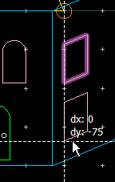
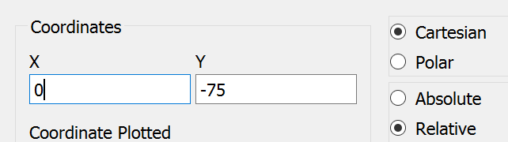
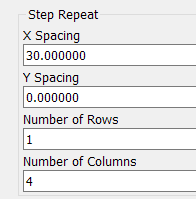
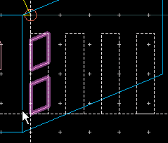
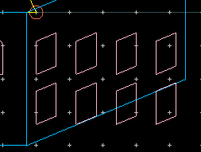
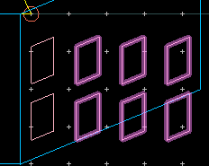
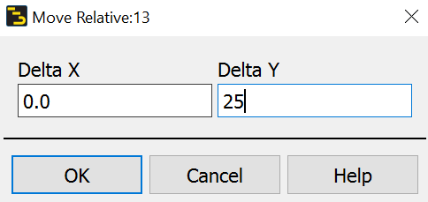
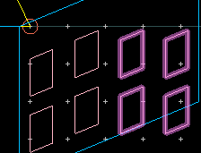
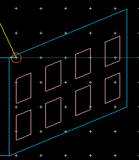

# Lab 02 - Module 6: Step and repeat

**Learning Objectives:** In this module, you will complete the following tasks:

- Copy using reference
- Step and repeat
- Move relative

This module contains the following lessons:

## Task 1: Copy using reference

   

1. Select the resulting trapezoid

1. Type “**C**”.

1. Click **bottom left vertex**.

1. Move it down along y-axis by -**75** with the mouse or using “**K**” (coordinate entry).

   

## Task 2: Step and repeat

1. Select the 2 new trapezoids.

1. Choose **Edit > Copy/Paste > Step and Repeat**.

1. Set **X Spacing** = **30,** **Y Spacing** = **0**

1. Set **Rows** = **1**, **Columns** = **4**.

1. Click **OK**

   

1. Click the **bottom left vertex** of the bottom trapezoid.

   

   

This creates a copy of the first 2, so click **Del** to get rid of the duplicates.

## Task 3: Move relative

1. Area select the 6 right-most trapezoids.

1. Type **`Shift` + `R`**

1. Move them up **25 mil**. Click OK

   

   

1. Holding the Shift key down, click the 2trapezoids in the 2nd column to unselect them.

   

1. Click OK again on the Move Relative dialog.

1. Unselect the 3rd column trapezoids.

   

1. Click **OK**, and then **Cancel**.

## You have successfully completed Lab 02 - Module 6.
