# Lab 02 - Module 7: Union of multiple polygons

**Learning Objectives:** In this module, you will complete the following tasks:

- Copy using reference
- Insert construction lines
- Change layer display
- Insert a polygon
- All shapes display
- Union
- Experiment with later display properties
- Experiment with display order

This module contains the following lessons:

## Task 1: Copy using reference

1. Click the **`cond2`** triangular polygon.

1. Type “**C**”.

1. Select the reference point as the **right top vertex of the rectangle** on layer **`hole`**.

   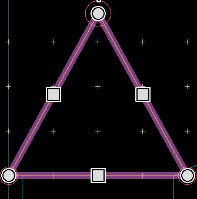

   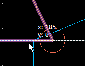

1. Copy to the **top right vertex of the trapezoid** on layer **`hole`**.

   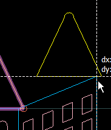

## Task 2: Insert construction lines

**Insert** two construction lines along the y-axis using the midpoints of the bases of the triangular polygons.

   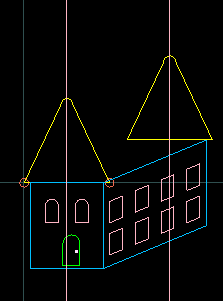

## Task 3: Change layer display

1. Change the `cond2`shape display to **Both**.

   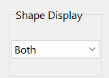

   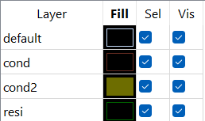

## Task 4: Insert a polygon

1. Insert a polygon  on **`cond2`**

Press “**0**” to turn off the 90 degree entry mode

Use the top 2 intersection snap points, and the 4 vertices to the right of the intersection points (right triangle edges).

| 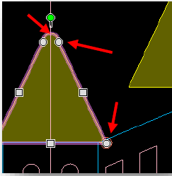 | 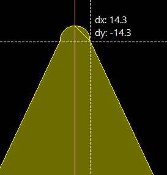 |
|---|---|

   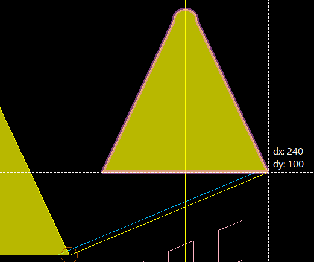

   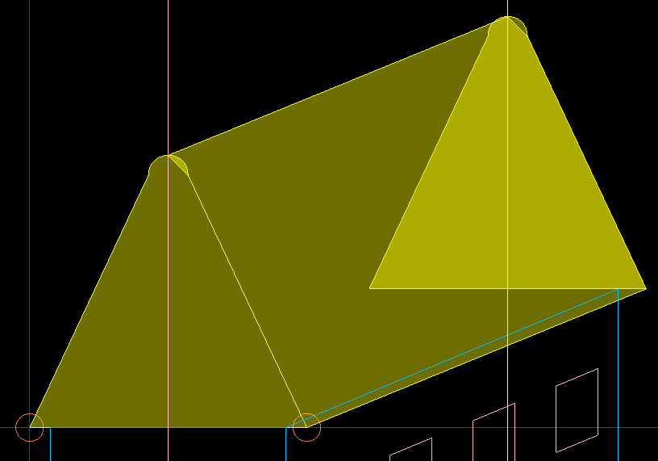

### It should look like this

   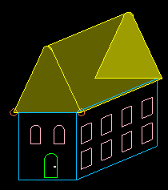

1. **Delete** the two construction lines when done.

1. Turn off origin crosshair (**Shift+O**)

1. Turn off grid visibility (**Shift+G**, **Ctrl+G**).

## Task 5: All shapes display

1. Change the shape display to **Both**.

   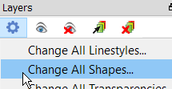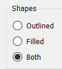

## Task 6: Union

Select the two **`cond2`** polygons on the right and choose **Edit > Merge > Union**.

   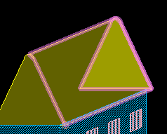

   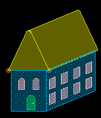

## Task 7: Experiment with later display properties

Experiment with fill colors and transparency settings

   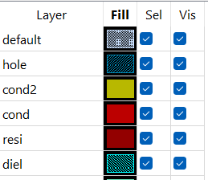

   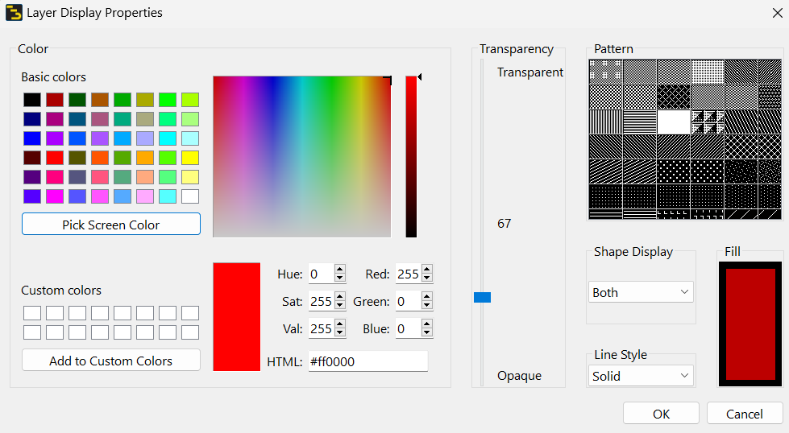

## Task 8: Experiment with display order

Use **Options > Technology > Layer Definitions**, **Display Order** tab, to change which layer is on top of which.

   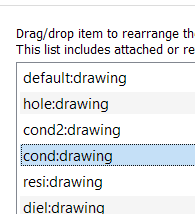

   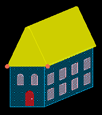

## You have successfully completed Lab 02 - Module 7.
