# Lab 02 - Module 8: Boolean operations, subcircuits, mirror

**Learning Objectives:** In this module, you will complete the following tasks:

- Subtract objects
- Create new subcircuit cell
- Examine the subcircuit cell
- Copy using reference point
- Mirror about Y axis

This module contains the following lessons:

## Task 1: Subtract objects

Use **Edit > Boolean Logical** and subtract **All Objects** on **`bond`** from layer **`hole`** using **DIFF**.

   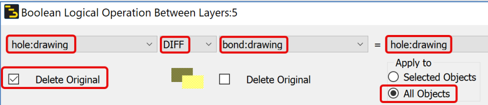

   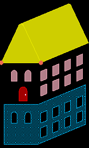

### Undo

> **Warning:** If you move any shapes to check the result, undo to just after the Boolean before continuing.
>
>    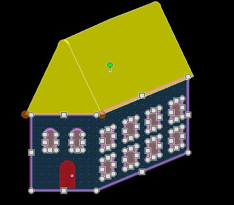

## Task 2: Create new subcircuit cell

1. **Select > Select All On Layer** click **Clear**, select the **`bond`** layer and **OK**

   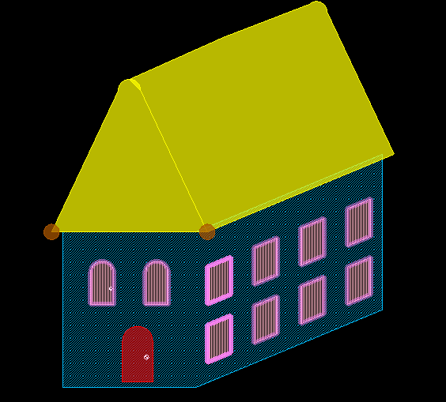

1. Choose **Edit > Component > Create Hierarchy**

1. Type a name for the new subcircuit cell called **`Windows`**.

   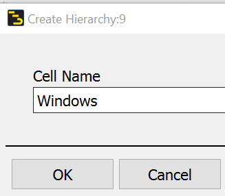

## Task 3: Examine the subcircuit cell

1. Select one of the **`bond`** shapes

Notice that you now get a large bounding box.

   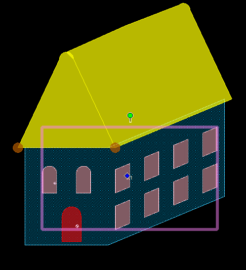

If you delete it, you see the cutouts from the Boolean.

   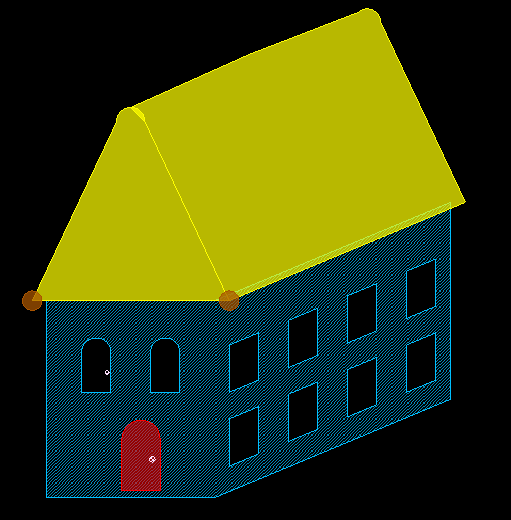

Ctrl+Z to undo

### Push into hierarchy

Use the **Push Into Hierarchy** icon to take a look at the new cell that was created.

   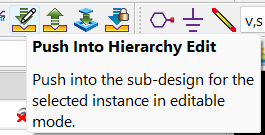

   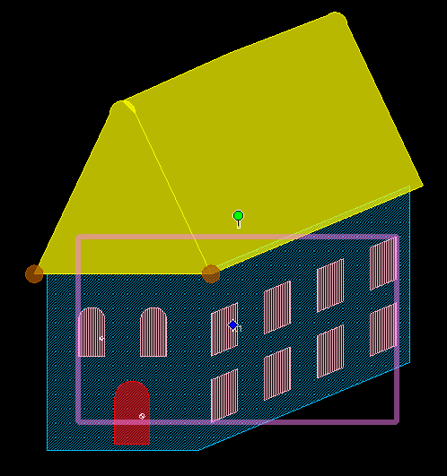

   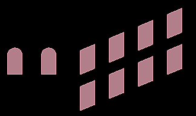

### Pop out

Then use the icon next to it to **push back out** of the cell.

   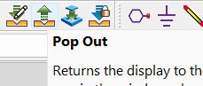

## Task 4: Copy using reference point

Select everything using “**`Ctrl` + `A`**” and **Copy Using Reference Point** to the left.

   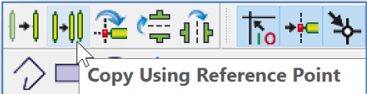

   

## Task 5: Mirror about Y axis

Use the **Mirror About Y Axis** icon and experiment with different snap points around which to mirror (undo and repeat the mirror command).

   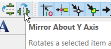

   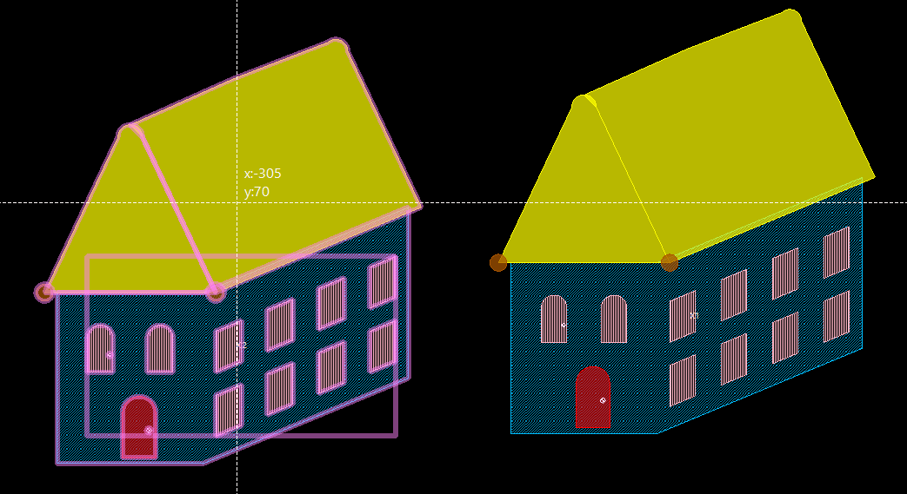

   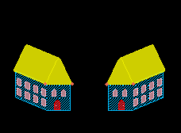

## You have successfully completed Lab 02.
