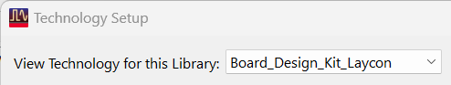
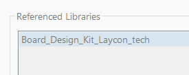
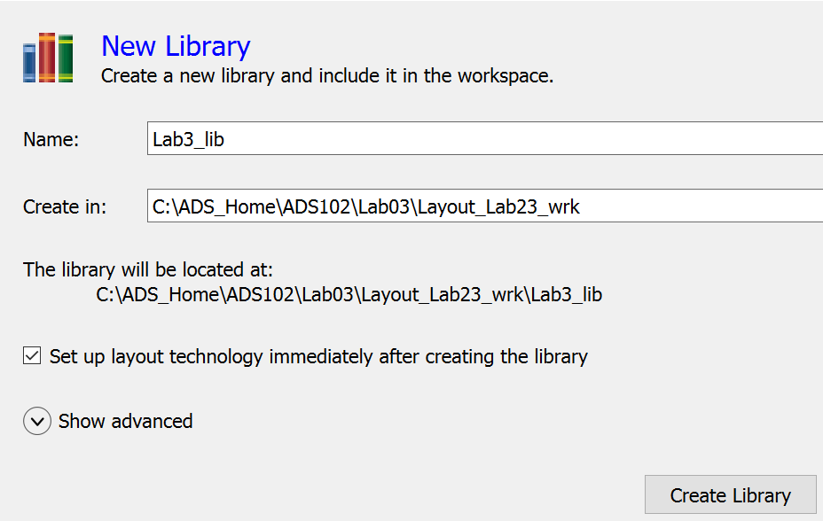
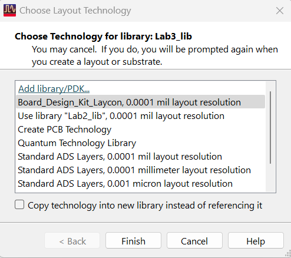
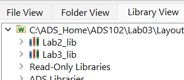
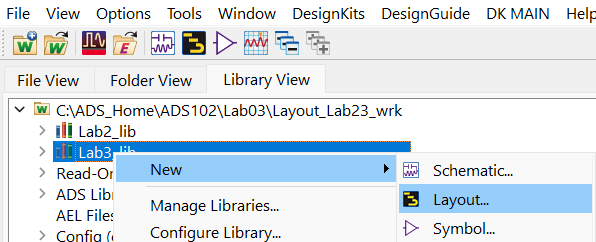
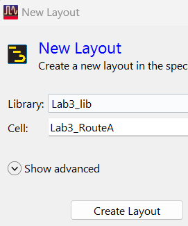

# Lab 3A - Module 2: Examine technology files

**Learning Objectives:** In this module, you will complete the following tasks:

- Technology definition
- Create library
- Create layout

## Task 1: Technology definition

1. Use **Options > Technology > Technology Setup**

1. Select **Board_Design_Kit_Laycon**

   

   

It uses a referenced library for the layers and units definitions called **Board_Design_Kit_Laycon_tech** which is also part of the PDK. In this case, the layers are just a copy of the **ads_standard_layers**.

1. Cancel the dialog when done.

## Task 2: Create library

   

1. Use **File > New > Library** command

1. Set Name = **`Lab3_lib`**

1. Click Show advanced

1. Select “Set up layout technology immediately… ”

1. Click **Create Library**

### Choose technology for library

   

1. Choose "Board_Design_Kit_Laycon, 0.0001 mil layout resolution"

1. Click **Finish**

### Lab3_lib has been created

Go to Library View tab, note **`Lab3_lib`** has been created

   

## Task 3: Create layout

1. Right-click on the **`Lab3_lib`** and choose **New > Layout**.

   

   

1. Name the cell **`Lab3_RouteA`**

1. Click **Create Layout**

## You have successfully completed Lab 3A - Module 2.
