# Lab 3A - Module 3: Basic routing and editing interconnects

**Learning Objectives:** In this module, you will complete the following tasks:

- Board Design Kit palette
- Insert components
- Identify layers used by pins
- Flatten all levels of hierarchy to shapes
- Turn on the Maintain adjacent angles flag
- Auto layer snap
- Making traces
- Move the parts around

## Task 1: Board Design Kit palette

Verify that the **Board Design Kit** palette is available.

   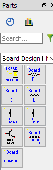

## Task 2: Insert components

1. Insert a **resistor** from the palette 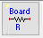

   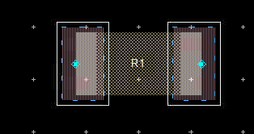

1. Add a **capacitor** 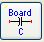 and change the package to **0603 package**.

   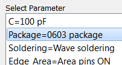

1. When you click OK, rotate the capacitor with “**r**”. Place the capacitor below and to the right of the resistor.

   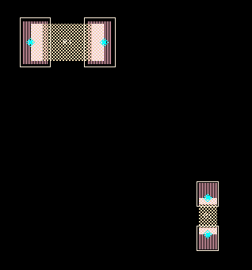

1. Click 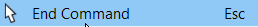

## Task 3: Identify layers used by pins

1. Select the resistor and check the Info docking window. .

   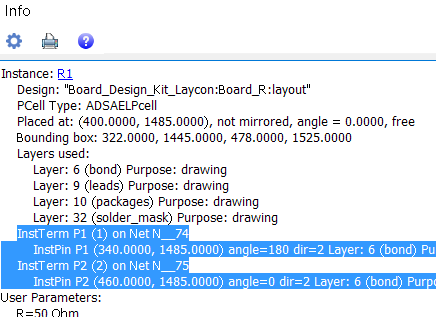

> **Note:** Note the layers used by the pins (**`bond`**)

## Task 4: Flatten all levels of hierarchy to shapes

   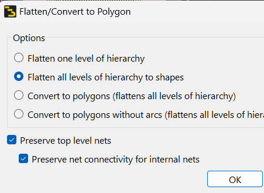

1. With the resistor still selected, execute **Edit > Component > Flatten**.

1. Select *Flatten all levels of hierarchy to shapes*

1. Click **OK** to the dialog

### Identify layers

1. Drag the constituent shapes apart and identify their layers.

   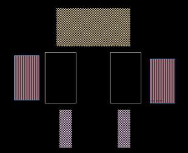

1. If you double-click a shape, the Properties window shows parameters which can be edited (change some).

   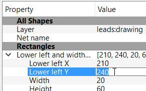

### Unflattened resistor component

Use **Ctrl+Z** to undo the edits back to the unflattened resistor component.

## Task 5: Turn on the Maintain adjacent angles flag

Type “**p**”, select **Entry/Edit** tab, and turn **on** the *Maintain adjacent angles* flag. OK

   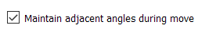

## Task 6: Auto layer snap

   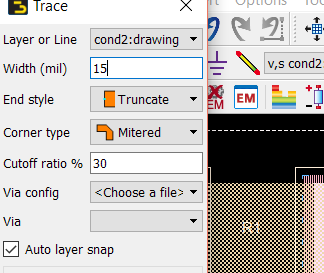

1. Press “**t**” (or the **Trace** icon )

1. Make **`cond2`** the insert layer.

1. Set Width (mil) = **15**

1. Set End style = **Truncate**

1. Set Corner type = **Miltered**

1. Click the right pin of **R1.** Move the mouse to the right.

1. Press “9” (90 degree entry).

Note that the insert layer automatically changes to **`bond`** because that is where the pins are (**Auto layer snap** flag is **set**).

   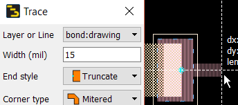

1. In the Trace dialog, change the layer to **`cond`**.

The **Auto layer snap** flag is **turned off**.

   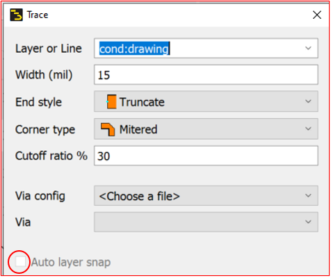

   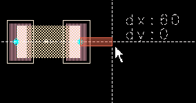

## Task 7: Making traces

1. Drag the trace down, then to the right.

> **Important:** Do not click on the top capacitor pin.

   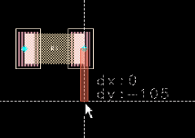

   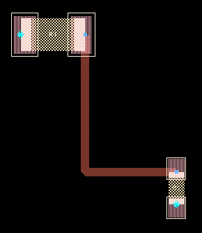

1. Again go back to the R1 pin and move right. Then down

1. Click on the top capacitor pin.

   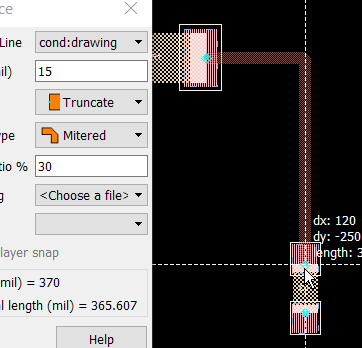

### It should look like this

   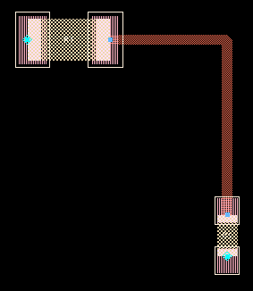

**Close** the Trace window.

## Task 8: Move the parts around

1. Move the resistor to the right of the capacitor.

This creates an overlap of the trace with the component and a short circuit.

   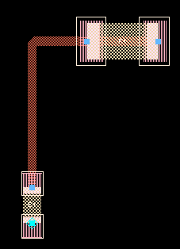

### Move edge

1. Type **Shift+E** (Edit > Move > Move Edge)

1. Click on the top trace edge. Move it down.

Trace “edges” are actually the center lines in the middle of the traces.

   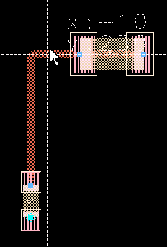

   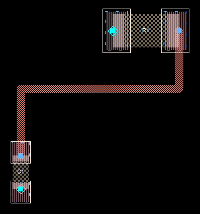

### Move edge

1. Click the right segment.

1. Move it to the right.

   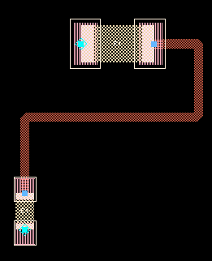

## Task 9: Move the parts around

**Drag** the capacitor to the right of R1.

   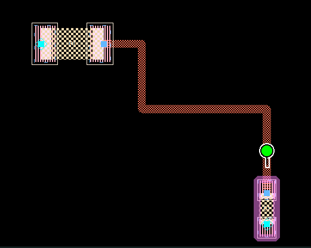

Select the trace and click the midpoint stretch handle of the top vertical segment.

   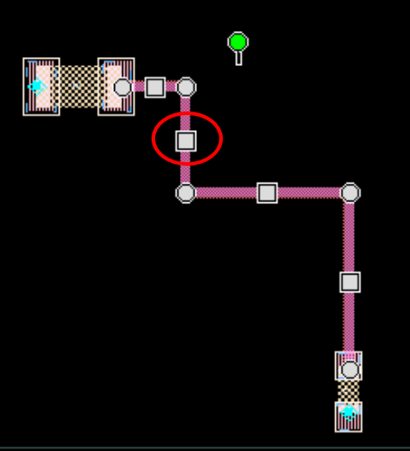

Move the cursor on top of the midpoint of the bottom vertical segment.

   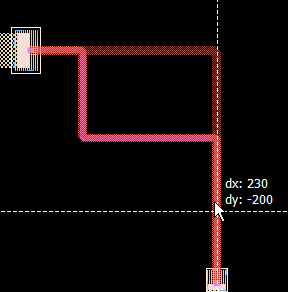

### It should look like this

   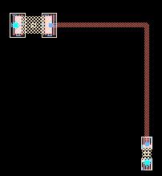

**Save and close** the layout.

## You have successfully completed Lab 3A - Module 3.
