# Lab 3A - Module 4: Non-orthogonal Interconnects

**Learning Objectives:** In this module, you will complete the following tasks:

- Create layout view
- Insert PDK parts
- Highlight color
- Open trace window
- Insert traces
- Align segment
- Align component
- Delete last segment
- Delete segment
- Save layout

## Task 1: Create layout view

Create a layout view in a new cell called **`Lab3_RouteB`** in the library **`Lab3_lib`**.

   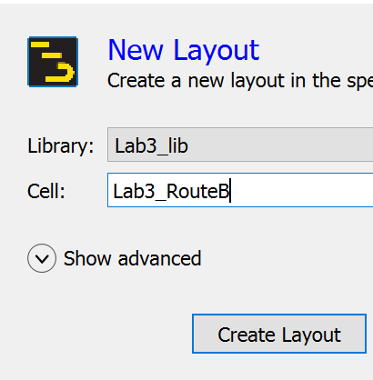

## Task 2: Insert PDK parts

1. From Board design kit palette, insert PDK parts similar to what is shown here.

   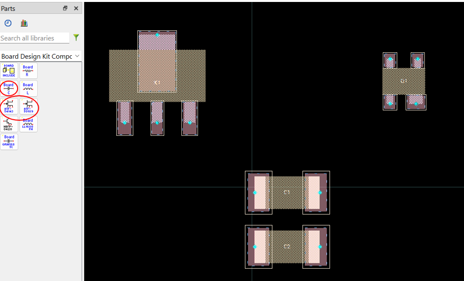

## Task 3: Highlight color

1. Click “**p**” and **Color** tab, change the Highlight color to red.

1. Click OK

This color is used to indicate unconnected pins.

   

   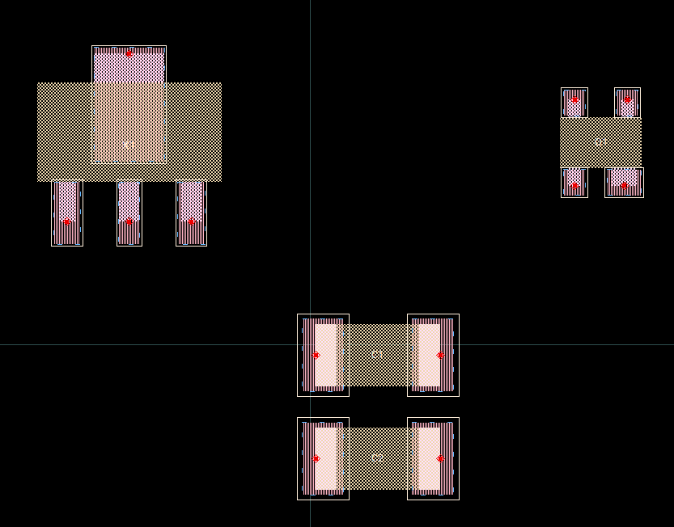

## Task 4: Open trace window

   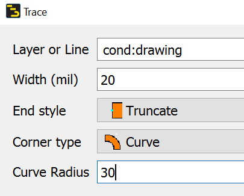

1. Press “**t**” (or the **Trace** icon )

1. Set Layer = **`cond`**

1. Set Width = **20**

1. Set End style = **Truncate**

1. Set Corner Type = **Curve**

1. Set Curve Radius = **30**

## Task 5: Insert traces

Using arbitrary-angle routing (hotkeys **“4”** is **45 degrees**, **“9”** is **90 degrees**, and **“0”** is **any angle**) to insert traces as shown.

   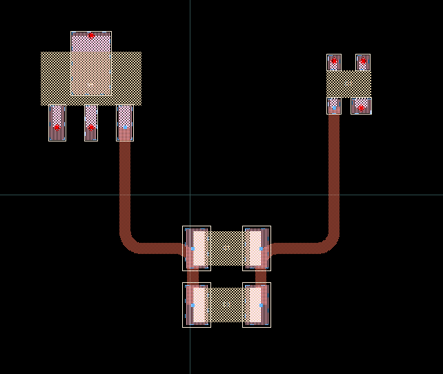

Using arbitrary-angle routing (hotkeys **“4”** is **45 degrees**, **“9”** is **90 degrees**, and **“0”** is **any angle**) to insert traces as shown.

   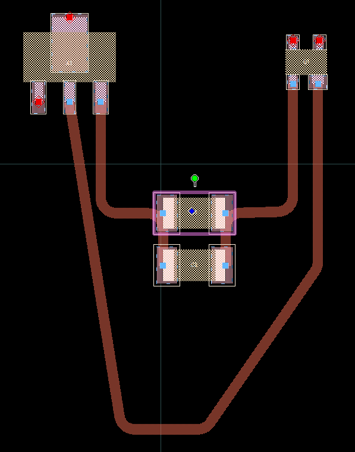

## Task 6: Align segment

1. Preselect the trace, then select a vertex.

   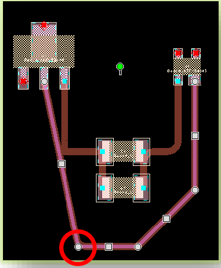

1. Type “**x**” to constrain the move along the x-axis.

1. Click the pin you want to align to.

   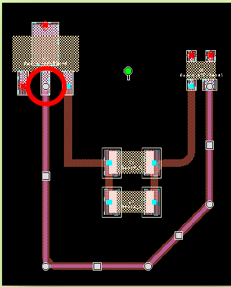

> **Note:** You don’t usually need such alignment operations if you remember to turn 90 degree constraint back on before routing the last TWO segments.

## Task 7: Align component

Try the **Edit > Align** commands on some components.

   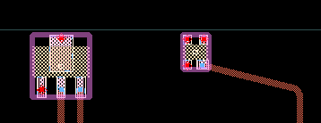

## Task 8: Delete last segment

1. Click the endpoint handle

1. Move it back to the previous midpoint.

   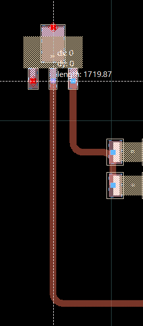 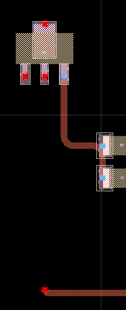

## Task 9: Delete segment

You can also area select 2 vertex points at once and delete 2 segments that way.

| 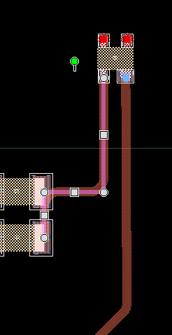 | 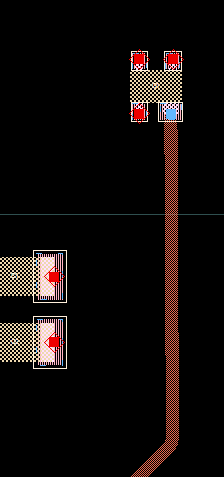 |
|---|---|

## Task 10: Save layout

> **Warning:** When you add new trace segments to existing traces, they will only be correctly merged if all trace properties match *exactly* . Otherwise, you may see small gaps at corners or multiple colinear segments.

Save the layout.

## You have successfully completed Lab 3A - Module 4.
