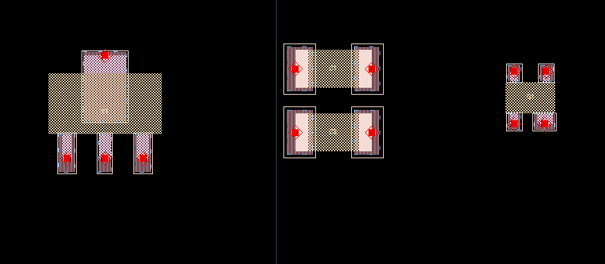
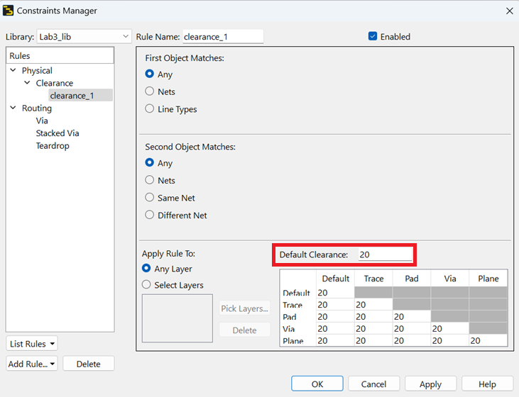
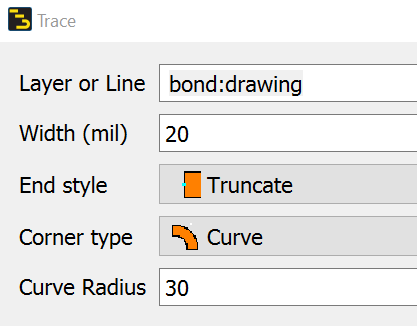
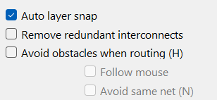
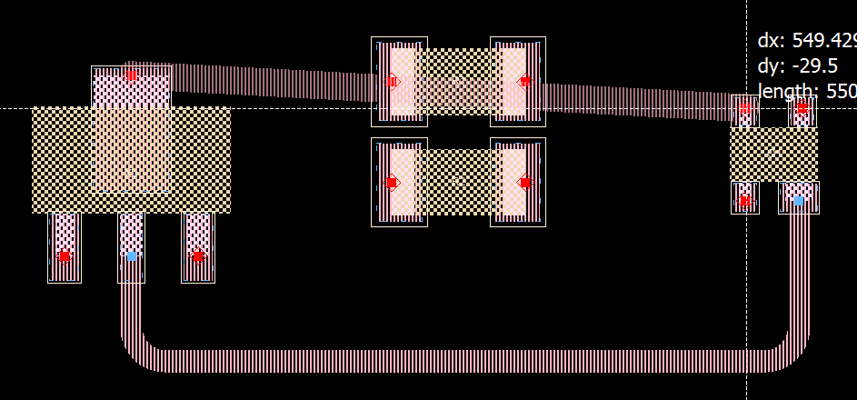
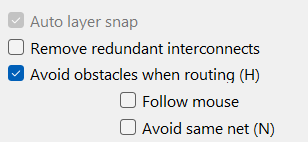
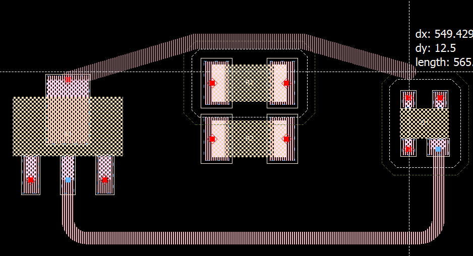
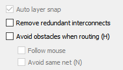
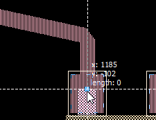
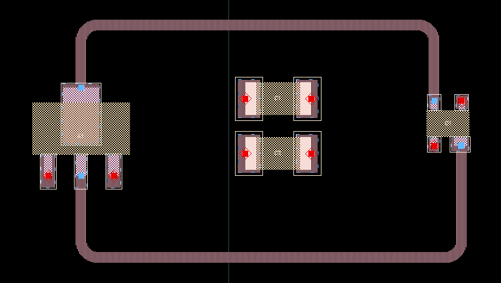

# Lab 3A - Module 5: Use of avoidance routing

**Learning Objectives:** In this module, you will complete the following tasks:

- Rearrange components
- Define a clearance rule for avoidance routing
- Open trace window
- Turn off Avoid obstacles when routing
- Turn on Avoid obstacles when routing
- Connect the 2nd component pin

## Task 1: Rearrange components

   

## Task 2: Define a clearance rule for avoidance routing

   

1. Use **Options > Technology > Constraints Manager** command

1. Select **Library** = **`Lab3_lib`**

1. Click **Add Rule**, then select **Clearance Rule**

1. Define a simple rule to avoid objects by **20** layout units.

1. Click **OK**.

## Task 3: Open trace window

1. Press “**t**” (or the **Trace** icon ).

1. Change insertion layer to **`bond`**

   

> **Note:** Avoidance routing currently only works for traces that are on the same layer as the connected pin.

## Task 4: Turn off Avoid obstacles when routing

1. Make sure **Avoid obstacles when routing** is turned **off**

   

1. Route a trace from one component pin to another crossing some other component along the way.

   

> **Note:** The trace will cut right through the part that is in the way.

## Task 5: Turn on Avoid obstacles when routing

1. **Turn on** the flag **Avoid obstacles when routing**.

1. Make sure insertion layer is **`bond`**

   

1. Route the same trace and notice how it automatically avoids the component along the way.

   

> **Note:** Notice that the trace refuses to connect to the pin of the 2nd component.

## Task 6: Connect the 2nd component pin

You can either type “**H**” as you route or **turn off** the flag **Avoid obstacles when routing**.

   

Then finish the last segment to connect to the 2nd component pin.

   

   

## You have successfully completed Lab 3A.
