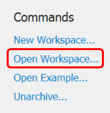
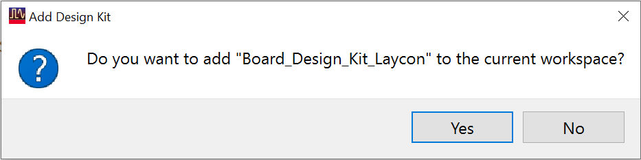

# Lab 3B - Module 1: Install the supplied design kit

**Learning Objectives:** In this module, you will complete the following tasks:

- Load workspace
- Add design kit to workspace

## Task 1: Load workspace

   

1. Click **Open Workspace**

1. Select C:\ADS_Home\ADS102\Lab03\Layout_Labs23_wrk

## Task 2: Add design kit to workspace

1. Choose **DesignKits > Unzip Design Kit…**

1. Browse to: C:\Program Files\Keysight\ADS2026_Update1\examples\Training\Layout

1. Select **Board_Design_Kit_Laycon_ADS2012_v01.zip**. Click **Open**

1. Navigate to: C:\ADS_Home. Click **Select Folder**

1. Click **Yes** to add it

   

## You have successfully completed Lab 3B - Module 1.
