# Lab 3B - Module 2: Multilayer Routing using Automatic Via Stitching

**Learning Objectives:** In this module, you will complete the following tasks:

- Create library
- PCB layout technology setup
- Open tech.subst
- VIA definition
- Create layout
- Open trace window
- Drawing multilayer traces
- Create stackable via
- Update corner type
- Convert trace into individual pieces

## Task 1: Create library

   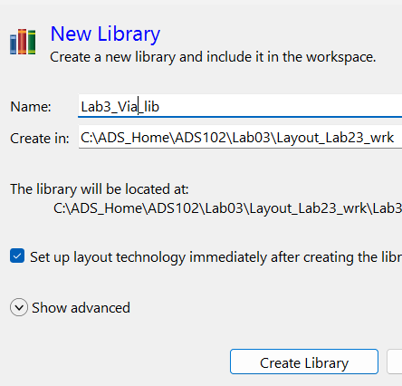

1. Use **File > New > Library** command

1. Set Name = **`Lab3_Via_lib`**

1. Select “Set up layout technology immediately after creating the library ”

1. Click **Create Library**.

## Task 2: PCB layout technology setup

   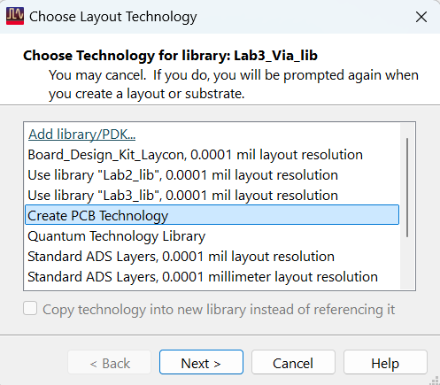

1. Choose **Create PCB Technology.**

1. Click **Next**.

   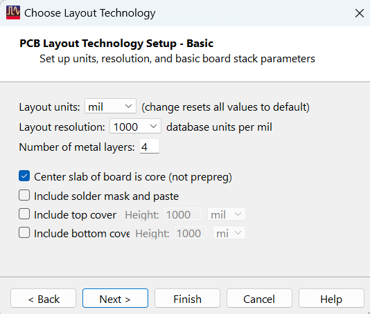

1. Choose units of **mil** and resolution of **1000.**

1. Click **Next**.

   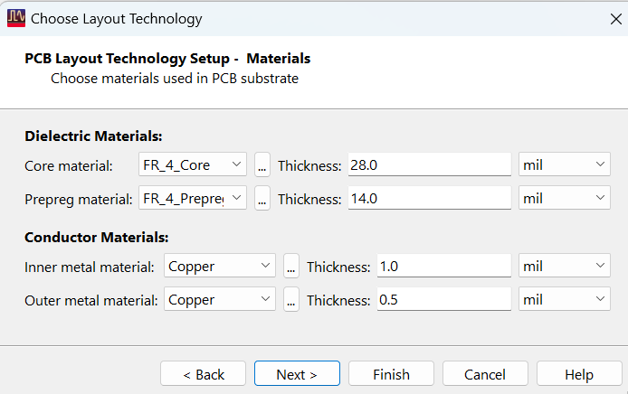

1. Keep the default materials.

1. Click **Next**.

   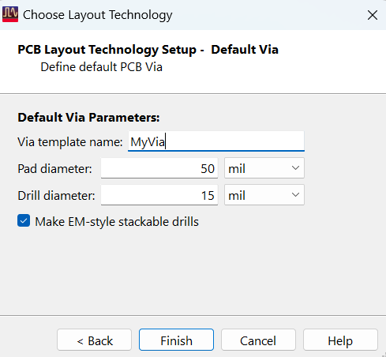

1. Set **Via template name** = **MyVia**

1. Select **Make EM-style stackable drills.**

1. Click **Finish**

## Task 3: Open tech.subst

In Library View tab, open the newly created tech.subst

   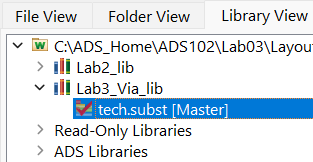

## Task 4: VIA definition

Investigate the layers that were created and mapped as strip conductors and via holes.

   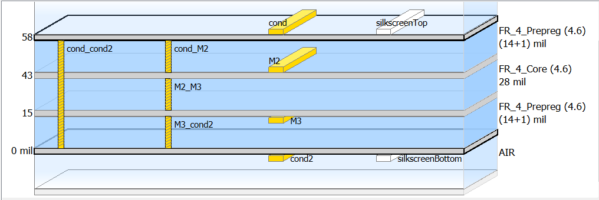

> **Note:** The via definitions determine how vias are drawn. If multiple vias are defined through layers, the routing tool will draw the shortest possible via between two traces on different layers.
>
> 1. Close window

## Task 5: Create layout

Create a **New Layout** called **`Lab3_Via_Stitching`** in the library **`Lab3_Via_lib`**.

   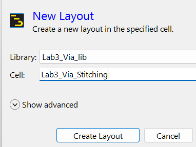

## Task 6: Open trace window

   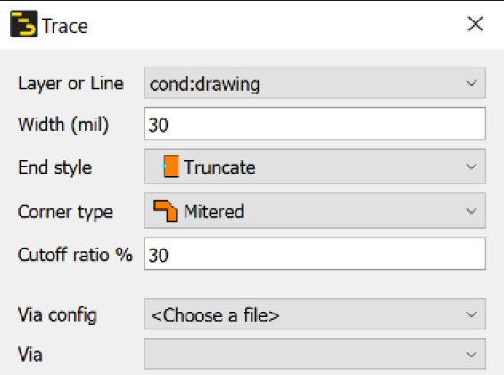

1. Press **“t”** or 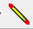

1. Set Layer = **`cond`**

1. Set Width =**30**

1. Set End style = **Truncate**

1. Set Corner type =**Mitered**

## Task 7: Drawing multilayer traces

   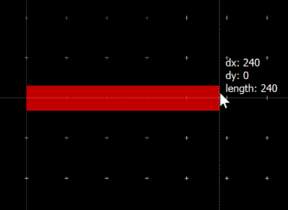

1. Starting at Origin(0,0), begin drawing a 240 length trace

1. Press **hotkey “.” (period)** to **scroll down** to layers **`M2`** and **`M3`**.

1. Press **hotkey “,” (comma)** to **scroll up** twice back to layer **`cond`**.

   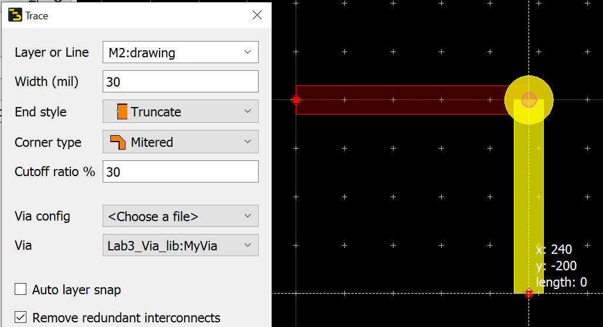

1. On **`cond`**, insert a segment of trace (**left-click**).

> **Note:** Notice how the trace segment layer changes dynamically.

1. Press **“.”** to change to layer **`M2`**.

1. Move some distance below the 2nd point of the **`cond`** trace.

1. Press the **spacebar** to finish the route.

1. Close trace window

### via has been created

Select the trace, and use the Info docking window to validate :

   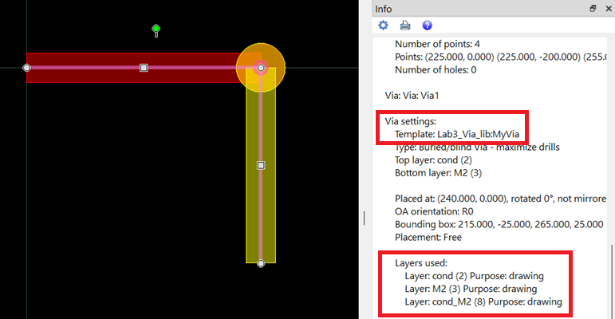

> **Note:** A trace segment is drawn on **`M2`** and an instance of the via **`cond_M2`** is automatically inserted.

   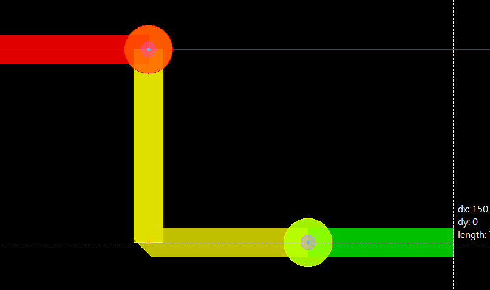

1. Press “**t**” (or the **Trace** icon )

1. Add a new trace segment on **`M2`** starting at the bottom endpoint going to the right, left-click.

1. Press **“.”** to change to layer **`M3`**. Add a segment of trace, left-click.

1. Press **spacebar**.

1. Close the trace window.

### Examine the segment

> **Note:** Notice how the segments are automatically merged with the right corner type when you finish the route (as long as you don’t change the trace properties).

   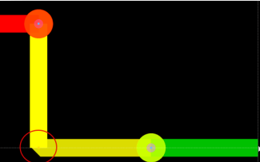

   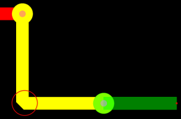

### 3D View

Click the “3” key (View > 3D View). Click the flag for Don't show this message again to he dialog and then OK.

   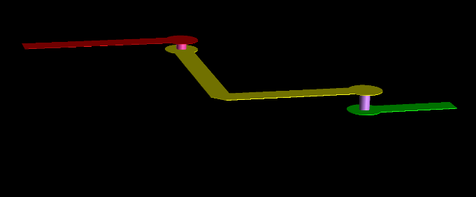

## Task 8: Create stackable via

Double-click the trace. Edit the **`M3`** segment to **`cond2`**. Edit **`M2`** segment to **`M3`**. Click **OK**.

   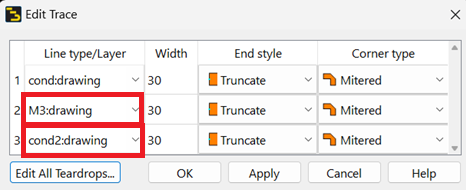

Then click away from the via to unselect it.

   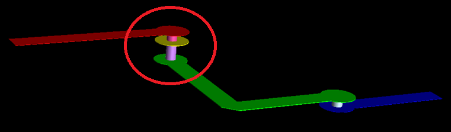

> **Note:** Note that a stackable via is created using both vias - **`cond_M2`** and **`M2_M3`** from **`cond`** to **`M3`**

## Task 9: Update corner type

Double-click the trace. Change the 2nd segment **Corner type** to **Square**. Click **OK**.

   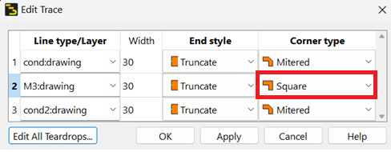

   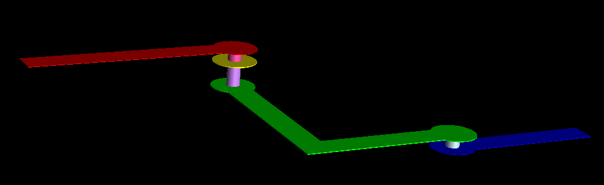

Press the “2” key to return to 2D View

   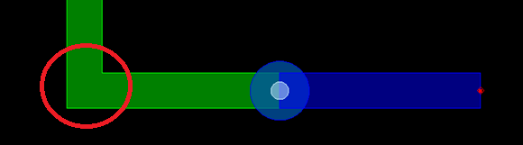

## Task 10: Convert trace into individual pieces

Right-click on the trace, Use **Break Trace At Vias** to convert the trace into individual pieces.

   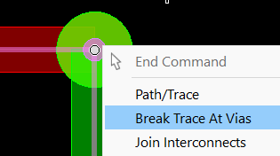

Play around with the pieces using **Ctrl+left-click** and drag to break the connections.

   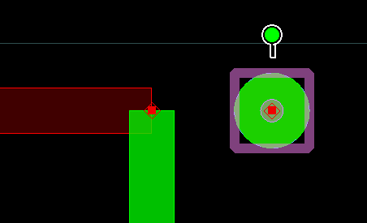

**Undo** (Ctrl+Z) to get back the trace object.

## You have successfully completed Lab 3B - Module 2.
