# Lab 3B - Module 3: Connecting GND to capacitor

**Learning Objectives:** In this module, you will complete the following tasks:

- Insert a capacitor
- Insert a trace segment
- Create ground plane with clearance
- Connecting GND to capacitor
- Validate net names
- A thermal relief has been created
- Thermal clearance

## Task 1: Insert a capacitor

1. Insert a capacitor 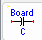from the Board Design Kit palette

1. Set the **PadLayer** to **`cond`**.

   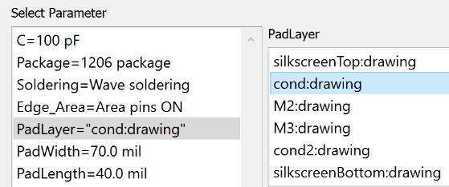

1. Place it somewhere next to the trace endpoint and connect the right component pin to the trace pin.

   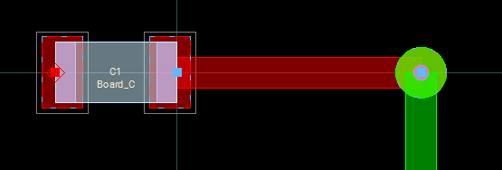

## Task 2: Insert a trace segment

   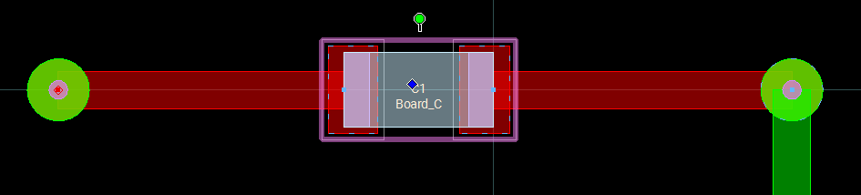

1. Use 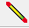insert a trace segment on **`cond`** attached to the left pin of the capacitor, left-click

1. Press **"."** twice to change to layer **`M3`**

1. Press the **spacebar** to finish.

## Task 3: Create ground plane with clearance

Use **Insert > Plane** command to define a ground plane with a **clearance** of **30** (mil) around the network.

   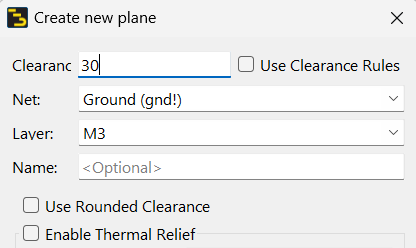

### Draw rectangle

Note that all shapes on **`M3`** are being cleared.

   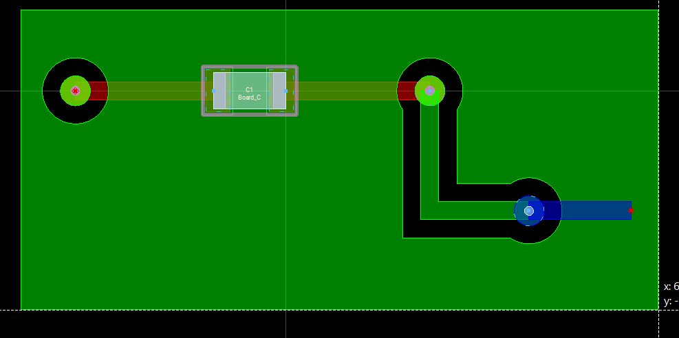

## Task 4: Connecting GND to capacitor

To ground the left side of the capacitor, one has to name the net “**gnd!**” (the exclamation mark defines a forced net).

   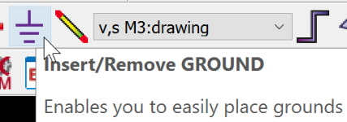

   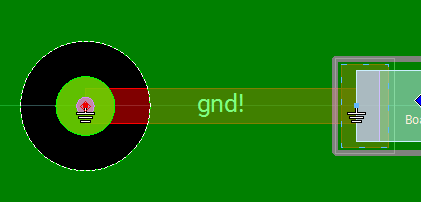

1. Click the Ground icon

1. Snap to the pin on the left via.

1. Click 

## Task 5: Validate net names

Select the trace and the capacitor and note in the **Info** or **Properties** window that the net names are now **gnd!** for the trace/vias and for the left pin of the capacitor.

   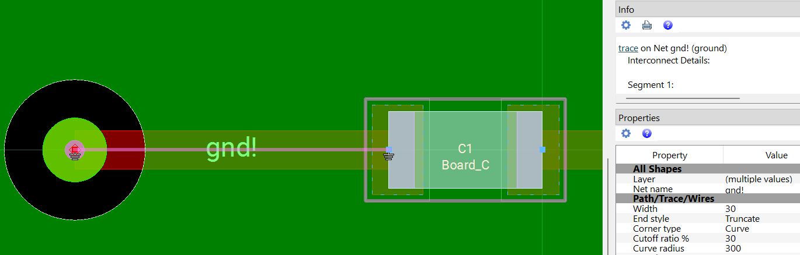

   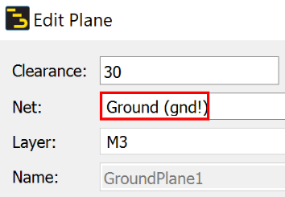

1. Double-click on the plane

1. Make sure that Ground (gnd!) has been assigned as Net

1. Click OK.

   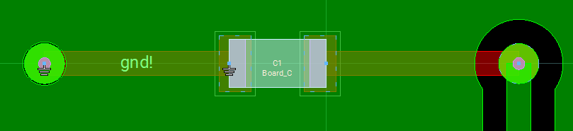

## Task 6: A thermal relief has been created

1. Click the “3” key (View > 3D View)

   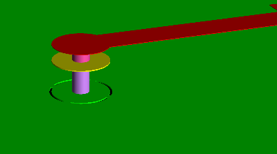

Now, the **`M3`** shape of Via **`M2_M3`** is no longer cleared because the net names of both plane and trace network are **gnd!** and this connection is respected in the clearance algorithm.

> **Note:** A thermal relief has been created instead.

## Task 7: Thermal clearance

   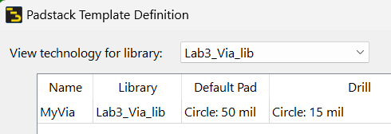

   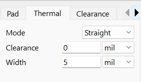

1. Execute **Options > Technology > Padstack Definitions...**

1. Double-click **MyVia**.

1. Set **Thermal Clearance** = **0 mil**.

1. Click OK

1. Close the first dialog.

1. Double-click the plane object

1. Click OK

   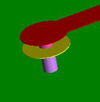

> **Note:** Note that there is no longer any thermal relief.

## You have successfully completed Lab 3B.
