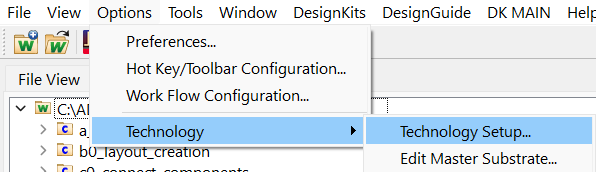
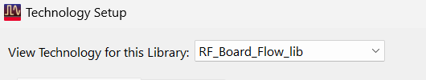
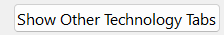
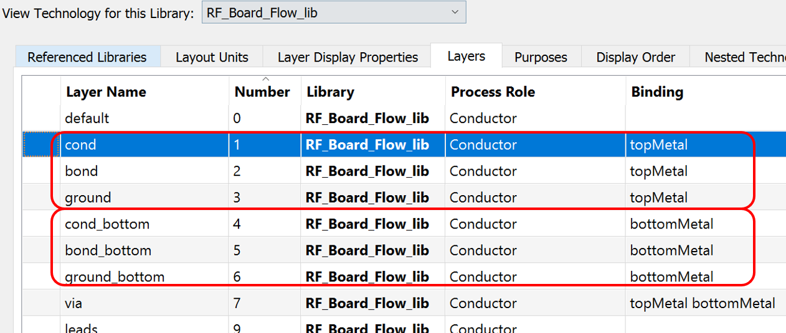
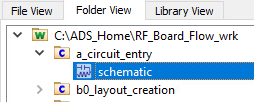
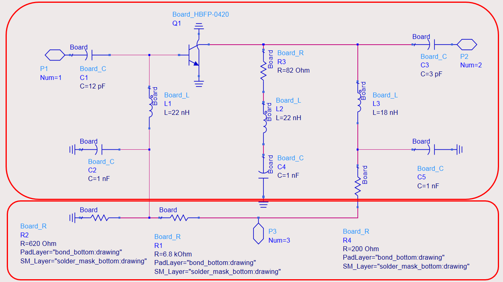
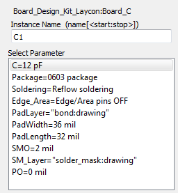

# Lab 4A - Module 2: Inspect technology

**Learning Objectives:** In this module, you will complete the following tasks:

- RF_Board_Flow_lib
- Open a_circuit_entry
- Examine components

## Task 1: RF_Board_Flow_lib

1. Use **Options > Technology > Technology Setup**

   

1. Show Other Technology Tabs for **RF_Board_Flow_lib**.

   

   

### Inspect units and layers

   

Under Layers tab, you can see the binding definitions of the layers. This is used to determine physical connectivity (typically metal-to-metal contacts) between shapes that are touching.

This technology has been setup for a 2-sided board design.

- Layers **`cond`**, **`bond`** and **`ground`** are actually on the same physical top copper layer.

- Layers **`cond_bottom`**, **`bond_bottom`** and **`ground_bottom`** are the bottom physical layer.

## Task 2: Open a_circuit_entry

Open the schematic view of **`a_circuit_entry`**.

   

### 2-sided board design

   

P1 is the RF input, P2 is the RF output. P3 is the DC bias input.

R1, R2, and R4 are bias resistors. Their PadLayer and SM_Layer definitions are *bond_bottom* and *solder_mask_bottom* .

The bias components are placed on the bottom side of an FR4 board and all other components are placed on the *top side* .

## Task 3: Examine components

1. **Double-click** on *C1*

Check their layer mappings (bond and solder_mask), package and pad sizes and some of the other options that were built into this PDK (edge/area pins, etc.)

   

Click **Cancel** when done.

> **Important:** **Do not click Apply** when the Soldering parameter is selected (Reflow or Wave) since that will activate a callback and change the solder mask offset parameter (SMO) to the default value of 5 mil instead of the 2 mil that have been entered manually.

## You have successfully completed Lab 4A - Module 2.
