# Lab 4A - Module 3: Manual placement of schematic components in layout

**Learning Objectives:** In this module, you will complete the following tasks:

- Create new cell
- Generate layout
- Snap grid distance
- Placement of schematic components in layout
- Clear the layout
- Clear highlighted components

## Task 1: Create new cell

   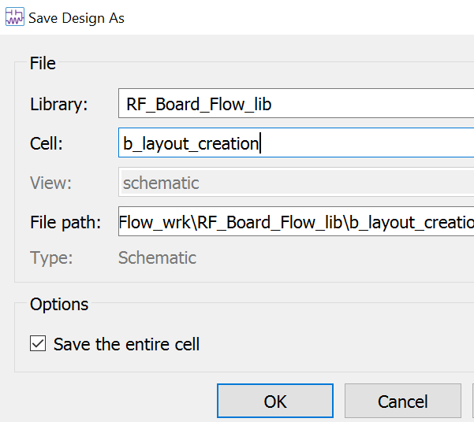

1. Use **File > Save As** to create the cell **`b_layout_creation`**.

## Task 2: Generate layout

1. In the schematic window, click **Layout > Place Components From Schem To Layout**.

The highlighted components indicate that they do not exist in the layout.

   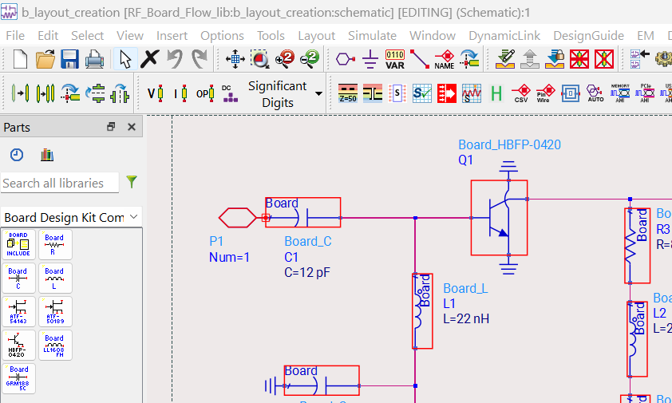

### Arrange windows

Size and position the schematic and layout windows next to each other.

   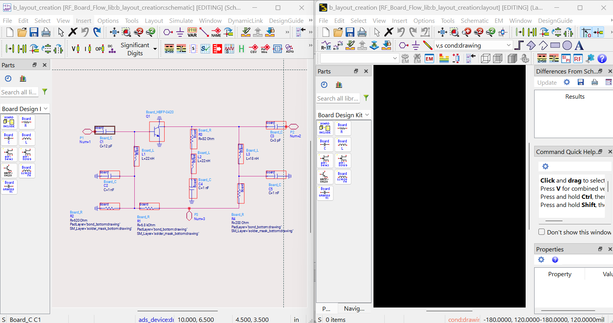

### Differences From Schematic

   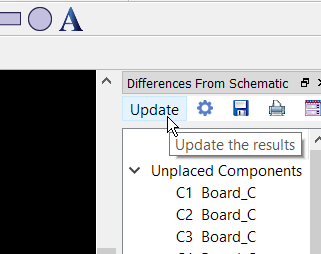p

1. Look for **Differences From Schematic** window in layout window (docked on right side)

1. Click the **Update** button

   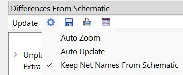

1. Set **Keep Net Names from Schematic**.

## Task 3: Snap grid distance

In the layout window, type “**p**” and go to the **Grid/Snap** tab. Check that the **Snap Grid Distance** is set to **10** and the **Snap Distance** to **40 screen pixels**.

   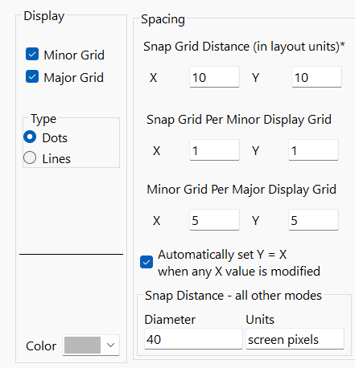

The choice of 10 mil is fairly coarse which makes it easier to align component pins vertically or horizontally, so they can be easily connected with straight trace segments.

## Task 4: Placement of schematic components in layout

1. Click the transistor symbol in schematic and place it in the layout.

| 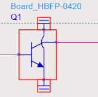 | 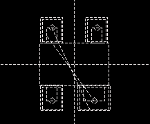 |
|---|---|

The schematic symbol highlights disappear as you place the parts.

   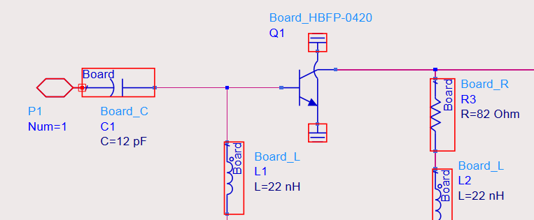

1. Place the 3 surrounding elements C1, L1 and R3 some distance away in the layout.

   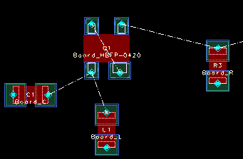

> **Note:** The dashed *flight lines* indicate which pins are connected together in the schematic.

   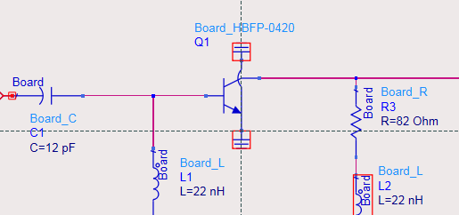

> **Note:** The schematic symbol highlights disappear as you place the parts.

## Task 5: Clear the layout

Clear the layout using **Edit > Delete All**.

## Task 6: Clear highlighted components

In the schematic window, use **Layout > Clear Highlighted Components**.

   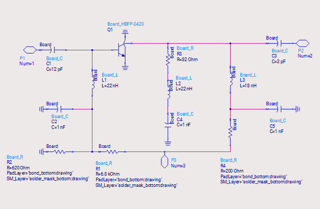

## You have successfully completed Lab 4A.
