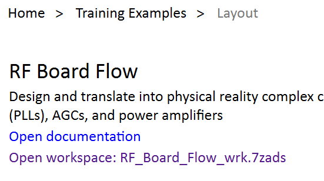

# Lab 4B - Module 1: Load the RF Board Flow workspace and PDK

**Learning Objectives:** In this module, you will complete the following tasks:

- Load RF board flow workspace
- Add design kit to workspace
- Open a_circuit_entry

## Task 1: Load RF board flow workspace

   

   

1. Click **Open Example**

1. Navigate to **Training Examples > Layout.**

1. Select **RF_Board_Flow_wrk.7zads**

1. Destination path C:\ADS_Home

1. Click **Finish**

## Task 2: Add design kit to workspace

1. Choose **DesignKits > Unzip Design Kit…**

1. Browse to: C:\Program Files\Keysight\ADS2026_Update0.1\examples\Training\Layout

1. Select **Board_Design_Kit_Laycon.zip**. Click **Open**

1. Navigate to: C:\ADS_Home. Click **Select Folder**

1. Click **Yes** to add it

   

## Task 3: Open a_circuit_entry

Open the schematic view of **`a_circuit_entry`**.

   

## You have successfully completed Lab 4B - Module 1.
