# Lab 4B - Module 2: Automatic placement of wire-connected components

**Learning Objectives:** In this module, you will complete the following tasks:

- Create new cell
- Generate and update layout
- Force to grid
- Move the components around
- Disable display net overlap zones
- Arrange components
- Assign pins to layers

## Task 1: Create new cell

   

1. Use **File > Save As** to create the cell **`b_layout_creation`**.

## Task 2: Generate and update layout

   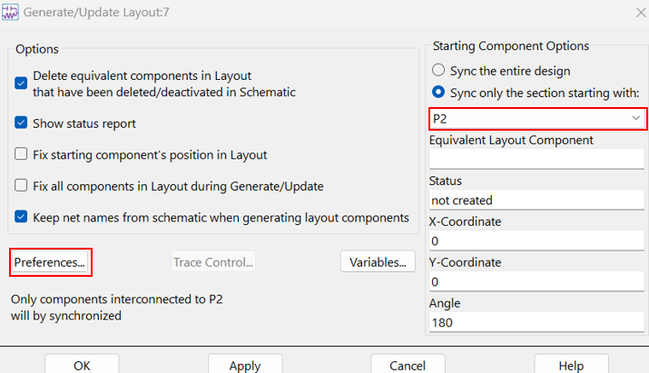

1. In schematic window, execute **Layout > Generate/Update Layout**.

1. Click the button **Sync only the section starting with**

1. Choose **P2**.

1. Click on **Preferences**.

   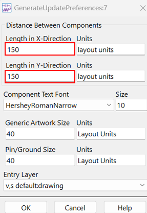

1. Set **Length in X-Direction** = **150**.

1. Set **Length in Y-Direction** = **150**.

1. Click **OK** twice

### Components have been placed in layout

   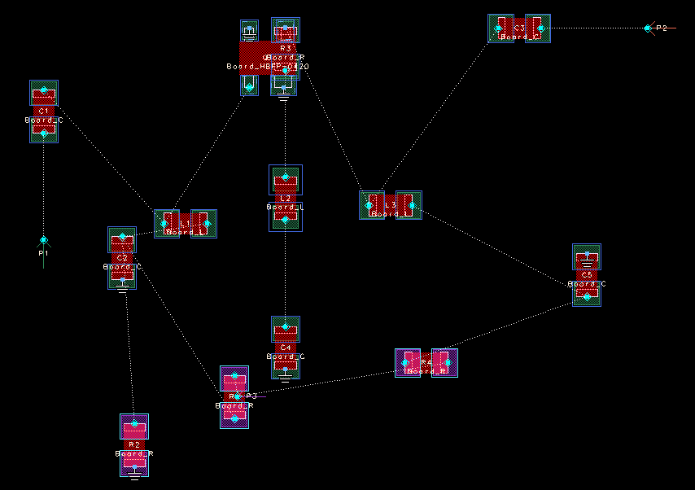

> **Note:** Components from schematic placed automatically in the layout.

## Task 3: Force to grid

Hover the mouse over the various pin locations, you can see (bottom right absolute coordinate readout) that not all got placed on grid points.

   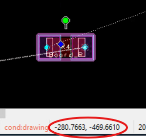

   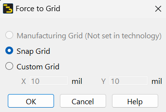

1. Press **Ctrl+A** (Select > Select All)

1. Execute **Edit > Modify > Force** **To Grid**

1. Choose the **Snap Grid**.

1. Click **OK**

Move the mouse over the pins and note how they are now on grid (pin 1 and the other pins where possible).

   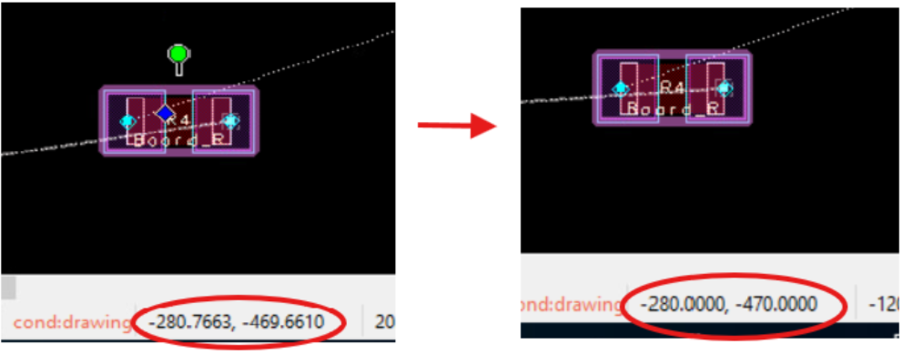

## Task 4: Move the components around

1. Move R3 on top of the transistor and L2 below it to the right.

   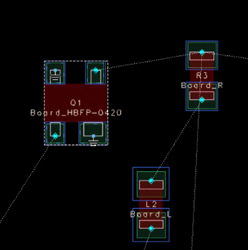

## Task 5: Disable display net overlap zones

   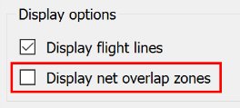

1. Execute **Tools > Set Connectivity Options**

1. Uncheck the option “Display net overlap zones”.

1. Click OK

## Task 6: Arrange components

1. Arrange and align the components similar to the layout shown here:

1. Move the GND symbols to the pins they belong to.

   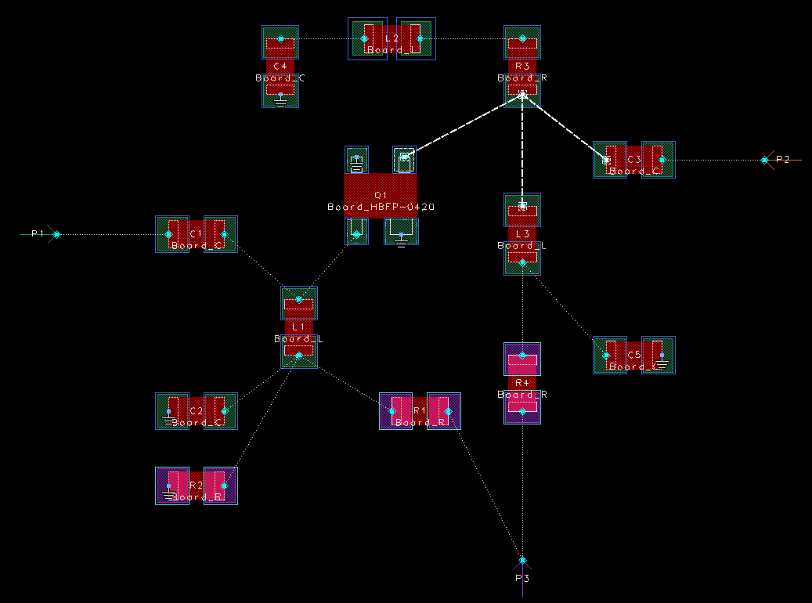

> **Tip:** Using “**r**”, “**m**” and “**x**” and “**y**” keys (rotate, move, constrained move). This will allow for easier orthogonal routing of the interconnect.
>
> You can use **Layout** **> Show Equivalent Component** in schematic to find the corresponding components in the layout window.

## Task 7: Assign pins to layers

   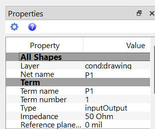

1. Right-click on pin **P1** and choose Properties to change its layer to **`cond`**.

1. Assign **P2** to layer **`cond`**.

1. Assign **P3** to layer **`cond_bottom`**.

1. **Save** the layout.

### It should look like this

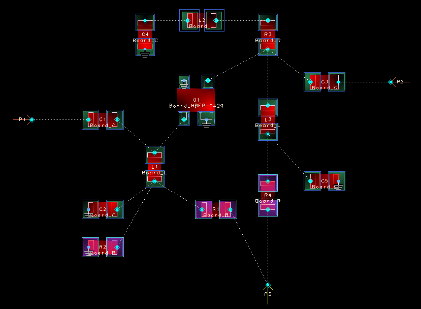

## You have successfully completed Lab 4B - Module 2.
