# Lab 4B - Module 3: Connect components with traces

**Learning Objectives:** In this module, you will complete the following tasks:

- Create layout
- Connect RF components with traces
- Connect bias components with traces
- Set origin
- Insert circles on overlapping points (1)

## Task 1: Create layout

   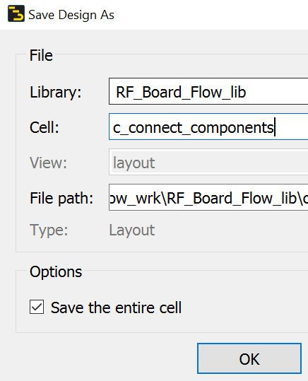

1. Press “**F2**” or use (File > Save As)

1. Set **Cell** = **`c_connect_components`**

1. Turn on **Save the entire cell**

1. Click **OK**

## Task 2: Connect RF components with traces

   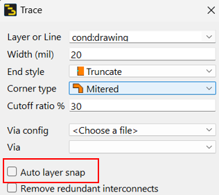

1. Press **“t”** (or **Trace** icon).

1. Set **Layer** = **`cond`**

1. Set **Width**=**20 mil**

1. Turn **off** Auto layer snap.

1. Connect all RF components on the topside using the layer **`cond`**.

   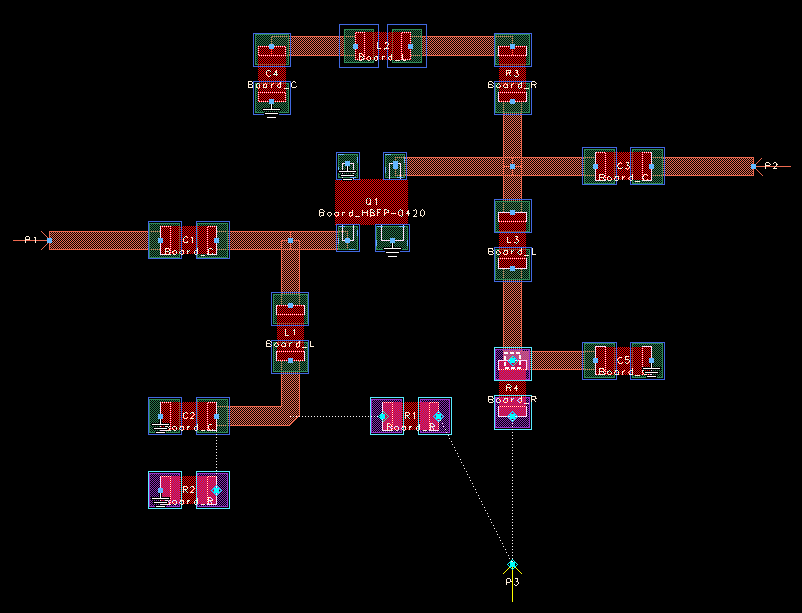

> **Tip:** Use “9” (Options > 90 Degree Entry) to force orthogonal routes.
>
> To close the trace, click the spacebar.
>
> The dashed flight lines between components will disappear as you make valid pin-to-pin connections.

## Task 3: Connect bias components with traces

1. Change layer to **`cond_bottom`**

   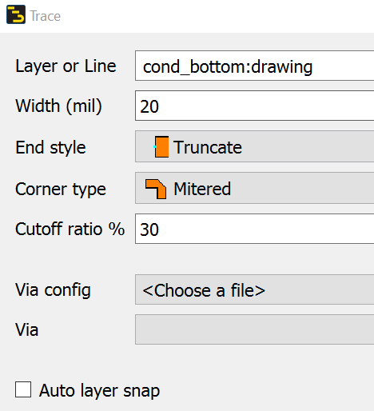

1. Connect the bias resistors (bottom side of the board) using the layer **`cond_bottom`**.

When traces cross, you must connect the midpoints manually to get a valid connection.

   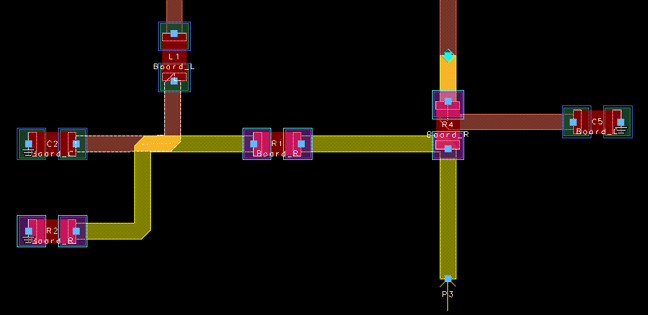

> **Tip:** Create enough overlap to the top traces, so that you can later place via holes there.

### It should look like this

   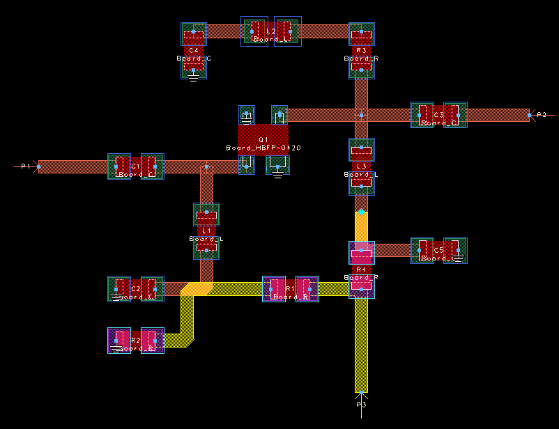

## Task 4: Set origin

Use **Edit > Modify > Set Origin** and click on **P1**.

## Task 5: Insert circles on overlapping points (1)

   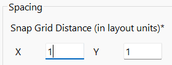

1. Type “**p**”, select Grid/Snap tab, set the **Snap Grid Distance** to **1 mil**.

1. Click **OK**

### Insert circles on overlapping points (2)

1. Make the layer **`via`** the new insert layer.

   

1. Turn on **Edge snap**

   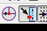

### Insert circles on overlapping points (3)

1. Click on the **Circle** icon. 

1. Place the cursor at the center of the traces where **`cond`** traces overlap with **`cond_bottom`** traces.

1. Click once to **define the circle center**.

1. Drag the outline **8 mils** to define the radius. or use "K" (Coordinate Entry)

| 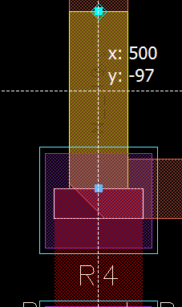 | 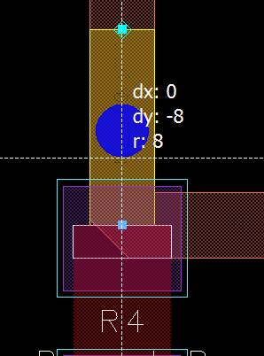 |
|---|---|

   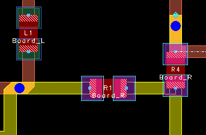

**Save** the layout.

## You have successfully completed Lab 4B - Module 3.
