# Lab 4B - Module 4: Create ground planes

**Learning Objectives:** In this module, you will complete the following tasks:

- Create new cell
- Insert ground plane
- Insert bottom ground plane
- Making ground connection

## Task 1: Create new cell

Press “**F2**” (File > Save As) to create the cell **`d_create_ground_planes`** (Save the entire cell checked).

   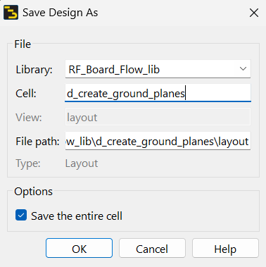

## Task 2: Insert ground plane

1. Set the insert layer to **`ground`**.

   

1. Insert a **rectangle**  around the entire design.

   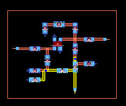

### Align edges with pins

1. Select it, and use the edge midpoint stretch handles to align 3 edges with the pins.

1. Align the top edge of rectangle about ~40 mil from the top edge of L2.

| 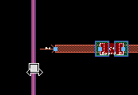 | 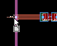 |
|---|---|

   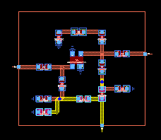

### Create clearance on ground plane

   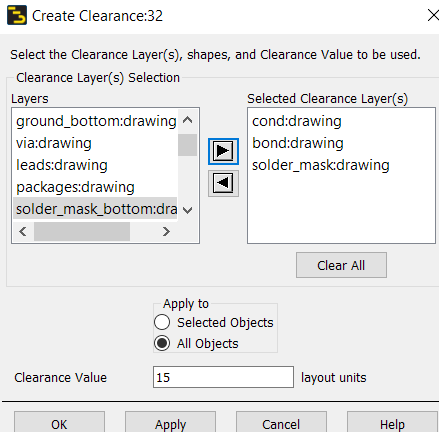

1. Use **Edit > Create Clearance**

1. Select the **ground plane** rectangle. Click **OK**.

1. Select **`cond`**, **`bond`**, **`solder_mask`** as clearance layers.

1. Click **All Objects**

1. Set **Clearance Value** = **15** layout units.

1. Click **OK**.

### It should look like this

   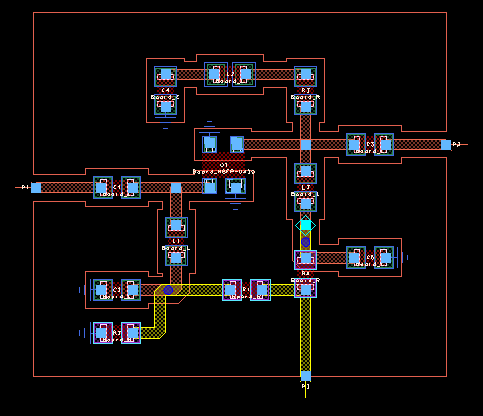

### See the metalization pattern

1. Change **Shape Display** = **Filled** mode

   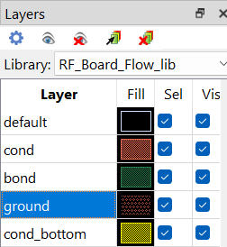

   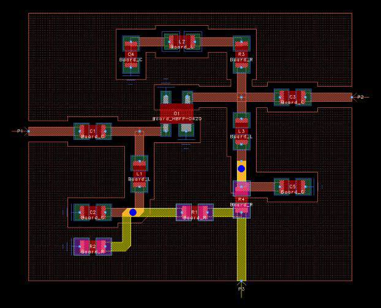

## Task 3: Insert bottom ground plane

1. Set the entry layer to **`ground_bottom`**.

   

1. Turn on **Vertex Snap**.

   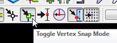

1. Insert a **rectangle** matching the upper ground plane outline.

   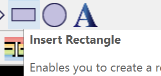

### Make the upper ground plane Invisible

Make the upper ground plane (**`ground`**) invisible using “**L**” ( *Options > Layer Preferences* ).

   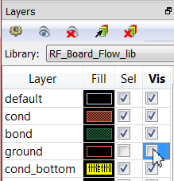

### Create clearance on bottom ground plane

   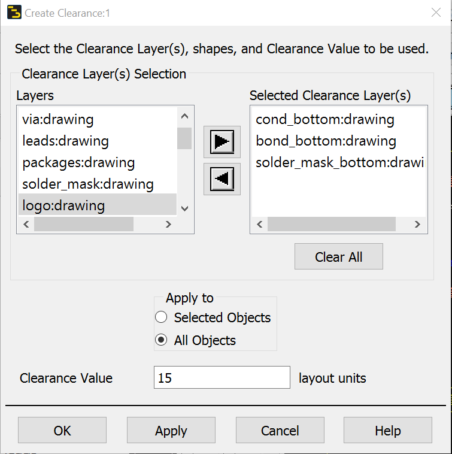

1. Use **Edit > Create Clearance,**

1. Select the **bottom ground plane** rectangle. Click **OK.**

1. Select **`cond_bottom`**, **`bond_bottom`**, **`solder_mask_bottom`** as clearance layers.

1. Click **All Objects**

1. Set **Clearance Value** = **15** layout units.

1. Click **OK**.

### It should look like this

   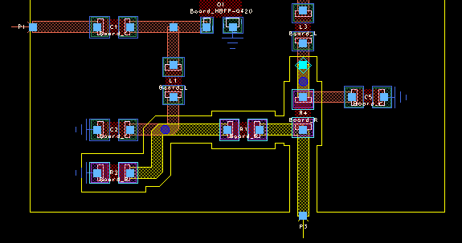

Use filled mode to see the metalization pattern.

   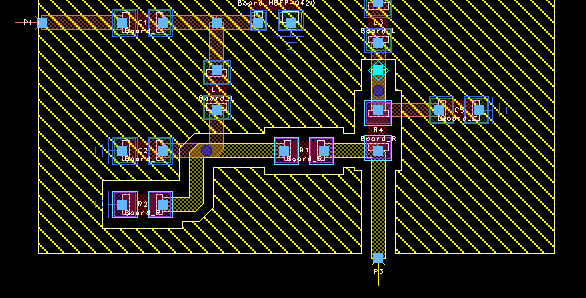

## Task 4: Making ground connection

Finally, the ground connections need to be made to replace the ideal ground symbols with a physical representation and to tie the top and bottom grounds together for a balanced current distribution and shielded signal propagation.

### Change to Outline display

Change the **`ground`** and **`ground_bottom`** layer display mode back to **Outline**.

   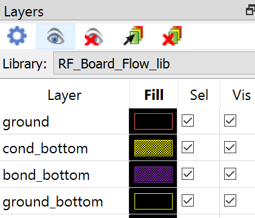

### Replace ground symbols with traces

1. Make **`cond`** as insert layer.

1. Replace the ground symbols with 20 mil wide **traces** from the ground pins to the **`ground`** layer.

   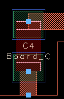

| 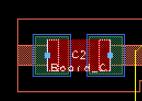 | 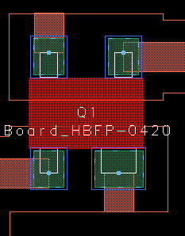 |
|---|---|

   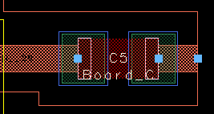

### Replace ground symbols with traces

1. Make **`cond_bottom`** as insert layer.

1. Replace the ground symbols with 20 mil wide **traces** from the ground pins to the **`ground_bottom`** layer

   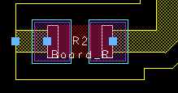

### Tie top and bottom grounds together

   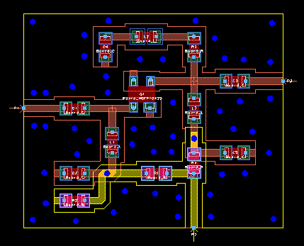

1. Select one of the vias and press **Ctrl+C** (**Copy**).

1. Press **Ctrl+V** and paste it to various locations along the edges where the traces are routed but fully inside the ground plane polygons and not too close to the edges.

1. **Save** the layout.

## You have successfully completed Lab 4B.
