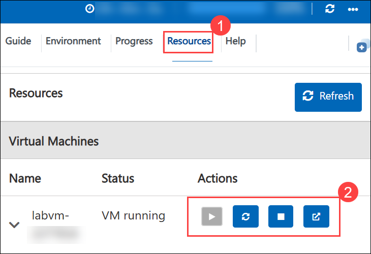
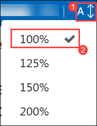

# RFPro101: EM Simulation with RFPro

### Estimated Duration: 705 Minutes

## Overview

This hands-on lab series is made up of 8 RFPro101 labs, completed in sequence:

- **Lab 1A: Introduction: Discovering the RFPro GUI** (45 Minutes): This lab introduces the RFPro GUI. You will open a predefined spiral inductor layout, transfer it to RFPro, assign ports, set up and run the simulation, and investigate the response, inductance and Q factor versus frequency.

- **Lab 1B: Low-Pass Filter Design** (120 Minutes): In this lab we investigate a low-pass filter design, which has been initially described by lumped components only. You’ll simulate the design to confirm the expected performance. Using the supplied layout, you are going to run this entire design in RFPro by the Momentum simulator. You’ll investigate the S-Parameter results in RFPro and generate a schematic for ADS to run a Circuit-EM-Cosimulation .

- **Lab 1C: Optimizing the final LPF** (90 Minutes): In this lab, you will optimize in the next step the vendor components to get back the initial low-pass filter response @ 2 GHz cut-off frequency.

- **Lab 2A: EM Model Extraction of ADI Eval Board** (120 Minutes): In this lab, you’ll work on the evaluation board ADTR1107 T/R from Analog Devices. Instead of simulating the entire layout, you select just the Nets of interest in a User Defined EM Simulation. In addition, you will set different kinds of Virtual Pins directly in RFPro.

- **Lab 2B: Process Variations of Through line** (90 Minutes): In this final step, you learn to investigate manufacturing process variations using the THROUGH calibration line. Note that for the THROUGH line at the top of the layout, no pins have been defined yet. From the previous lab we have learned that the CPW ports are very well suited for this application. In a last step we want to compare the simulated results with the measured data from Analog Devices.

- **Lab 3A: Mixed-Technology Design in RFPro** (120 Minutes): In this lab we introduce the concept of Smart Mount, which allows us to combine different designs having different technologies in one complete EM simulation and then run a Circuit-EM cosimulation. In this example we combine a matched LNA with a LP-Filter.

- **Lab 3B: Inductance and Current in Spiral Inductors & Bondwires** (60 Minutes): In this lab, we will have a closer look to a single spiral inductor and a bondwire transition, to investigate the overall inductance of these two components. Then, we’ll investigate the current distribution of both components.

- **Lab 3C: Optimization and Nonlinear Simulation** (60 Minutes): In this exercise, we will optimize the final design and comparing the results to initial design. You will be using the optimized component values to get back the desired amplifier performance and will investigate the nonlinear behavior of our design.

## Getting started with your lab

Welcome to your Keysight Advanced Design System (ADS) hands-on lab. This environment gives you a Windows 11 virtual machine with **Advanced Design System 2027** pre-installed, along with the lab workspaces you need to complete each module.

## Accessing Your Environment

Your virtual machine and this **Guide** are available within your web browser.

   

## Environment Details

1. To access the virtual machine over RDP, use the values on the **Environment** tab.

    - **VM DNS Name:** <inject key="VM DNS Name" enableCopy="true"/>
    - **Username:** <inject key="VM Username" enableCopy="true"/>
    - **Password:** <inject key="VM Password" enableCopy="true"/>

1. Your Deployment ID for this run is **<inject key="DeploymentID" enableCopy="false"/>**. Quote it if you contact support.

## Exploring Your Resources

To get a better understanding of your resources and credentials, navigate to the **Environment** tab.

   

## Utilizing the Split Window Feature

For convenience, you can open the guide in a separate window by selecting the **Split Window** button from the top right corner.

   

## Managing Your Virtual Machine

Feel free to **Start, Restart,** or **Stop** your virtual machine as needed from the **Resources** tab. Your experience is in your hands!

   

## Guide Zoom In/Zoom Out

To adjust the zoom level for the environment page, click the **A↕: 100%** icon located next to the timer in the environment.

   

## Lab Structure

| Lab | Module | Topic |
|-----|--------|-------|
| Lab 1A | Module 1 | Spiral Inductor Design |
| Lab 1A | Module 2 | Transfer the layout to RFPro |
| Lab 1A | Module 3 | Investigate the results |
| Lab 1B | Module 1 | Simulating the low-pass filter circuit design |
| Lab 1B | Module 2 | Open the layout and substrate |
| Lab 1B | Module 3 | Transfer the layout to RFPro |
| Lab 1B | Module 4 | Setup a full EM analysis |
| Lab 1B | Module 5 | Perform circuit-EM cosimulation |
| Lab 1C | Module 1 | Visualization of the current flow |
| Lab 1C | Module 2 | Optimizing the final low-pass filter |
| Lab 2A | Module 1 | Investigating the evaluation board |
| Lab 2A | Module 2 | EM analysis of a feed line using single-ended ports |
| Lab 2A | Module 3 | EM analysis of a feed line using coplanar waveguide ports |
| Lab 2A | Module 4 | Generating a subcircuit for ADS |
| Lab 2B | Module 1 | Investigating process variations of Through line |
| Lab 2B | Module 2 | Compare simulated results with measured data |
| Lab 3A | Module 1 | Unarchiving the workspace and examining the libraries |
| Lab 3A | Module 2 | Circuit simulation of the matched LNA |
| Lab 3A | Module 3 | FEM simulation of the LTCC-filter |
| Lab 3A | Module 4 | Creating the smart mount design |
| Lab 3A | Module 5 | Setup of a full EM analysis in RFPro |
| Lab 3B | Module 1 | User-defined EM analysis using spiral inductor |
| Lab 3B | Module 2 | Viewing current distributions of the bondwire and the spiral inductor |
| Lab 3C | Module 1 | Optimize the final design |
| Lab 3C | Module 2 | Nonlinear simulation of the optimized design |

>**Note:** Complete the labs in the order listed, starting with Lab 1A. Within each lab, the modules are not independent, so complete them in order.

## Launch Advanced Design System

Click the shortcut icon for ADS on your screen, or use the Start > Programs command to find and start Advanced Design System.

   

## Support Contact

The CloudLabs support team is available 24/7 via email and live chat.

- Email Support: labs-support@spektrasystems.com
- Live Chat Support: https://support.cloudlabs.ai/isv

Now, click on **Next >>** from the lower right corner to move on to the next page to begin with Lab 1A, Module 1.

   

## Happy Learning !!
