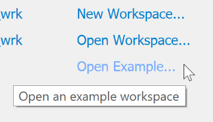
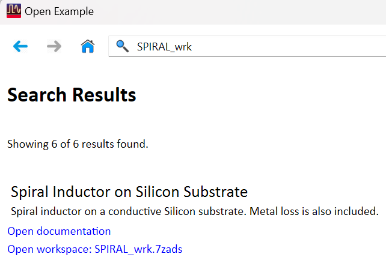
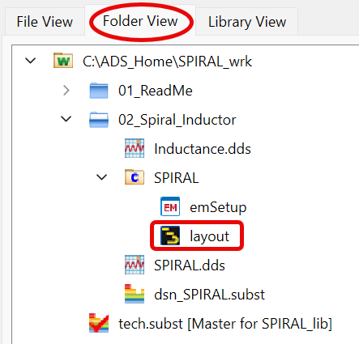
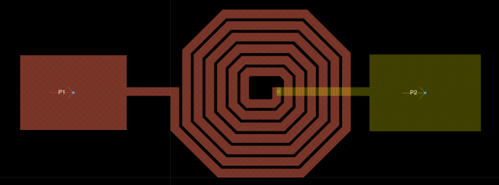
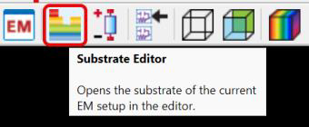
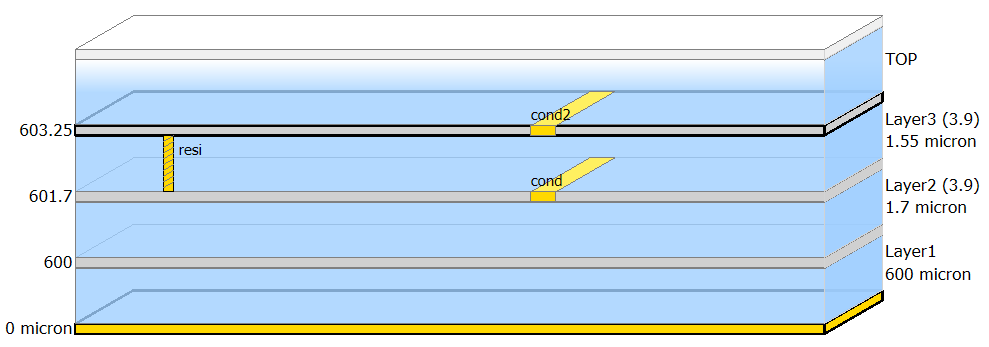

# Lab 1A - Module 1: Spiral Inductor Design

**Learning Objectives:** In this module, you will complete the following tasks:

- Open example
- Open the supplied layout view
- Get familiar with the predefined design

This module contains the following lessons:

## Task 1: Open example

1. Click **Open Example…**

   

1. Type in the Search field **SPIRAL_wrk**

   

1. Select Open workspace: **SPIRAL_wrk.7zads**

1. Choose destination path = C:\ADS_Home

1. Click Finish

## Task 2: Open the supplied layout view

1. First, close the Readme schematic

1. Open the **02_Spiral_Inductor** folder and the **SPIRAL** cell.

1. Open the supplied **layout** view.

   

   

## Task 3: Get familiar with the predefined design

1. Click on the **Substrate Editor** icon in the layout

   

   

## You have successfully completed Lab 1A - Module 1.
