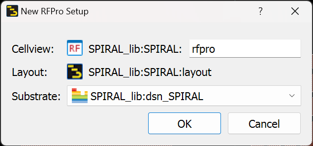
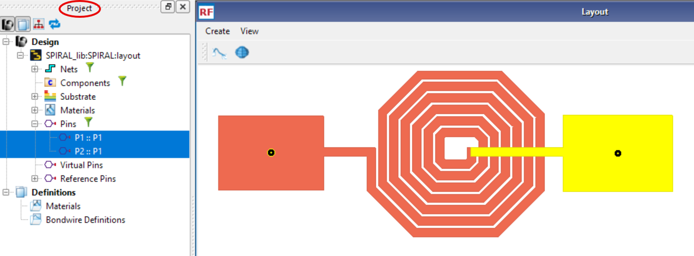
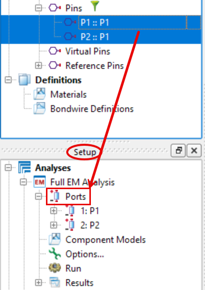
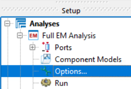
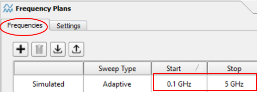
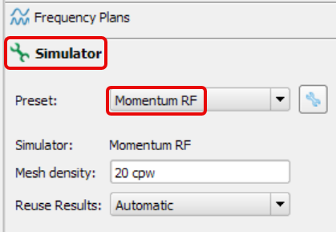

# Lab 1A - Module 2: Transfer the layout to RFPro

**Learning Objectives:** In this module, you will complete the following tasks:

- Create an RFPro view
- Select pins
- Assign port
- Define frequency plan
- Simulator setup

This module contains the following lessons:

## Task 1: Create an RFPro view

   

1. In your layout window, go to **Tools > RFPro > New**.

1. Click **OK**.

## Task 2: Select pins

1. In the **Project** panel (upper left) open the **Pins folder**

1. Select the input and output pins (Ctrl-key).

These pins are now visible on the layout.

   

## Task 3: Assign port

Drag & drop the selected Pins down into the **Setup** panel > Analyses > Full EM Analysis > **Ports**.

   

## Task 4: Define frequency plan

   

   

1. Double-click on the **Options**

1. Define an Adaptive Frequency Sweep from **0.1 GHz** up to **5 GHz**.

## Task 5: Simulator setup

   

1. Select the **Simulator**-Tab

1. Make sure that the **Momentum RF** simulator has been chosen.

1. Click **Done** to accept the new settings

## You have successfully completed Lab 1A - Module 2.
