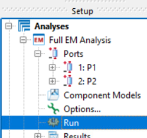
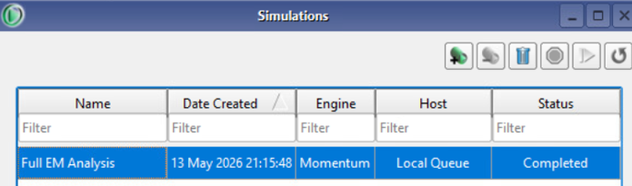
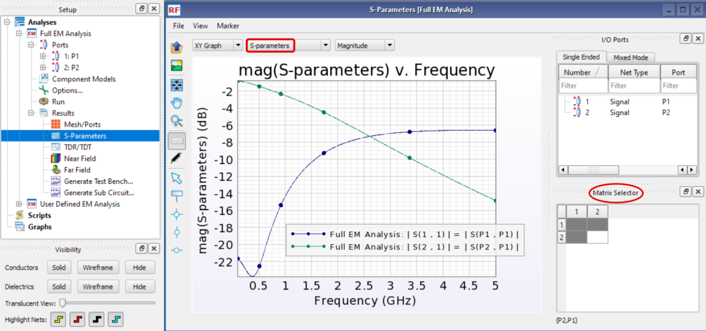
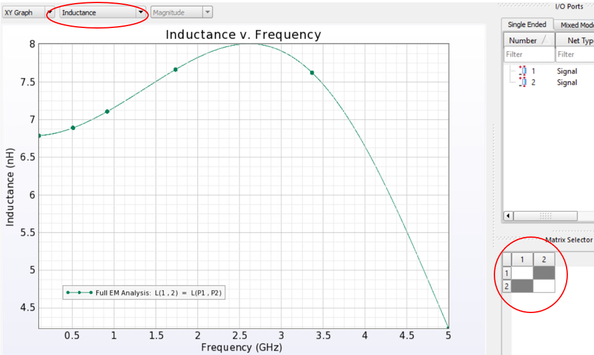
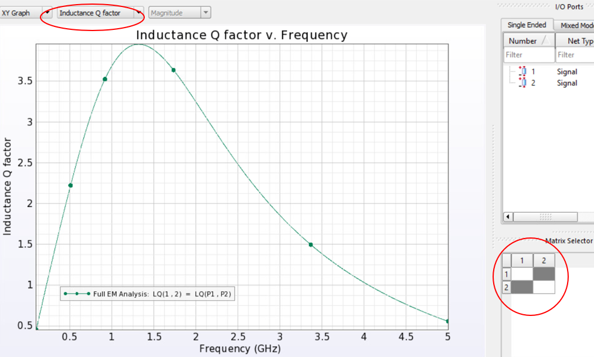

# Lab 1A - Module 3: Investigate the results

**Learning Objectives:** In this module, you will complete the following tasks:

- Start the simulation
- Response vs. Frequency
- Inductance vs. Frequency
- Inductance Q factor vs. Frequency

This module contains the following lessons:

## Task 1: Start the simulation

1. Double-click on **Run**

   

In the upcoming window select “**Always Save Modified Project**” and click on the **Yes** button.

The Simulations Window will open and shows you the progress. After a couple of seconds, the simulation should be finished.

   

## Task 2: Response vs. Frequency

1. Double-click on **S-Parameters** in the **Results** folder

1. Select in the Matrix Selector (lower right) **S11** and **S21**

## Task 3: Inductance vs. Frequency

1. **Uncheck** the **S11** parameter in the Matrix Selector

1. Choose **Inductance**

   

## Task 4: Inductance Q factor vs. Frequency

1. Choose **Inductance Q factor**

   

## You have successfully completed Lab 1A.
