# Lab 1B - Module 1: Simulating the low-pass filter circuit design

**Learning Objectives:** In this module, you will complete the following tasks:

- Open example workspace
- Add vendor component library to workspace
- Open the supplied schematic view
- Simulate the filter design
- Add marker icons to data display
- Initial circuit performance

This module contains the following lessons:

## Task 1: Open example workspace

   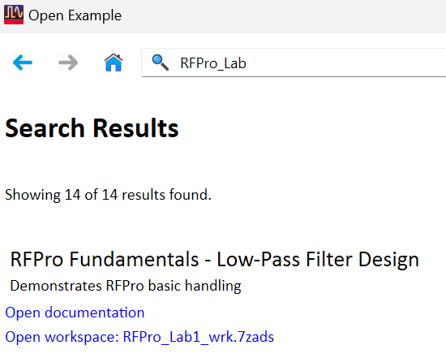

1. Click the icon **Open An Example Workspace** 

1. Type in the Search field **RFPro_lab**

1. **Open** the workspace: **RFPro_Lab1_wrk.7zads.**

1. Set Destination path: C:\ADS_Home\RFPro101\Lab1B

1. Click **Finish**

1. In the **Unarchive Status** message, click **OK**

   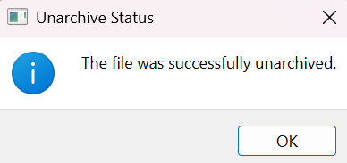

## Task 2: Add vendor component library to workspace

1. At Main window, select **DesignKits > Unzip Design Kit.**

1. Navigate to : C:\Program Files\Keysight\ADS2026_Update1\oalibs\componentLib

1. Select **RF_Passive_SMT_vendor_kit.7z**. Click **Open**

1. Navigate to: C:\ADS_Home\RFPro101\Lab1B. Click **Select Folder**

1. Keep the Design Kit name

   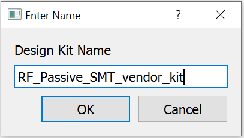

   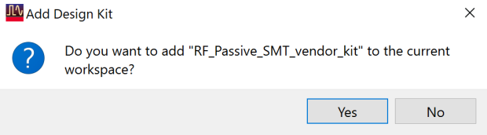

1. Click **OK**

1. Click **Yes** to add it

## Task 3: Open the supplied schematic view

After closing the Readme schematic, expand the **`a1_LP_Filter`** cell and then open the supplied schematic view

   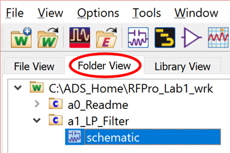

### Examine the design

This design consists of accurate vendor component models, which are already optimized for a 2 GHz low-pass filter.

   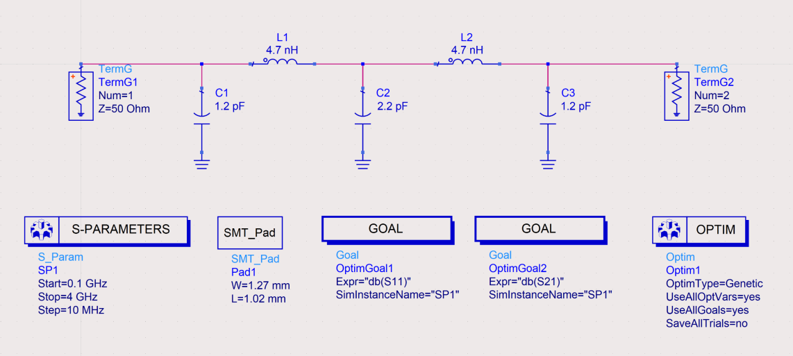

## Task 4: Simulate the filter design

**Simulate** the filter-design

   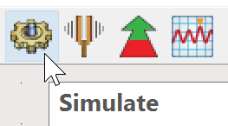

> **Note:** Note that there may be a loading delay.

### Data display will pop up

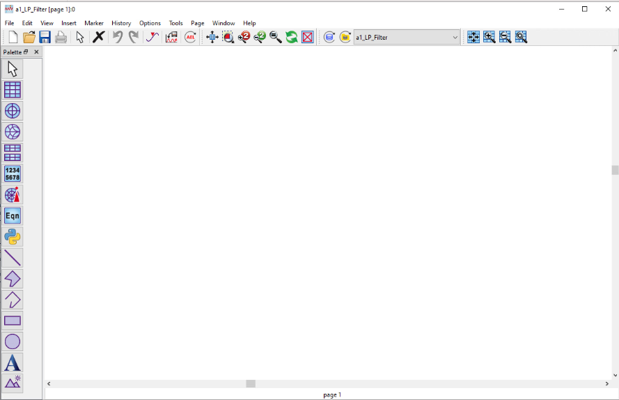

## Task 5: Add marker icons to data display

In data display window, right-click the tool bar and select the check boxes to add **Marker** icons to your data display window.

   

## Task 6: Initial circuit performance

   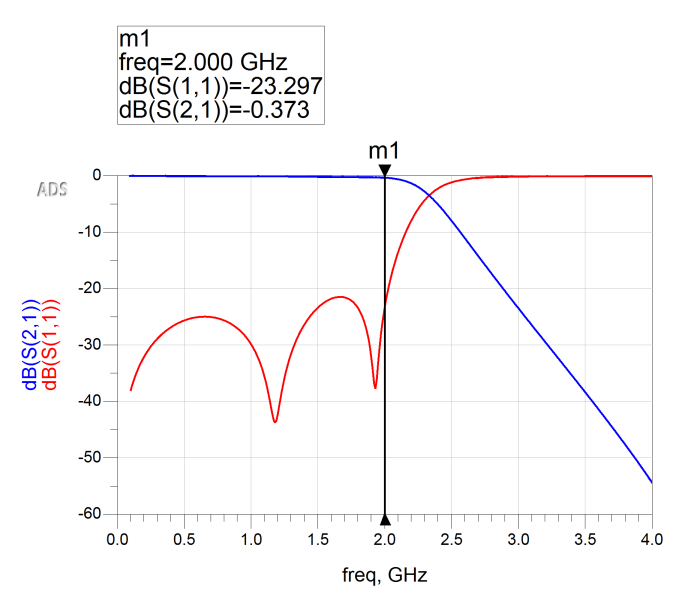

1. Create a rectangular plot 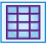

1. Add the **a1_LP_Filter** data for **dB(S(1,1))** and **dB(S(2,1))**

1. Add a **Line Marker** 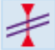 at the filter edge @ 2GHz.

### Save and Close

Finally Save and Close the DataDisplay and the Schematic view.

## You have successfully completed Lab 1B - Module 1.
