# Lab 1B - Module 2: Open the layout and substrate

**Learning Objectives:** In this module, you will complete the following tasks:

- Open the layout view
- Create new substrate
- Update substrate layer
- Update conductor layer
- Map conductor Via
- Final substrate should look like this

This module contains the following lessons:

## Task 1: Open the layout view

Back in the ADS main window, expand the cell **a3_LP_Filter_RFPro_Mom** and open the **layout** view.

   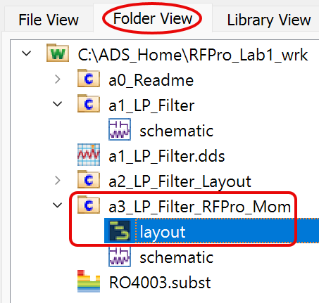

### Examine the layout

This layout contains in addition to the lumped components also the interconnects, via-holes to the ground layer and input/output pins.

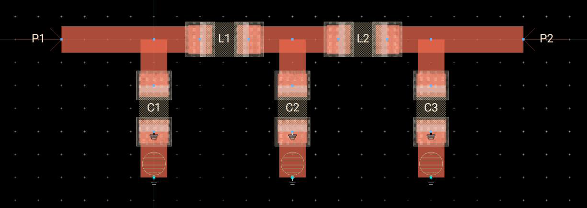

## Task 2: Create new substrate

   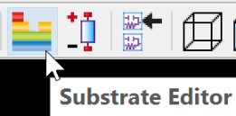

   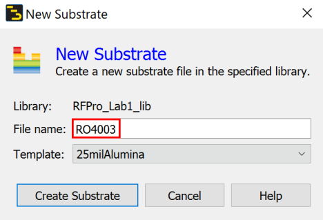

1. Click on the **Substrate Editor** icon, click **OK** on the upcoming message.

1. Set **File name** = **`RO4003`**

1. Keep the 25milAlumina template

1. Click **Create Substrate**

### The template substrate will be opened

   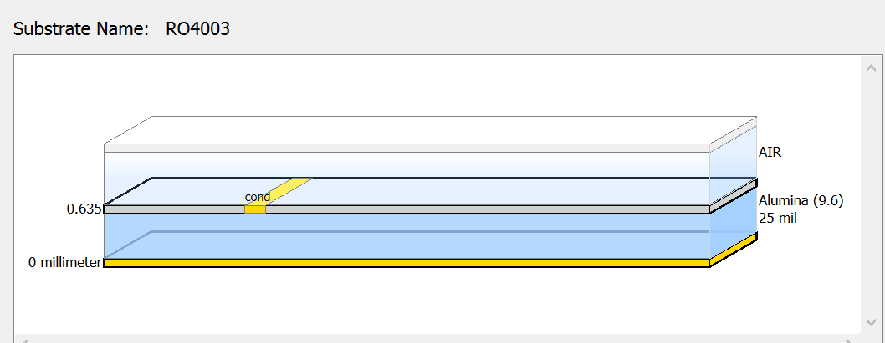

## Task 3: Update substrate layer

1. Click on the **Alumina** Substrate Layer

   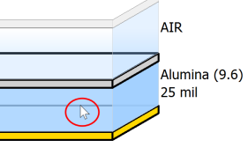

1. Select Material = **Roger_RO4003 (3.55)**

1. Enter a **Thickness** of **20 mil**

   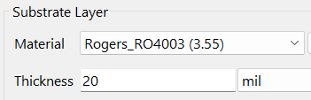

It should look like this

   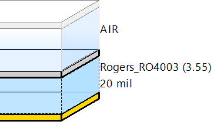

## Task 4: Update conductor layer

1. Click on the **cond** layer

   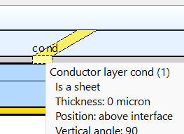

1. Substitute **Material** with **Copper**

1. Define a **1.4 mil thick** layer which is **intruded into the substrate** and located **above the interface**

   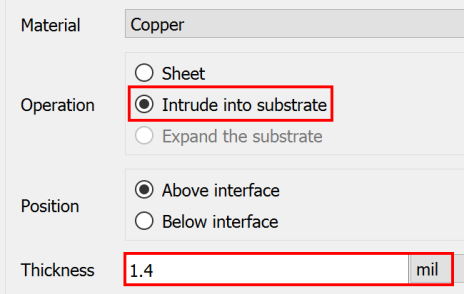

It should look like this

   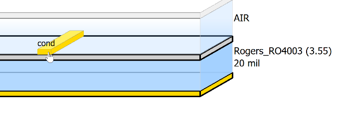

## Task 5: Map conductor Via

1. Right-click on the blue **RO4003** substrate layer

1. Map a **Conductor Via** on layer **pcvia1 (24)**

   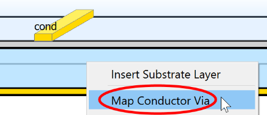

   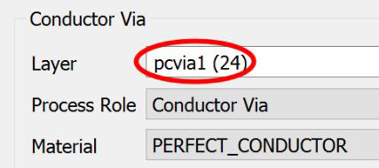

It should look like this

   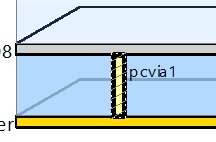

## Task 6: Final substrate should look like this

   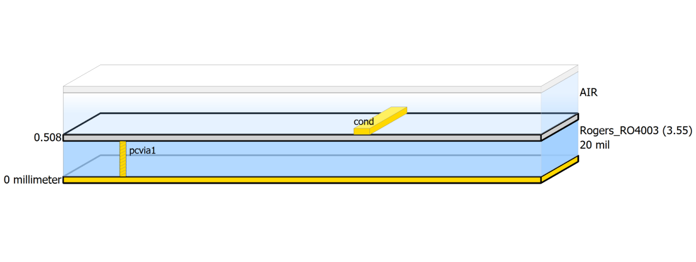

### Save and close

**Save** and close the substrate editor.

## You have successfully completed Lab 1B - Module 2.
