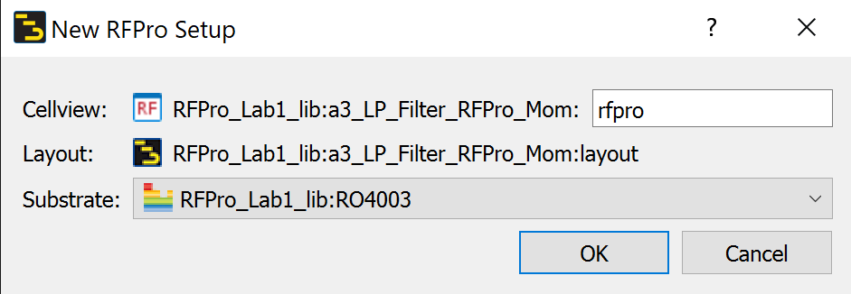
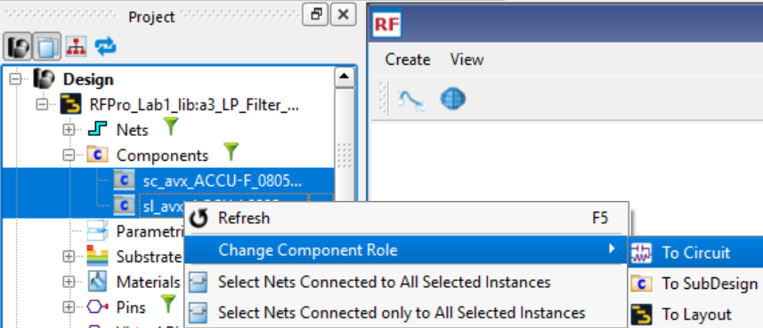
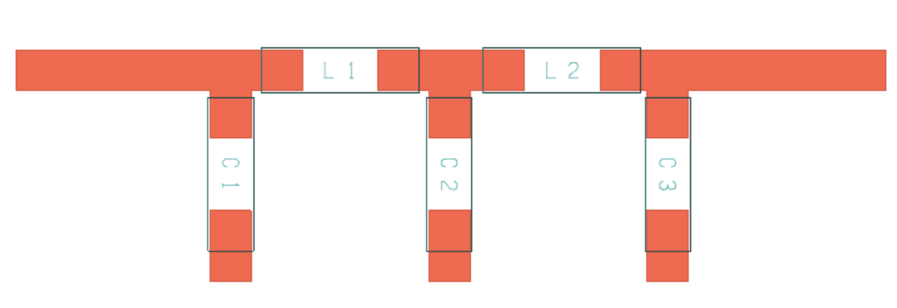
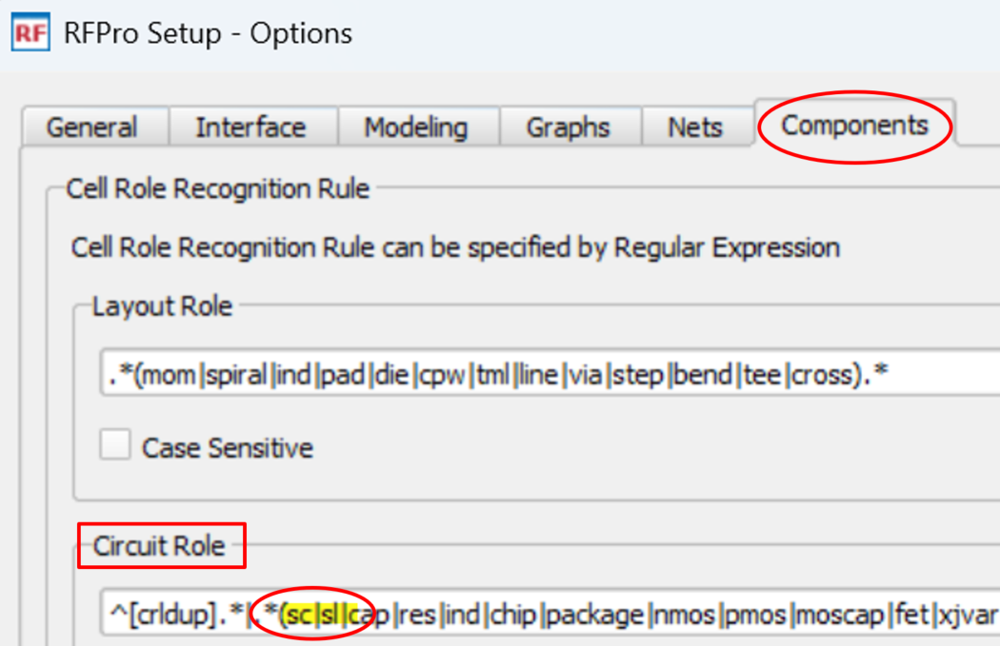
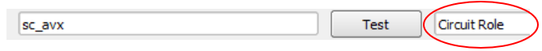
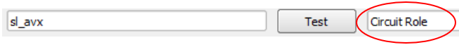
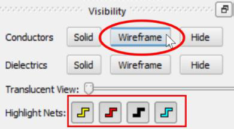
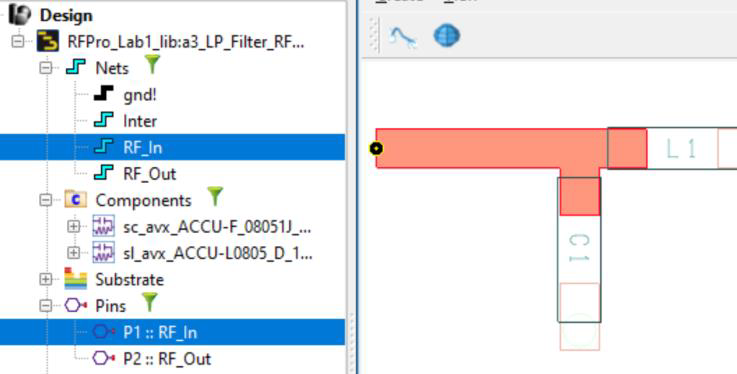

# Lab 1B - Module 3: Transfer the layout to RFPro

**Learning Objectives:** In this module, you will complete the following tasks:

- Create an RFPro view
- Change component role to circuit
- Setup auto detect of lumped components (circuit role)
- Highlight nets and pins

This module contains the following lessons:

## Task 1: Create an RFPro view

   

1. In your layout window, go to **Tools > RFPro > New**.

1. Click **OK**

### Why doesn't show any lumped components?

The initial RFPro-layout does not show any lumped components. Why?

   

## Task 2: Change component role to circuit

   

1. In the **Project** panel, open the **Components** branch.

1. Select both component groups (**Ctrl** key)

1. Right-click to **Change** **Component Role > To Circuit**.

1. Read and accept the message

   

## Task 3: Setup auto detect of lumped components (circuit role)

To recognize the Circuit Role for the lumped components automatically next time

1. Go to **Tools > Options > Components,** add “**sc|sl|”** as another **Circuit Role** in the list.

   

1. Enter `sc_avx`, click **Test.**

   

1. Enter `sl_avx`, click **Test**

   

1. Click **OK**.

## Task 4: Highlight nets and pins

In the **Visibility** panel, click on **Wireframe** for Conductors. Make sure that all Nets are highlighted.

   

In the **Project** panel, select the **RF_In** and **P1 :: RF_In** to be highlighted in the layout. Use the Ctrl key to select more than one item.

   

## You have successfully completed Lab 1B - Module 3.
