# Lab 1B - Module 4: Setup a full EM analysis

**Learning Objectives:** In this module, you will complete the following tasks:

- Assign components
- Assign ports
- It should look like this
- Create frequency plan
- Simulator setup
- Run the simulation
- Investigate the created mesh cells
- S-Parameters result

This module contains the following lessons:

## Task 1: Assign components

   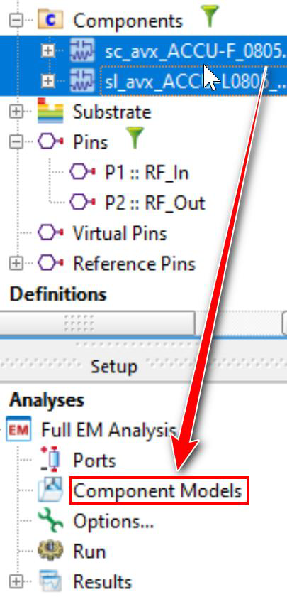

1. In the **Project** panel, open **Components** branch.

1. Select both groups of components (use Ctrl key)

1. Drag & drop the components into the **Component Models** branch (under **Full EM Analysis)**.

## Task 2: Assign ports

   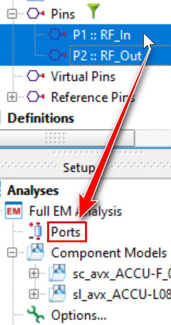

1. In the **Project** panel, open the **Pins** branch.

1. Select **P1::RF_In** and **P2::RF_Out**.

1. Drag & drop the pins into the **Ports** branch (under **Full EM Analysis).**

## Task 3: It should look like this

The Full EM Analysis Setup should now look like this one.

   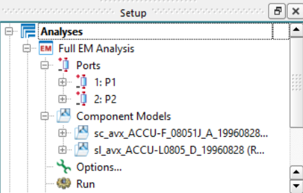

## Task 4: Create frequency plan

1. In the Setup panel, double-click on **Options**.

   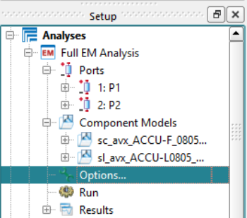

### Create Simulated Adaptive frequency plan

   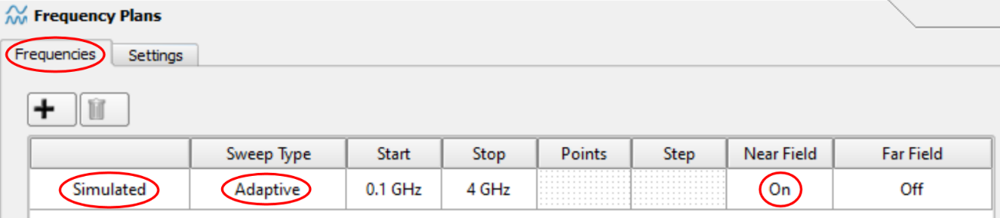

1. Set **Start** = **0.1 GHz**

1. Set **Stop** = **4 GHz**

1. Turn on **Near Field**

   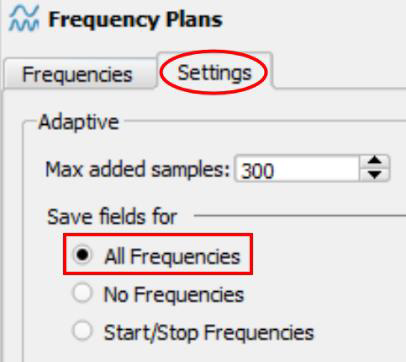

1. Go to Settings tab

1. **Save fields** for **All Frequencies.**

## Task 5: Simulator setup

   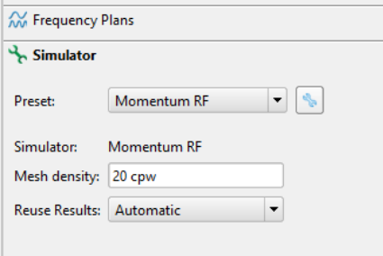

1. Click on the **Simulator** tab.

1. Choose **Momentum RF** and leave all other settings.

1. Click **Done**.

## Task 6: Run the simulation

1. Double-click the gear icon

   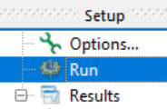

In the upcoming message, check the “**Always Save Modified Project**” box and click **Yes**.

After a couple of seconds, the analysis should be finished.

   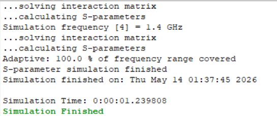

## Task 7: Investigate the created mesh cells

1. Open the **Results** branch and double-click on **Mesh/Ports**.

   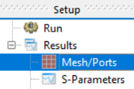

1. You can turn on **View Faces** and add the **Ports** information.

   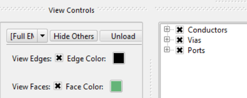

   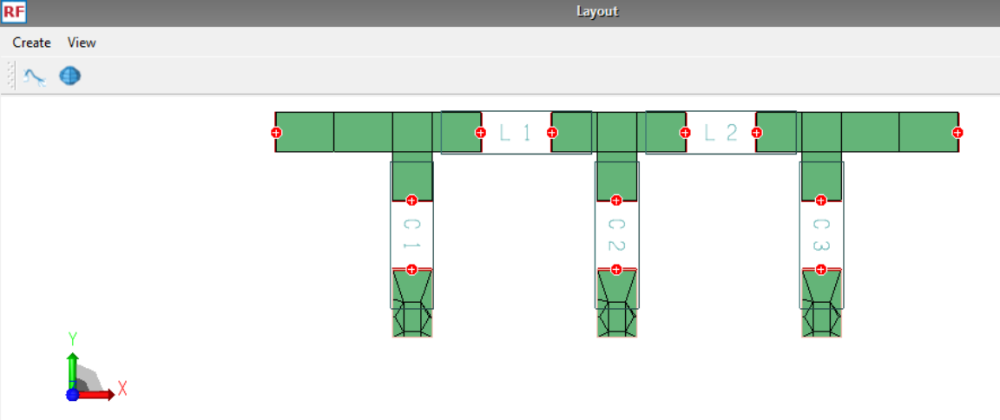

### Unload Mesh/Ports information

1. Click the **Unload** button

   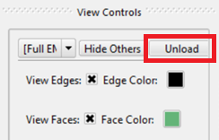

   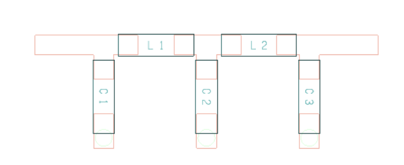

## Task 8: S-Parameters result

1. Under **Results** branch, double-click on **S-Parameters.**

   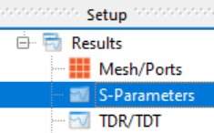

This gives us access to a 12-port dataset. This is because we have 2 ports for input and output but also 5 components, with 2-ports each.

   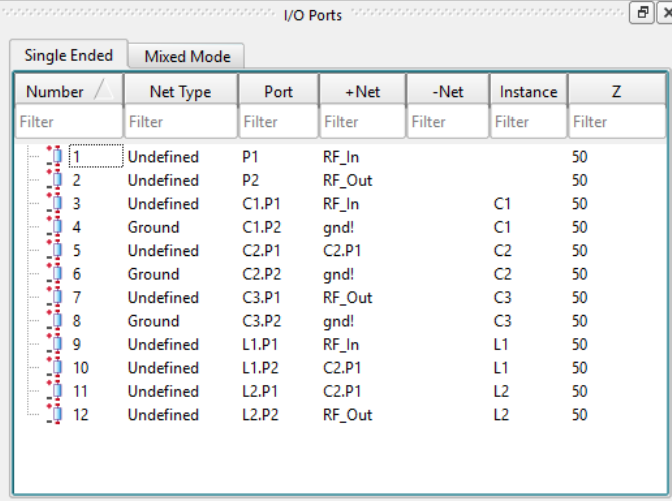

## You have successfully completed Lab 1B - Module 4.
