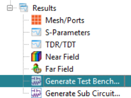
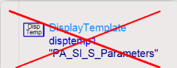
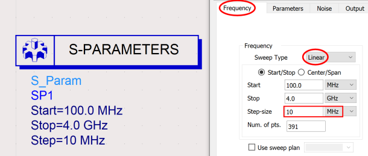
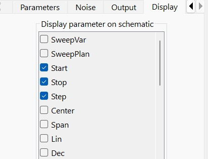
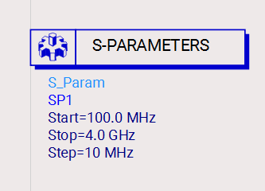
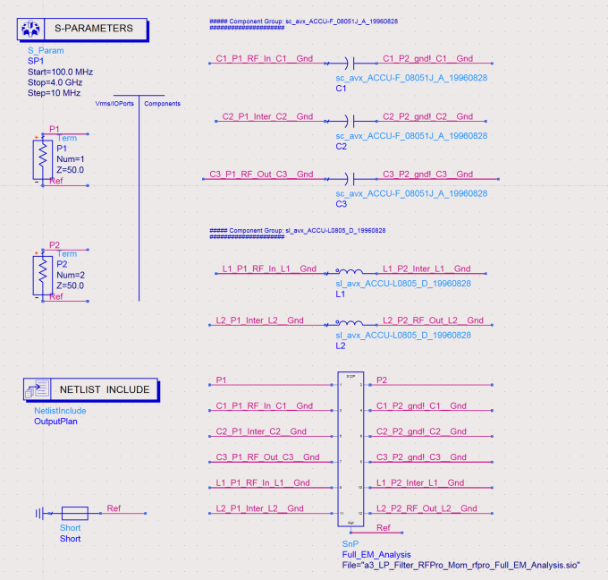
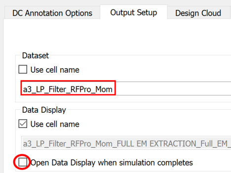
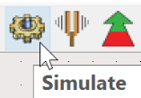
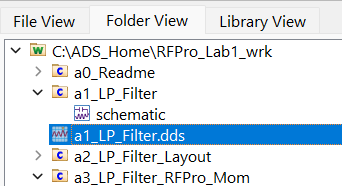
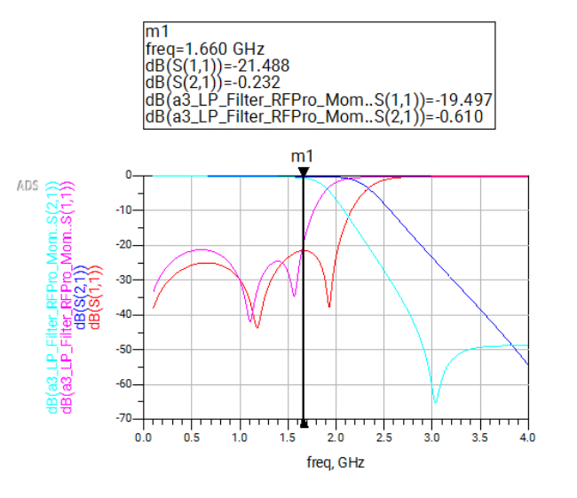

# Lab 1B - Module 5: Perform circuit-EM cosimulation

**Learning Objectives:** In this module, you will complete the following tasks:

- Overview
- Generate test bench
- Update test bench
- Run EM-circuit cosimulation
- Open data display
- Compare with initial circuit performance

This module contains the following lessons:

## Task 1: Overview

In the next steps, we will generate and export a schematic for ADS to run an EM-Circuit cosimulation to recombine the EM-simulated results with the lumped vendor component data.

## Task 2: Generate test bench

1. In the **Results** branch, double-click **Generate Test Bench**.

   

Take a moment to understand all parts of this schematic.

## Task 3: Update test bench

1. **Delete** the existing **DisplayTemplate**

   

### Linear frequency sweep setup

   

1. Double click the **S-Parameters** controller

1. Set Sweep Type = **Linear**

1. Set **Step-size** = **10 MHz**.

### Linear frequency sweep setup

   

1. Under the Display-Tab

1. Unselect the “Dec” and select “Step” instead.

1. Click **OK**

### It should look like this

   

### Your test bench should look like this

You can rearrange the items in your Test Bench if desired.

   

## Task 4: Run EM-circuit cosimulation

   

1. Go to **Simulate > Simulation Settings**

1. Uncheck "Use cell name"

1. Change Dataset name to `**a3_LP_Filter_RFPro_Mom**`

1. Uncheck “Open Data Display when simulation completes”.

1. Click **Apply**.

1. Close the window.

1. Run the simulation

   

## Task 5: Open data display

In the ADS main window, open the data display **a1_LP_Filter.dds**

   

## Task 6: Compare with initial circuit performance

1. Add the **a3_LP_Filter_RFPro_Mom** data for **dB(S(1,1))** and **dB(S(2,1))**.

As you can see the low-pass filter response has been shifted down about 17% due to the included layout effects.

   

## You have successfully completed Lab 1B.
