# Lab 1C - Module 1: Visualization of the current flow

**Learning Objectives:** In this module, you will complete the following tasks:

- Open workspace
- Open schematic
- Run AC simulation
- Near Field setup (1)
- Examine the current flow
- Get an animated current flow
- Unload the surface current density data
- Save and close all

This module contains the following lessons:

## Task 1: Open workspace

1. **Open workspace**: C:\ADS_Home\RFPro101\Lab1C\RFPro_Lab1_wrk

****

   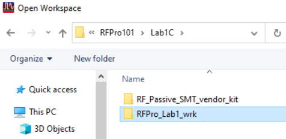

## Task 2: Open schematic

In ADS Main Window (folder view), open the schematic

   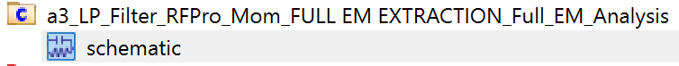

### a4_LP_Filter_RFPro_Mom_AC

Use **File > Save As** to create **`a4_LP_Filter_RFPro_Mom_AC`**

   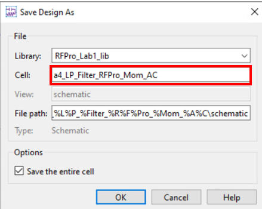

### Replace S-Parameter with an AC controller

   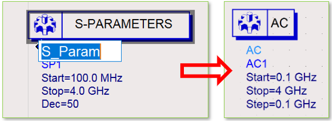

1. Replace the S-Parameter controller by an AC controller

1. Set a frequency range from **0.1 GHz up to 4 GHz** in 0.1 GHz steps.

### Edit first term to P_AC

   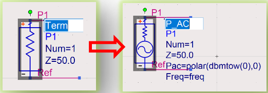

1. Edit the first Term P1 component from **Term** to **P_AC** with **0 dBm** input power

## Task 3: Run AC simulation

   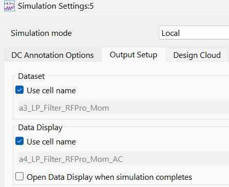

1. Under **Simulate > Simulation Settings**

1. Turn on the Dataset option **“Use cell name”**

1. **Simulate** the design.

## Task 4: Near Field setup (1)

Go back to the RFPro window.

   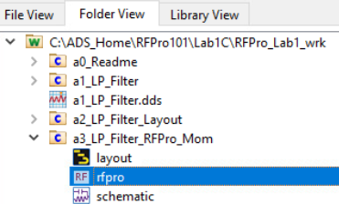

### Near Field setup (2)

In the **Setup** panel, under **Result** branch, double click on **Near Field**.

   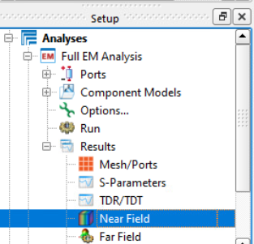

### Near Field Setup (3)

   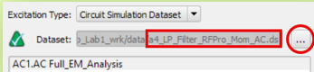

1. Set Excitation type = **Circuit Simulation Dataset**

1. Click on the button with the 3 dots.

1. Navigate to the **data** folder, choose **a4_LP_Filter_RFPro_Mom_AC.ds** .

> **Important:** The **Excitation Type** option may hide at the **right-most** side of the **View Controls** tab. Scroll the horizontal scroll bar to the right to see the option.

## Task 5: Examine the current flow

   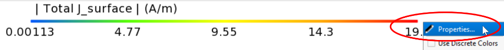

   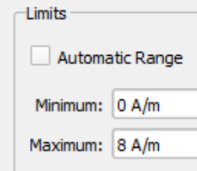

1. Right-click on the scale bar

1. Change the limits from **0 A/m to 8 A/m**

### Examine current flow

Now you can see the current flow **@ 100 MHz** as it would be under real operating conditions including the effect of the components.

   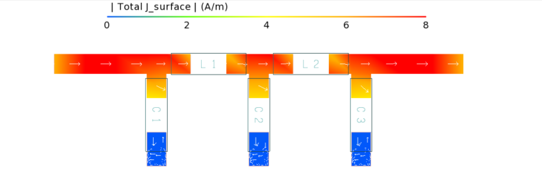

In setup tab, change the Frequency to **1400 MHz** (**passband**) and **4000 MHz** (**stopband**) respectively to investigate the expected current flow behavior.

   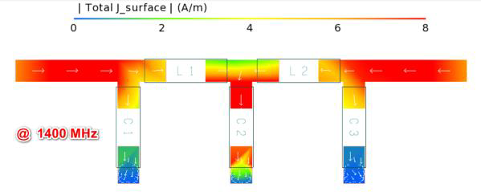

   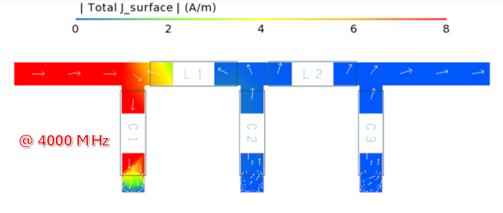

> **Important:** The current flow might vary due to the layout arrangement of a3_LP_Filter_RFPro_Mom.

Change **Frequency** back to **1400 MHz** (**pass-band**)

   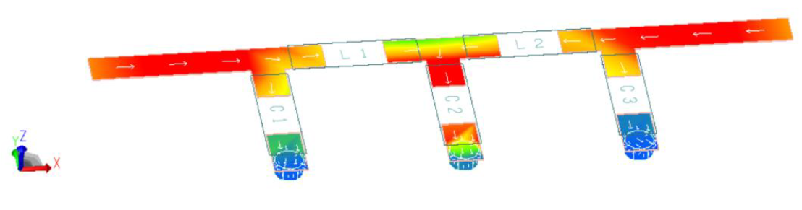

## Task 6: Get an animated current flow

   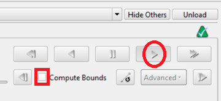

1. Go to the **Sequence** tab

1. **Uncheck** the box "**Compute Bounds**"

1. Select the **Play** button.

## Task 7: Unload the surface current density data

   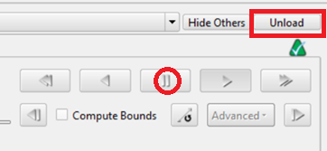

1. **Pause** the animation.

1. Unload the Surface Current Density data.

## Task 8: Save and close all

Finally **save** and **close** all your open windows (**File > Close All**).

   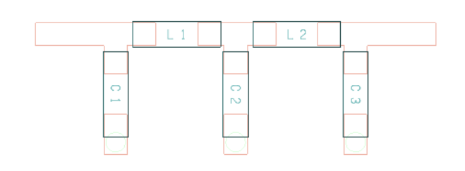

## You have successfully completed Lab 1C - Module 1.
