# Lab 1C - Module 2: Optimizing the final low-pass filter

**Learning Objectives:** In this module, you will complete the following tasks:

- Create new cell
- Add optimization controller and goal
- Simulation settings
- Launch optimizer
- Update the design
- Simulate the optimized design
- Open data display
- Compare with initial circuit response
- Check the optimized value
- Compare with initial component values

In this module, you will optimize in the next step the vendor components to get back the initial low-pass filter response @ 2 GHz cut-off frequency.

This module contains the following lessons:

## Task 1: Create new cell

In ADS Main Window (folder view), open the schematic

   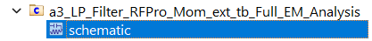

Use **File > Save As** to create **`a5_LP_Filter_Opt`**

   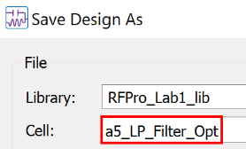

## Task 2: Add optimization controller and goal

1. In ADS Main Window, open schematic **`a1_LP_Filter.`**

   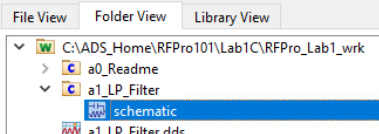

1. Copy the **Optimization** controller and the two **Goal** instances.

1. Paste (right click > paste) them into the **`a5_LP_Filter_Opt`** schematic.

Your **`a5_LP_Filter_Opt`** schematic should look like this:

   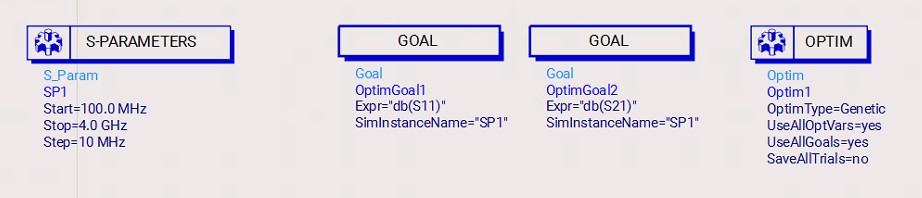

### Number of iterations

   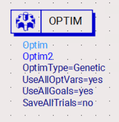

   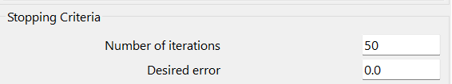

1. Increase the **Number of iterations** to **50** in the Optimization controller.

1. Click OK

## Task 3: Simulation settings

   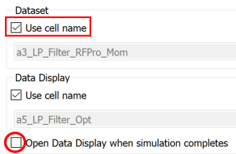

1. Go to the menu **Simulate > Simulation Settings**

1. **Turn on** Dataset option “Use cell name”

1. **Turn off** "Open Data Display when simulation completes"

1. **Apply**

1. Close the window.

> **Important:** **Don’t simulate.**

## Task 4: Launch optimizer

1. Click the **Optimize** icon

   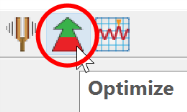

## Task 5: Update the design

1. Watch the progress

1. **Update the Design** after optimization is complete

   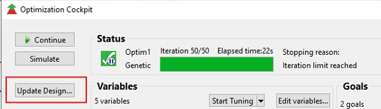

   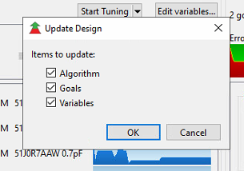

## Task 6: Simulate the optimized design

1. **Close** the Optimization cockpit

1. Click **Simulate**

   

## Task 7: Open data display

In the ADS main window, open the data display a1_LP_Filter.dds

   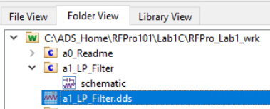

## Task 8: Compare with initial circuit response

1. **Delete** the **a3_LP_Filter_RFPro_Mom** data

1. **Add** the **a5_LP_Filter_Opt** data for **dB(S(1,1))** and **dB(S(2,1))**

1. Move the Line Marker to 2 GHz.

As you can see the low-pass filter response looks similar to the original pure circuit design but includes now all layout effects.

   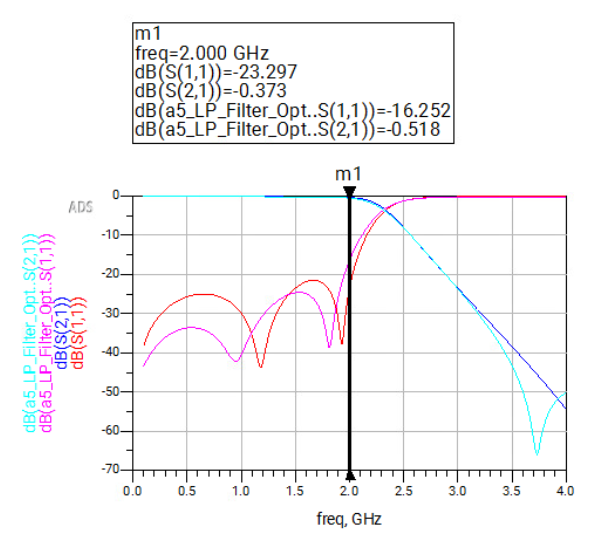

## Task 9: Check the optimized value

1. At the `**a5_LP_Filter_Opt**` schematic, double-click on C1 capacitor

In the Edit Instance Parameters tab, the capacitor value has been updated to the optimized value **0.7pF**

Check the optimized value of other components by double-click on them.

   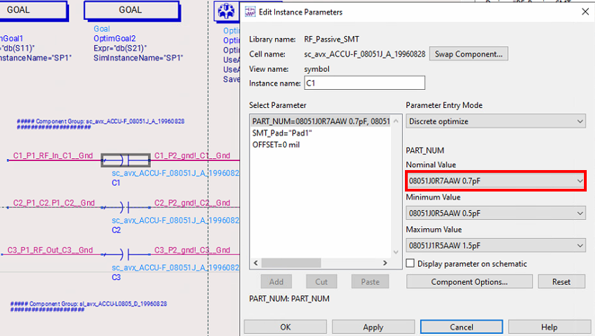

## Task 10: Compare with initial component values

If you compare the optimized components' values with the initial components' values of schematic **`a1_LP_Filter`**, you will see that all parameters have been lowered.

**Note: your optimized values (font in red) can deviate a bit**.

   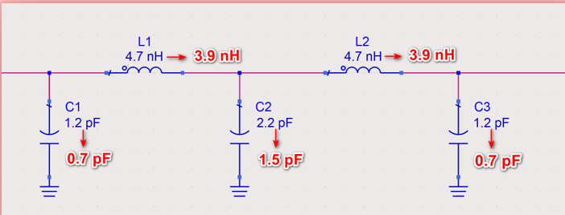

## You have successfully completed Lab 1C.
