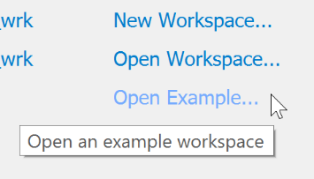
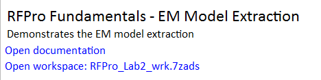
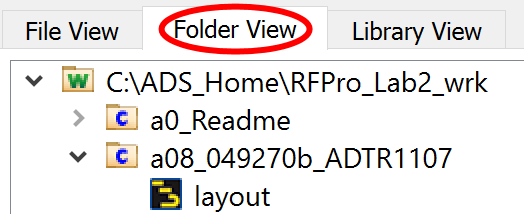
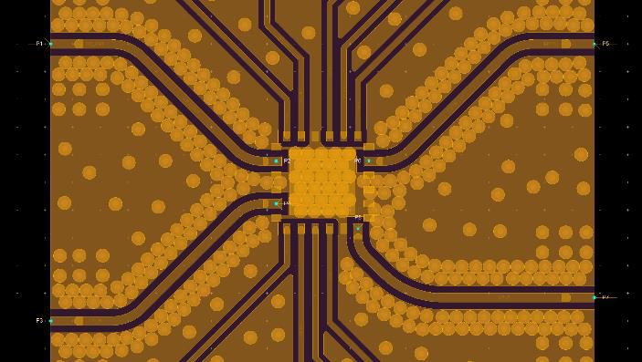
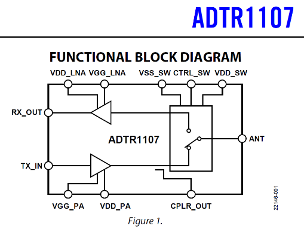
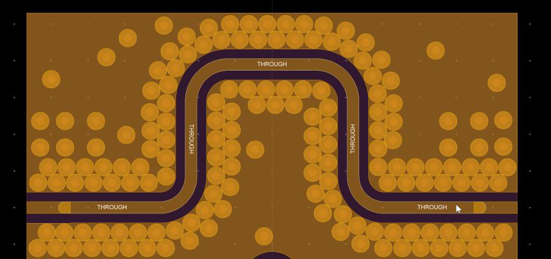
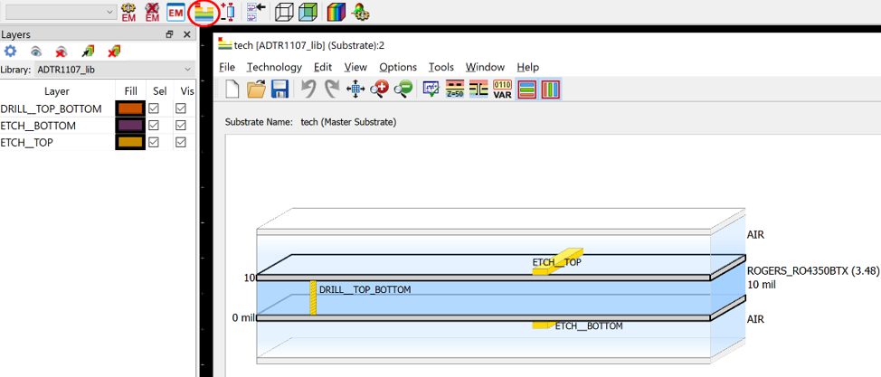
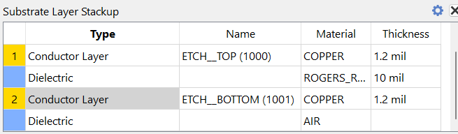

# Lab 2A - Module 1: Investigating the evaluation board

**Learning Objectives:** In this module, you will complete the following tasks:

- Load workspace
- Open a08*ADTR1107 layout
- Feed lines
- Through line
- Check the layer definition

This module contains the following lessons:

## Task 1: Load workspace

   

   

1. Click **Open Example**

1. Navigate to **Training Examples** and then **RFPro**.

1. Open workspace: **RFPro_Lab2_wrk.7zads**.

1. Set Destination path: C:\ADS_Home

1. Click **Finish**.

## Task 2: Open a08*ADTR1107 layout

**Open** the **a08*ADTR1107 layout** view.

   

## Task 3: Feed lines

   

Have a closer look to the feed lines in the middle, which connect the front-end IC, consisting of an integrated power amplifier (PA), low noise amplifier (LNA), and a reflective single-pole double-throw (SPDT) switch.

> **Note:** For theses feed lines you’ll extract an EM Model to determine their influence on the given board design.

   

## Task 4: Through line

   

On the top of the layout there is also a control **Through Line** used for calibration.

> **Note:** Here you’ll investigate the impact of **process variations** like Underetching or substrate parameter deviations.

## Task 5: Check the layer definition

1. Click on the **Substrate Editor** icon  .

1. Accept the upcoming message with OK.

   

Note that the thickness (1.2 mil) of the **ETCH*-layers** will be taken into account.

   

**Close** the window.

## You have successfully completed Lab 2A - Module 1.
