# Lab 2A - Module 2: EM analysis of a feed line using single-ended ports

**Learning Objectives:** In this module, you will complete the following tasks:

- Launch RFPro
- Change visibility for conductors
- Identify nets
- Setting up THROUGH net as signal
- Create virtual pins
- Create SE_Ports analysis
- Define an Adaptive Frequency Plan
- Simulator setup
- Run the simulation
- S-Parameter result

This module contains the following lessons:

## Task 1: Launch RFPro

1. Use **Tools > RFPro > New**

   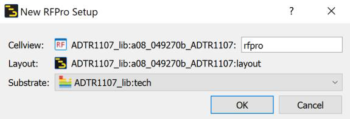

## Task 2: Change visibility for conductors

   

1. Change the **Visibility** for the Conductors to **Wireframe**.

## Task 3: Identify nets

   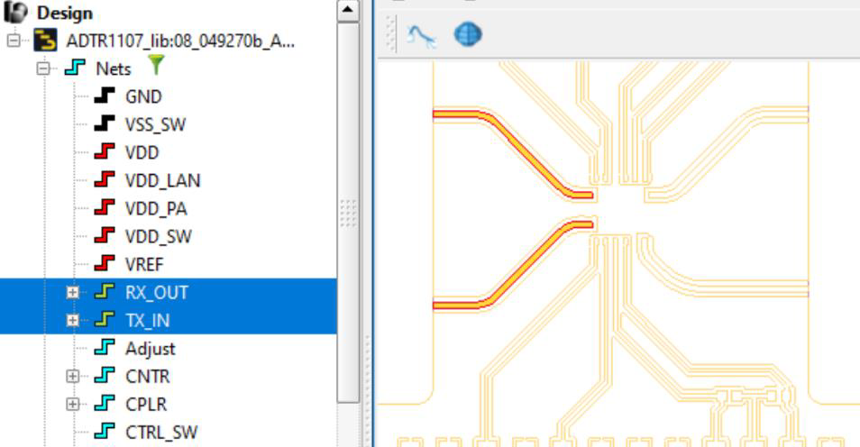

1. In the **Project** panel, open the layout branch, then **Nets.**

1. Click on **RX_OUT** and **TX_IN** to identify the signal nets (yellow).

1. Select other nets like **Power** (red) or **Ground** (black).

1. There are also nets that have not been assigned to a signal/ground/power role and are labeled as **Undefined** (turquoise).

## Task 4: Setting up THROUGH net as signal

Right-click on the **THROUGH** net and **Set as Signal**.

   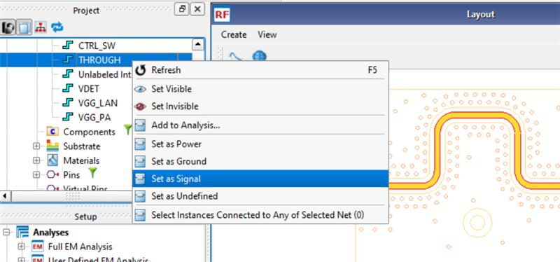

### It should look like this

   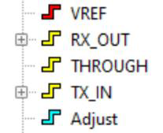

## Task 5: Create virtual pins

1. Open the **Pins** branch.

You’ll find the predefined 8 pins from the layout.

   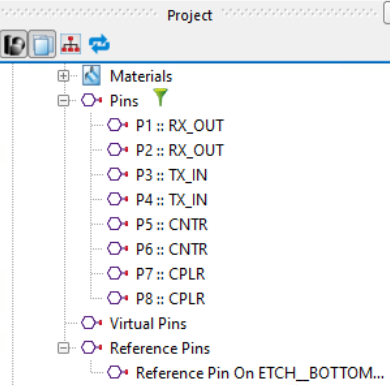

There are also an empty **Virtual Pins** branch.

A **Reference Pins** branch assigned to the **ETCH_BOTTOM** ground layer (see Port Editor definitions made in the layout).

For the **User Defined EM Analysis**, we’ll add our own Virtual Pins instead of using the Reference Pins.

   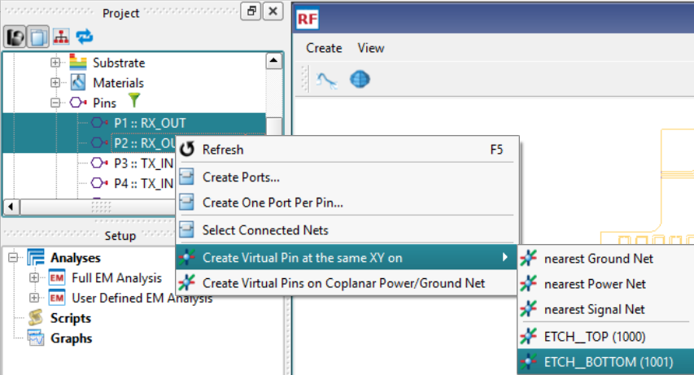

1. Select the pins **P1** and **P2** (Ctrl-key).

1. Right-click and create **Virtual Pins at the same XY** on the **ETCH_BOTTOM** layer.

### Rename VPin

   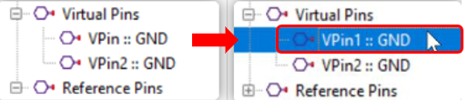

1. Rename (F2) the first virtual pin to **VPin1**

## Task 6: Create SE_Ports analysis

   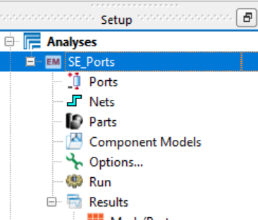

1. In the **Setup** panel, **delete** the branch Full EM Analysis.

1. Rename the User Defined EM Analysis to **SE_Ports**.

### Assign ports

   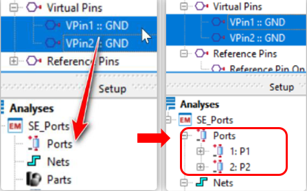

1. Drag & drop the two virtual pins that you just created into the **Ports** branch

### It should look like this

   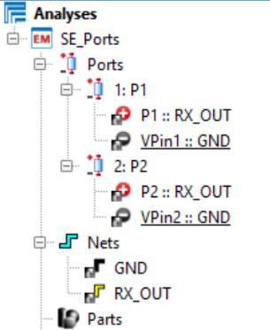

Note that the associated signal pins and nets are automatically added to the analysis.

### Update ports properties

   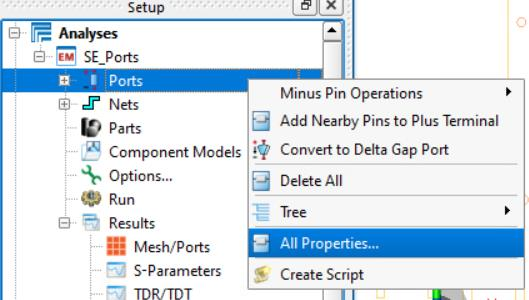

1. Right-click on **Ports > All Properties**

   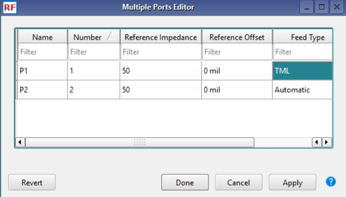

1. Change the **Feed Type** for **P1** to **TML**.

1. Click **Done**.

## Task 7: Define an Adaptive Frequency Plan

1. Double-click on **Options.**

   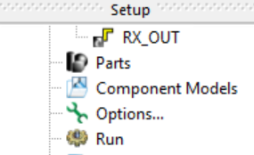

   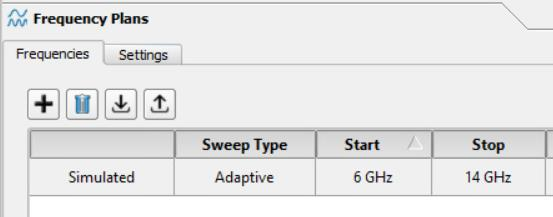

1. Set transmit frequency range from **6 GHz to 14 GHz**

## Task 8: Simulator setup

   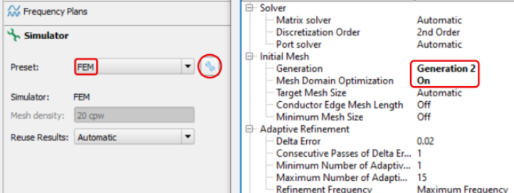

1. Go to Simulator tab

1. Choose **Simulator =** **FEM**

1. Pick the **Generation 2** mesh generator

1. **Turn on** the **Mesh Domain Optimization**.

1. Click **Done** twice.

## Task 9: Run the simulation

Double-click on **Run** to start the analysis.

   

After about one minute the simulation should be finished.

   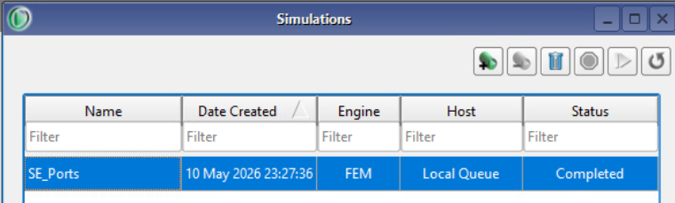

## Task 10: S-Parameter result

1. Double-click **S-Parameters** in the **Results** branch.

   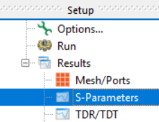

1. In the **Matrix Selector** window, select first **S(2,1)** only.

   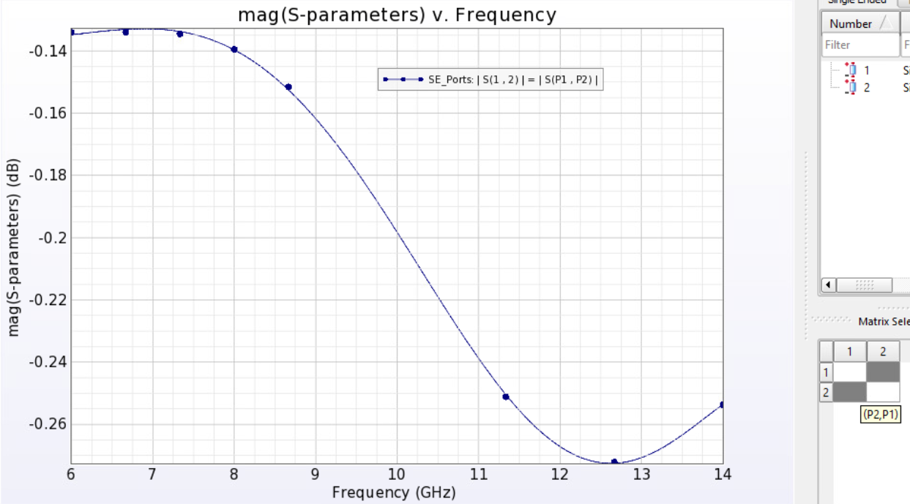

1. Add **S(1,1)**

   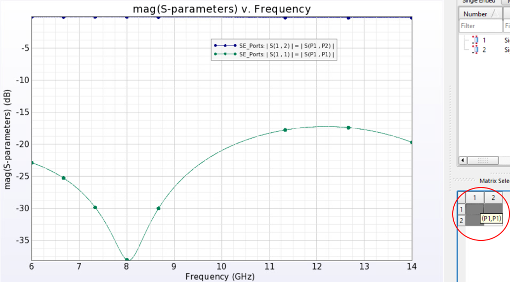

> **Note:** The results show a good matched feed line with an average insertion loss of 0.2 dB and return loss higher than 16 dB.

### Close the results

Close the results and simulation windows.

## You have successfully completed Lab 2A - Module 2.
