# Lab 2A - Module 3: EM analysis of a feed line using coplanar waveguide ports

**Learning Objectives:** In this module, you will complete the following tasks:

- Overview
- Create CPW_Ports analysis
- TX_IN signal line
- Create virtual pins
- Setting up symmetric CPW ports
- Run the simulation
- Compare result

This module contains the following lessons:

## Task 1: Overview

In the next steps, we investigate the feed line by applying coplanar waveguide ports, which can be directly compared with the single ended ports.

## Task 2: Create CPW_Ports analysis

**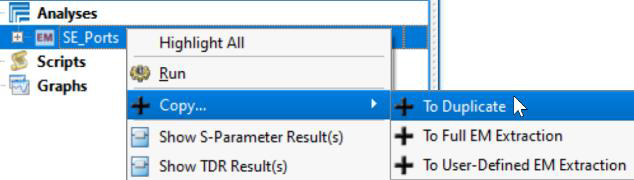**

1. Right-click on the **SE_Ports** analysis branch and **Copy > To Duplicate**.

**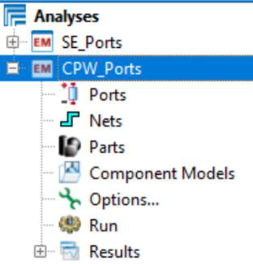**

1. Rename the new analysis to **CPW_Ports**.

1. **Delete** all the **Ports** and **Nets** defined before.

## Task 3: TX_IN signal line

   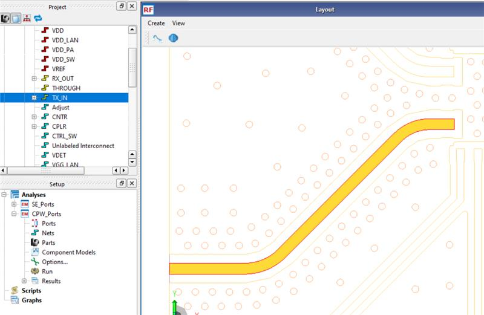

> **Note:** We’ll use the TX_IN signal line to set the CPW ports. This is an identical/symmetrical line and so we can compare both results directly in RFPro.

## Task 4: Create virtual pins

   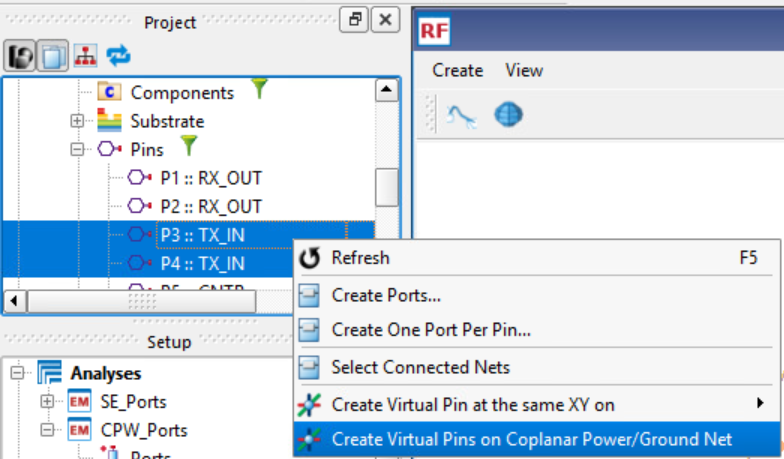

1. In the **Project** panel, under the **Pins** branch, select **P3** and **P4**

1. Right-click and choose **Create Virtual Pins** **on Coplanar Power/Ground Net**.

### Virtual pins have been created

   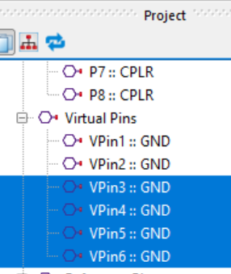

### Delete the default ref pin

   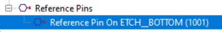

1. **Delete** the default **Reference Pins** on ETCH_BOTTOM.

## Task 5: Setting up symmetric CPW ports

| 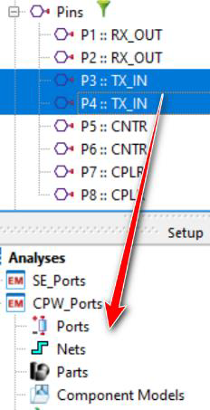 | 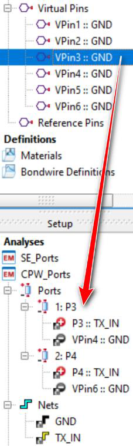 | 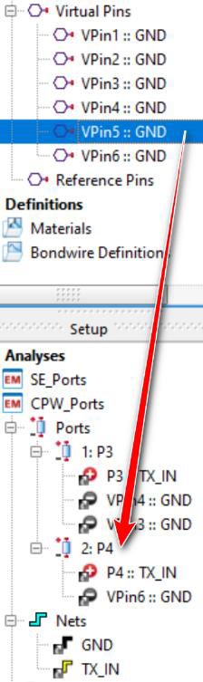 |
|---|---|---|

1. Drag & drop the Pins **P3** and **P4** into the **Ports** branch.

> **Note:** The associated nets are added automatically to the analysis. However, just one virtual pin has been added to each Port.

1. Select the missing second virtual pin for P3, which is **VPin3 (or VPin4)** and drag & drop it into the **P3** ports branch.

1. Drag & drop **VPin5 (or VPin6)** into the **P4** ports branch.

### Symmetric CPW ports has been setup

   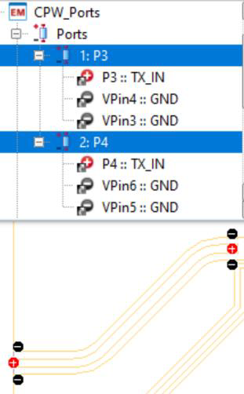

> **Note:** Two symmetric CPW ports should now be set up on the net TX_IN.

## Task 6: Run the simulation

Because the **Options** settings have been copied from the previous analysis, we can **Run** the new simulation immediately.

   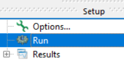

After about one and a half minute the analysis should be finished.

   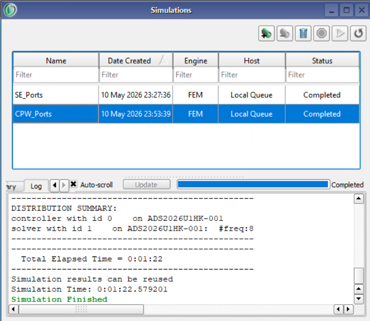

## Task 7: Compare result

   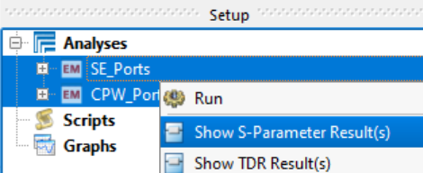

1. Select both analyses, right-click and chose **Show S-Parameter Results**.

1. In the Model Filter (below Matrix Selector), check the **CPW_Ports** box

1. In the Matrix Selector, select **S(1,1)**

1. Rescale the Y-Axis or change the color as you like using the **Graph Properties** icon.

The input reflection of the feed line using the CPW ports is similar to the single ended ports.

   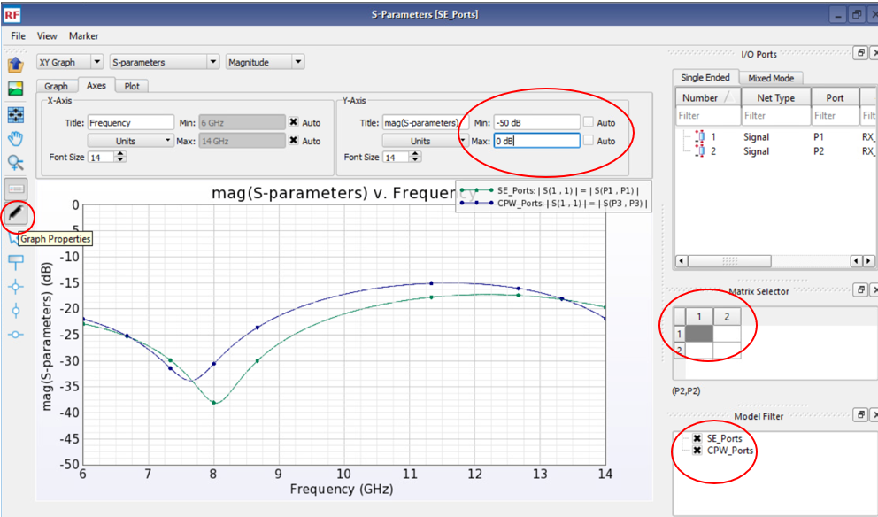

1. Select the **S(2,1)** results and edit the graph as you wish.

As expected, the insertion loss is about the same by using the CPW ports excitation.

   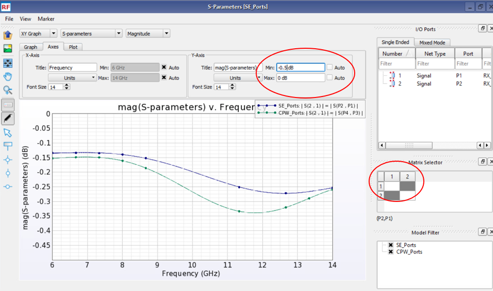

### Save your work

**Save** your work.

## You have successfully completed Lab 2A - Module 3.
