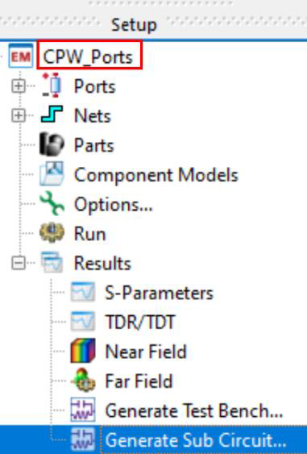
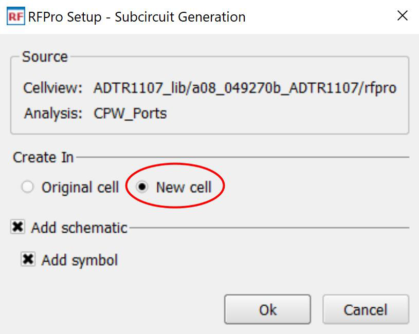
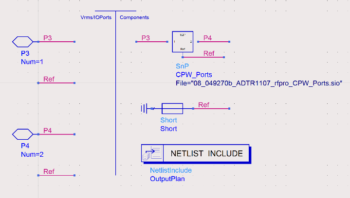
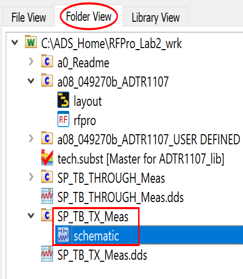
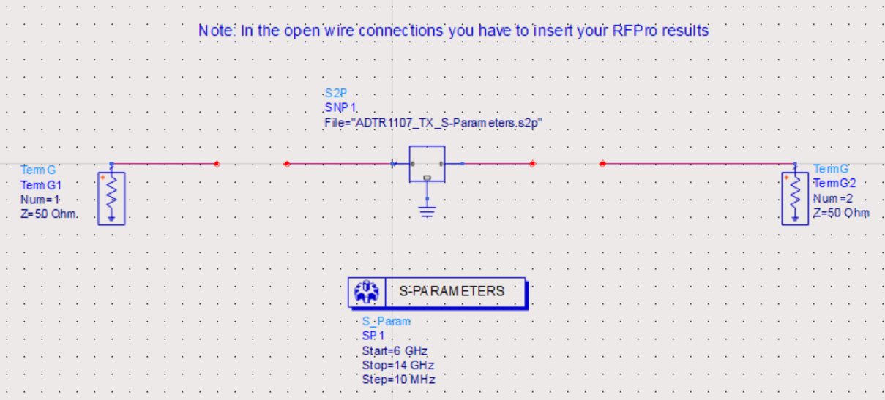
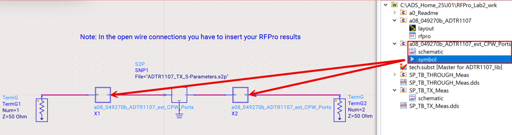
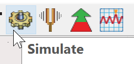
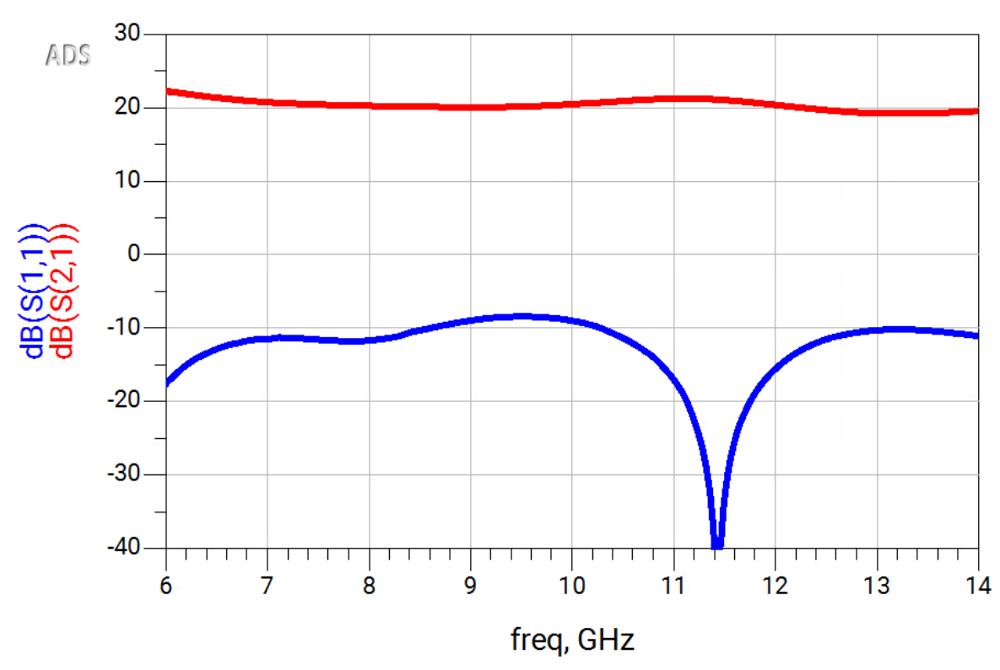

# Lab 2A - Module 4: Generating a subcircuit for ADS

**Learning Objectives:** In this module, you will complete the following tasks:

- Overview
- Generate sub circuit
- Open SP_TB_TX_Meas
- Assign subcircuit into schematic
- Run the simulation
- Examine the data display

This module contains the following lessons:

## Task 1: Overview

For further simulations in ADS, we’ll generate a subcircuit which contains the RFPro results.

## Task 2: Generate sub circuit

1. In setup panel, double-click on **Generate Sub Circuit**

   

1. Choose Create In **New cell**

1. Click **OK**

   

Have a short look at the new sub circuit before closing it.

   

## Task 3: Open SP_TB_TX_Meas

In the ADS Main window, open the schematic view of the cell **`SP_TB_TX_Meas`**which contains the measurement data of the front-end ADTR1107 IC (the transmit state).

   

   

## Task 4: Assign subcircuit into schematic

   

1. **Drag & drop** the generated **`a08_*_CPW_Ports`** subcircuit into the open wire connections to include the input/output lines.

1. Make sure that all components are connected properly.

## Task 5: Run the simulation

Simulate the entire design.

   

## Task 6: Examine the data display

The automatically created Data Display shows an almost flat gain of more than 20 dB over the entire frequency range for the transmit state.

   

### Save your work

**Save** your work

## You have successfully completed Lab 2A.
