# Lab 2B - Module 1: Investigating process variations of Through line

**Learning Objectives:** In this module, you will complete the following tasks:

- Open workspace
- Open RFPro
- Create Through_Line analysis
- Create Through_Line_Underetching analysis
- Create Through_Line_Underertching_Er analysis

This module contains the following lessons:

## Task 1: Open workspace

1. **Open workspace**: C:\ADS_Home\RFPro101\Lab2B\RFPro_Lab2_wrk

****

   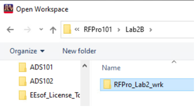

## Task 2: Open RFPro

   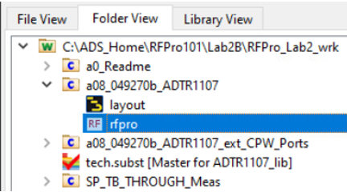

### Change visibility for conductor

   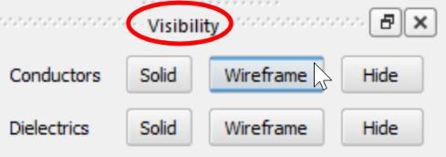

1. Change the **Visibility** for the Conductors to **Wireframe**.

## Task 3: Create Through_Line analysis

   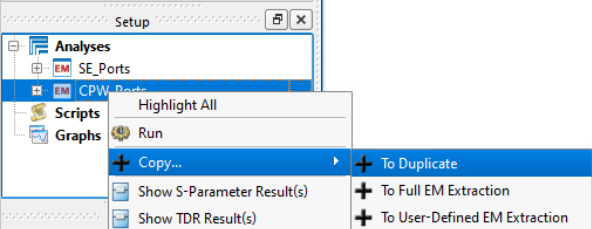

1. In the Setup panel, right-click the **CPW_Ports** analysis branch and **Copy > To Duplicate**.

   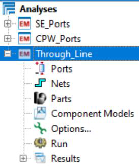

1. **Rename** the new branch to **Through_Line**.

1. **Delete** the **Ports** and **Nets**.

### Define the first CPW port

   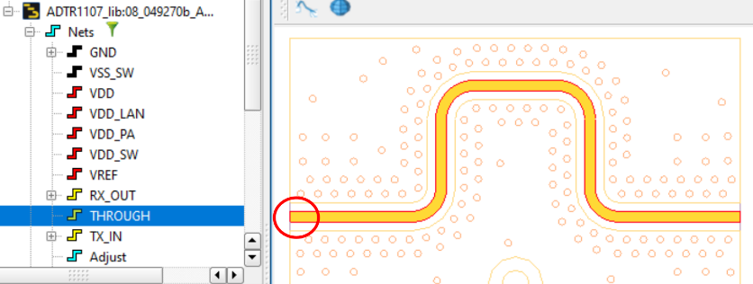

1. In the **Nets** branch of the **Project** panel, select the **THROUGH** net to get it highlighted in the geometry window.

1. Zoom in 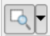 to the left side where we want to define the first **CPW port**.

### Create virtual pin

   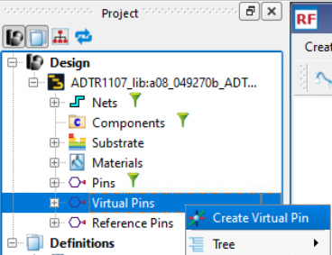

1. Right-click on the **Virtual Pins** branch. Select **Create Virtual Pin**.

### Create virtual pin

   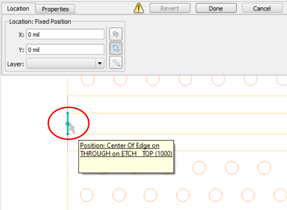

   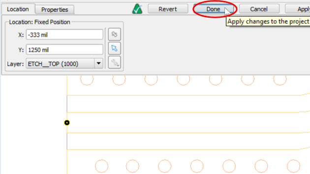

1. Position the mouse pointer at the edge center of the THROUGH line.

1. Left-click to create the pin

1. Click the Done button.

### New virtual pin created

In the **Virtual Pins** branch identify the new **VPin7**

   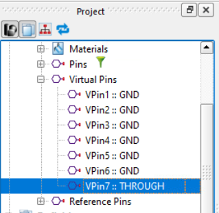

### Create virtual pins on Coplanar Power/Ground Net

Right-click the new **Vpin7** and **Create Virtual Pins on Coplanar Power/Ground Net**.

   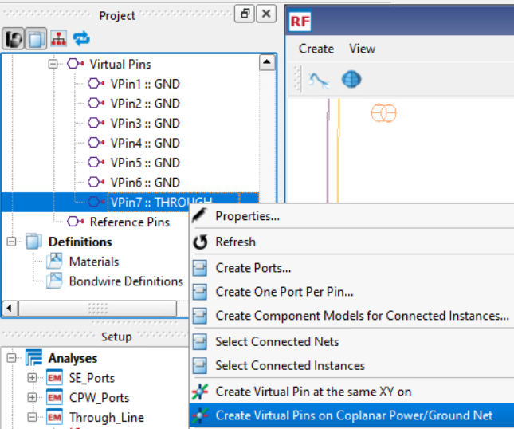

### Two new virtual pins are created

   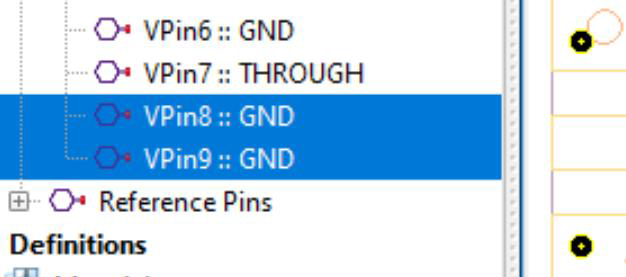

Two new virtual pins are created automatically.

### Repeat previous steps for second CPW port

Repeat the previous steps, by creating another **Virtual Pin** and the related **Coplanar** **Ground Net** for the **second CPW port** at the right side of the THROUGH line.

   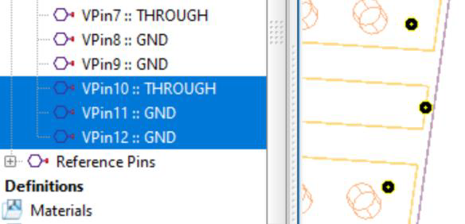

Note: Sometimes it helps to take a perspective geometry view instead of a top view to select the edge of the ETCH_TOP layer.

### Delete the reference pins

   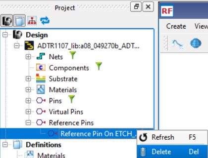

1. **Delete** the default **Reference Pins** on ETCH_BOTTOM.

### Setting up symmetric CPW ports (1)

| 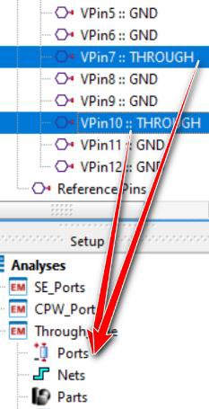 | 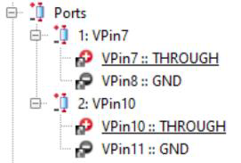 |
|---|---|

1. Drag & drop **VPin7** and **VPin10** into the **Ports** branch

As before, just one reference pin will be automatically assigned to each port.

### Setting up symmetric CPW ports (2)

   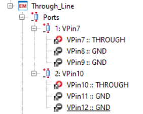

1. Drag & drop the missing reference pins **VPin9** (or **VPin8**) to port 1

1. Drag & drop **VPin12** (or **VPin11**) to port 2

### Setting up symmetric CPW ports (3)

   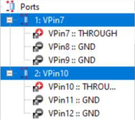

   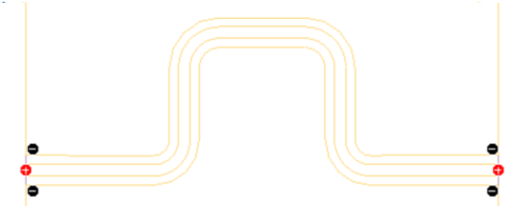

### Setting up symmetric CPW ports (4)

   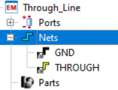

Note that the needed nets THROUGH and GND have been added to the analysis too.

### Run the analysis

Double-click **Run**

   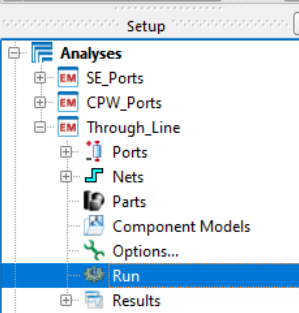

After about two minutes, the analysis should be finished.

   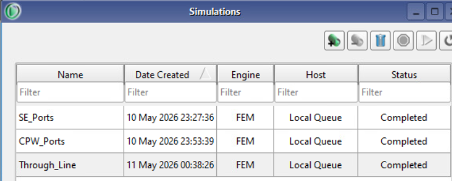

### Show S-Parameter result

1. Double-click on **S-Parameters** in the **Results** branch

   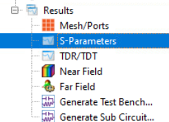

### Show S-Parameter result

1. Plot the through path **S(2,1)**.

1. Rescale the graph as desired. 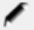

The insertion loss is around 0.34 dB@10 GHz.

   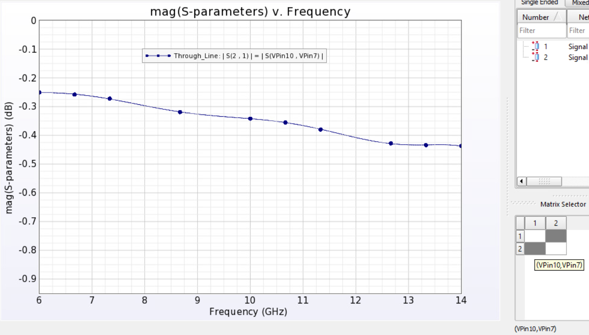

### Show S-Parameter result

1. Add **S(1,1)**.

The return loss is higher than 22 dB over the entire frequency range.

   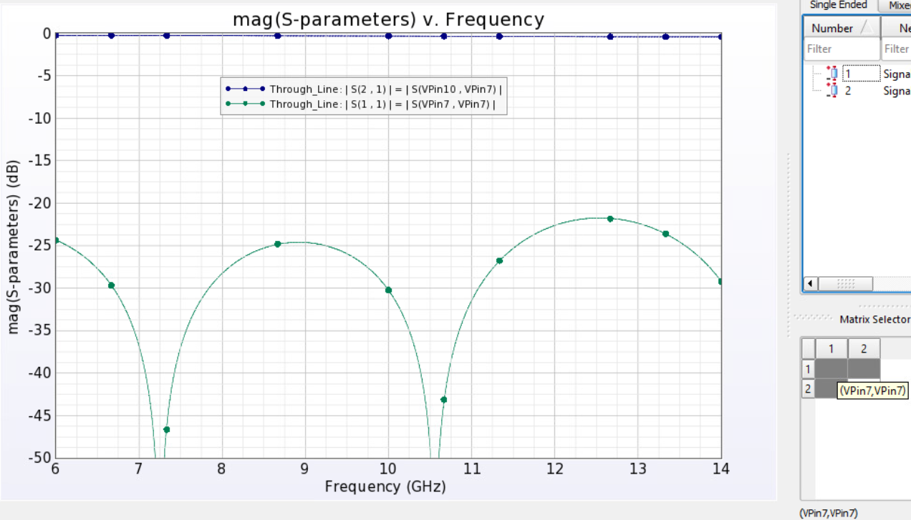

## Task 4: Create Through_Line_Underetching analysis

   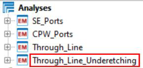

1. Right-click **Through_Line** branch and **Copy > To Duplicate**.

1. Rename the new branch to **Through_Line_Underetching**

### Add process variation: etch bias

   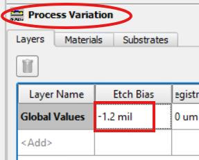

1. Expand **Through_Line_Underetching** branch

1. Double-click **Options**

1. Select **Process Variation.**

1. Enter an **Etch Bias** of -**1.2 mil**.

1. Click **Done**

### etch bias

   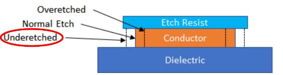

Note that a **negative value** simulates the effect of **underetching**, which grows the conductor width. The original line **width** is **16 mil** and the **gap** size is **13.1 mil**, which corresponds to an impedance of **56 Ohm**.

The Underetching grows the **width** to **18.4 mil** (16 mil + (2 x 1.2 mil)) and reduces the **gap** size to **10.7 mil** (13.1 mil – (2 x 1.2 mil)), which corresponds to **52.5 Ohm**.

### Run the analysis

Click **Run** the analysis.

   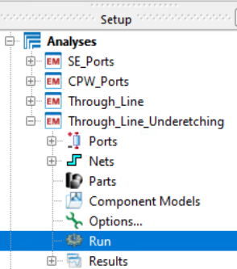

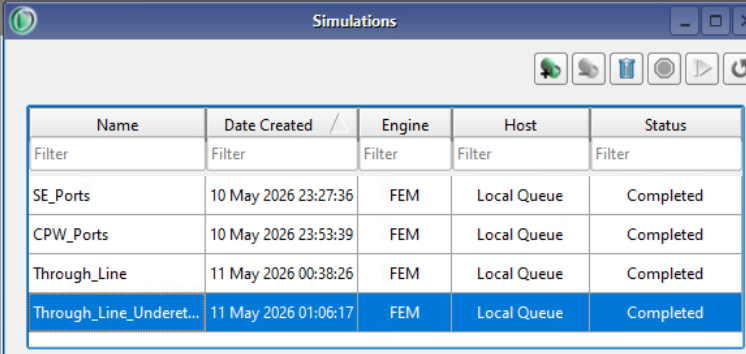

### Compare results of etch bias variation

Select the last two analyses. Right-click **Show S-Parameter Result(s)**.

   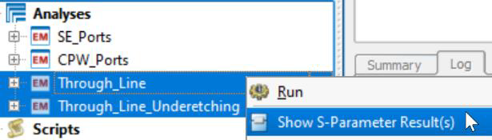

### Compare results of etch bias variation

> **Note:** As we can see the insertion loss has increased over the entire frequency band and the return loss has been degraded but is still acceptable.

   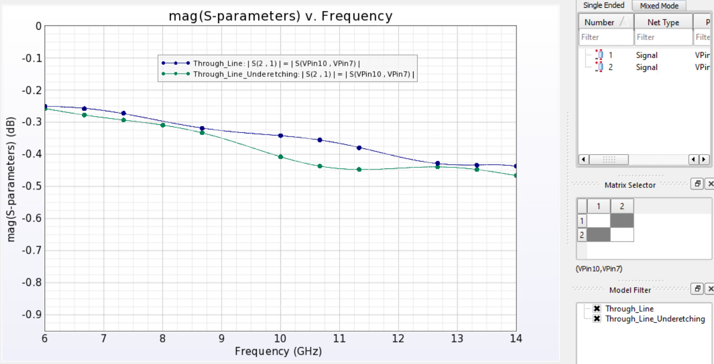

   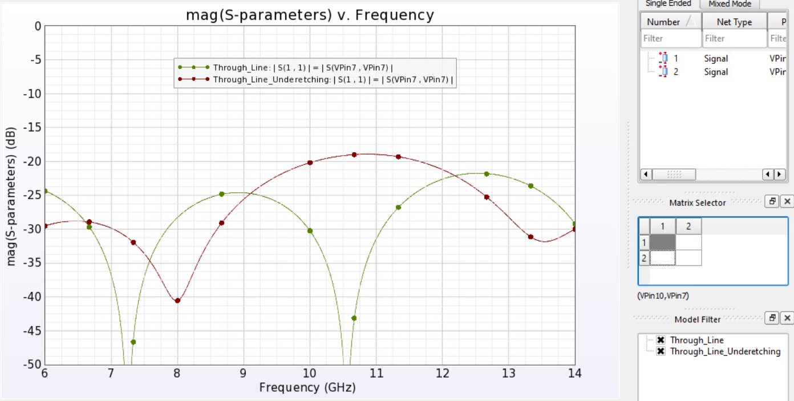

## Task 5: Create Through_Line_Underertching_Er analysis

   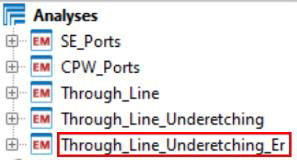

1. Right click the **Through_Line_Underetching** branch and **Copy > To Duplicate**.

1. Rename the new branch to **Through_Line_Underertching_Er**.

### Add process variation: permittivity bias

1. Expand **Through_Line_Underertching_Er** branch

1. Double-click **Options**

   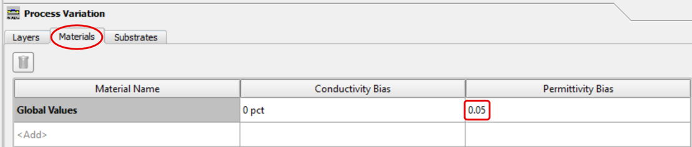

1. Select **Process Variation.**

1. Select **Materials** tab

1. Enter a **Permittivity** **Bias** of absolute **0.05** ( ***not*** percent!).

1. Click **Done**

According to the datasheet the max tolerance for the dielectric constant is just 3.48+/- 0.05.

   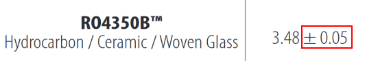

### Run the analysis

Click **Run** the analysis.

   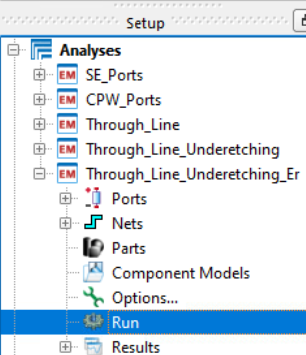

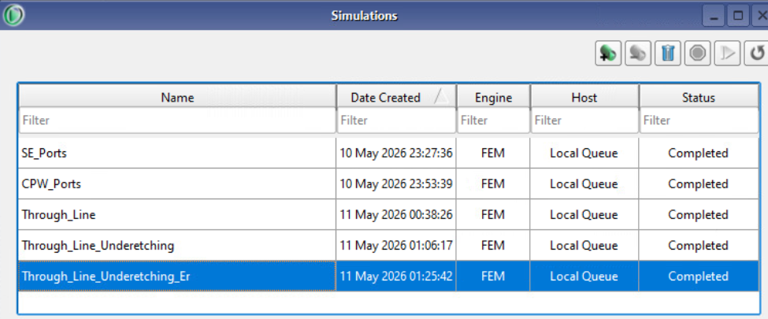

### Compare results of permittivity bias

Select the last two analyses. Right-click **Show S-Parameter Result(s)**.

   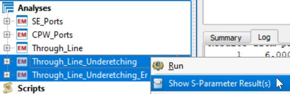

### Compare results of permittivity bias

> **Note:** The results are again almost identical, showing that the given permittivity variation has no significant impact on the performance.

   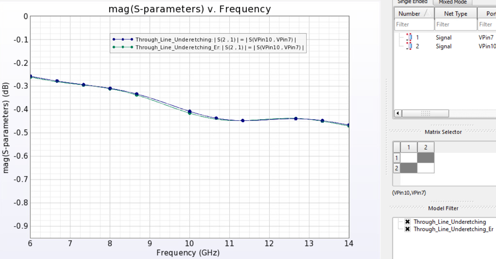

   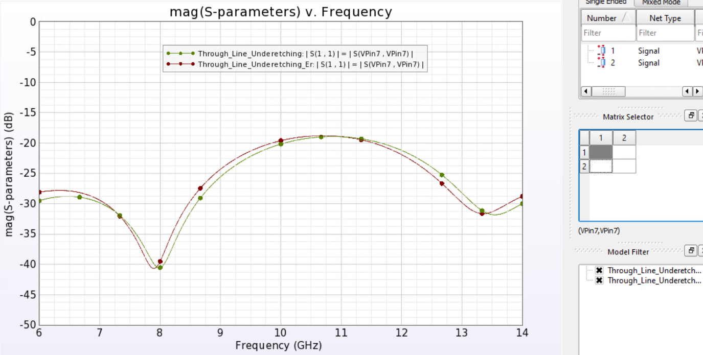

## You have successfully completed Lab 2B - Module 1.
