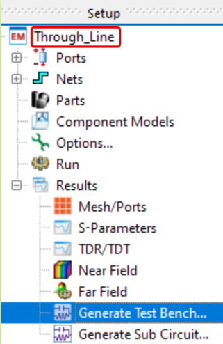
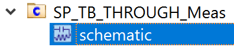
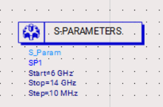
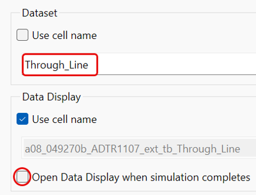
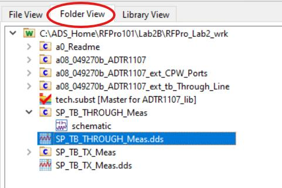
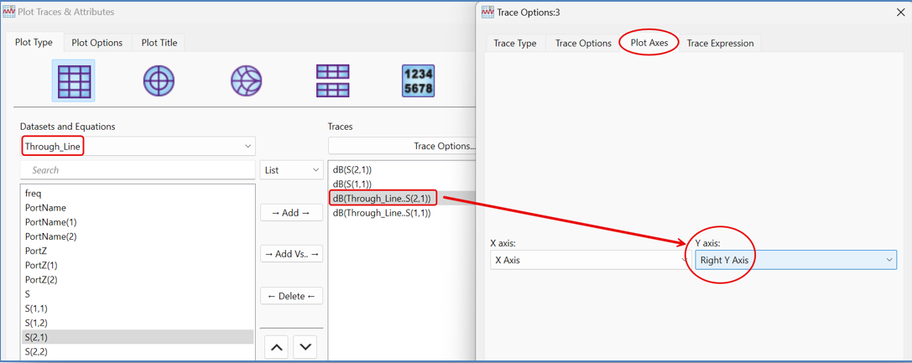
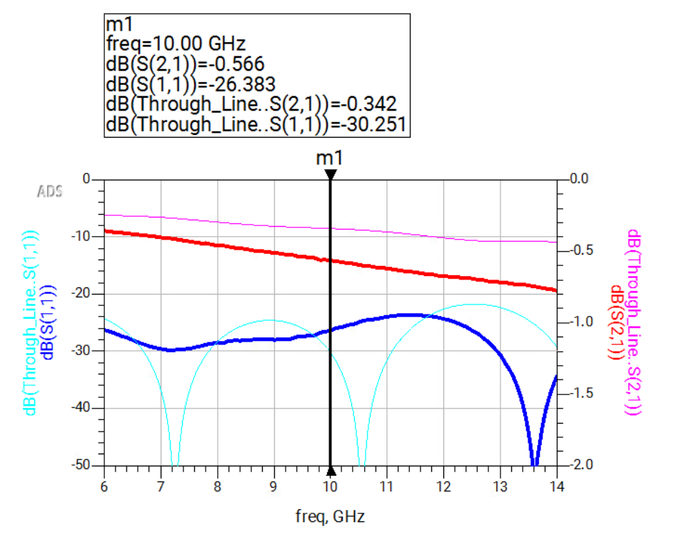

# Lab 2B - Module 2: Compare simulated results with measured data

**Learning Objectives:** In this module, you will complete the following tasks:

- Generate test bench
- Insert SP controller into test bench
- Run the simulation
- Inspect measured data from the THROUGH line
- Add simulated dataset to the plot
- Compare simulated results with measured data

This module contains the following lessons:

## Task 1: Generate test bench

   

1. In the **Through_Line > Results** branch, double-click on **Generate Test Bench**

1. In the schematic view that opens, **delete** the **Display Template** and the **S-Parameter** controller.

## Task 2: Insert SP controller into test bench

1. In the ADS main window, open the schematic of the cell **SP_TB_THROUGH_Meas**.

   

Note this design contains already the measured Thru-Data provided by Analog Devices.

1. **Copy/paste** the **S-Parameter** controller into the new **Test Bench**

   

## Task 3: Run the simulation

   

1. Go to **Simulate > Simulation Settings**

1. Set **Dataset Name** = **Through_Line**.

1. Uncheck the *Open Data Display …* flag.

1. Click on **Simulate**.

## Task 4: Inspect measured data from the THROUGH line

In the ADS Main window, open the **SP_TB_THROUGH_Meas.dds** to inspect the measured data from the through line. Note the different scaling for the Y-axles.

   

## Task 5: Add simulated dataset to the plot

   

1. **Double-click** the plot.

1. Choose the **Through_Line** dataset. Add **dB(S(2,1))** and **dB(S(1,1))**.

1. Double-click the **dB(Through_Line..S(2,1))** entry

1. Select **Plot Axes** tab.

1. Pick **Right Y Axis**.

1. Click OK twice.

## Task 6: Compare simulated results with measured data

   

> **Note:** The measurements show a higher insertion loss despite a similar return loss.

> **Note:** This extra loss could be caused by the SMA connectors, which are included into the measurement.

## You have successfully completed Lab 2B.
