# Lab 3A - Module 1: Unarchiving the workspace and examining the libraries

**Learning Objectives:** In this module, you will complete the following tasks:

- Load workspace
- Library view
- Board_lib
- LTCC_lib

## Task 1: Load workspace

   

   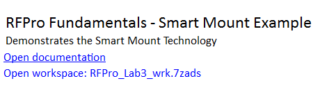

1. Click **Open Example**

1. Navigate to **Training Examples** and then **RFPro**.

1. Open the workspace **RFPro_ Lab3_wrk.7zads**

1. Set Destination path: C:\ADS_Home

1. Click **Finish**.

## Task 2: Library view

After closing the Readme schematic, select the **Library View.** Take a look at the different libraries, which we’ll use for this lab.

   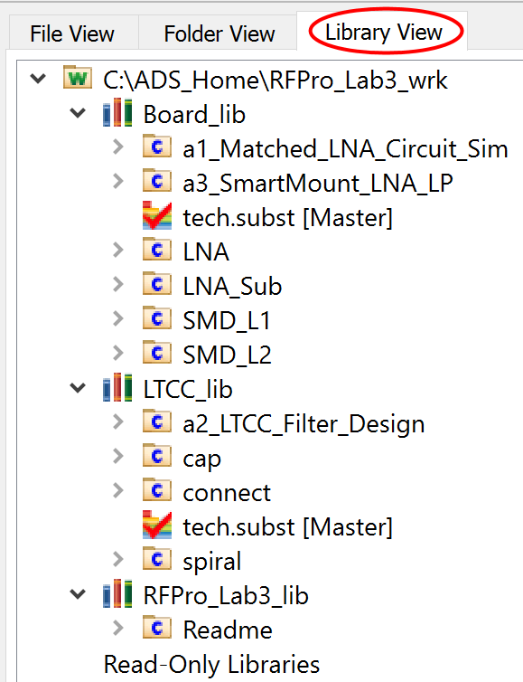

## Task 3: Board_lib

The **Board_lib** contains cells for the **LNA**-design including the **SMD**-components.

   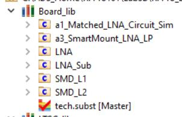

1. Open the substrate definition **tech.subst**, read the upcoming message, click OK.

   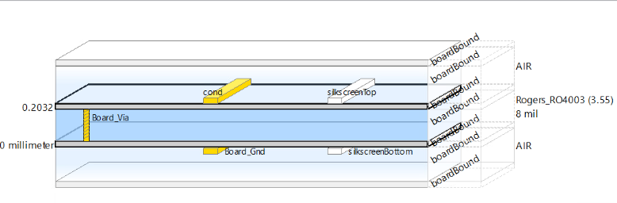

1. Open in the ADS Main Window > Options > Technology > **Technology Setup** > Referenced Libraries.

   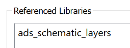

   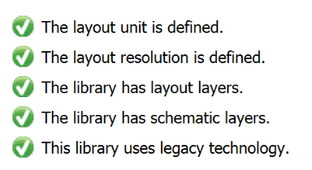

> **Note:** Note that just the *ads_schematic_layers* are referenced although checkmarks for the layout exist too.

Click on *Layout Units* tab to find the used units (**millimeter**) and resolution information.

Click on **Show Other Technology Tabs > Layers**

   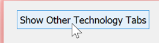

Try to arrange the Substrate and the Layers windows side by side to see which layers are used later in the simulation.

   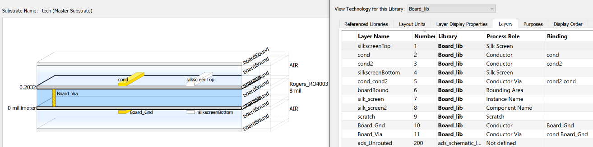

> **Note:** Note that a **`boardBound`**layer will be used to limit the substrate.

Close all windows.

## Task 4: LTCC_lib

The **LTCC_lib** includes the sub designs (**cap,connect and spiral**) and the final **LTCC_Filter_Design**, which we’ll mount later on the Circuit-Board.

   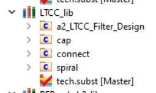

1. Open up the substrate definition **tech.subst**, read the upcoming message, click OK.

   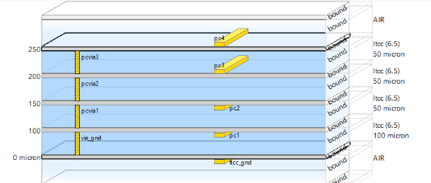

1. Open in the ADS Main Window > Options > Technology > **Technology Setup** > Referenced Libraries.

   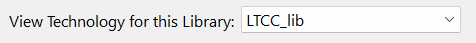

   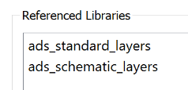

Click on the Layout Units tab to find the used units are in **micron**.

Scroll down in the Layers table to find that almost all layers are defined by the **ads_standard_layers** but some directly in the **LTCC_lib**. Physical Connectivity is set through Layer Bindings.

   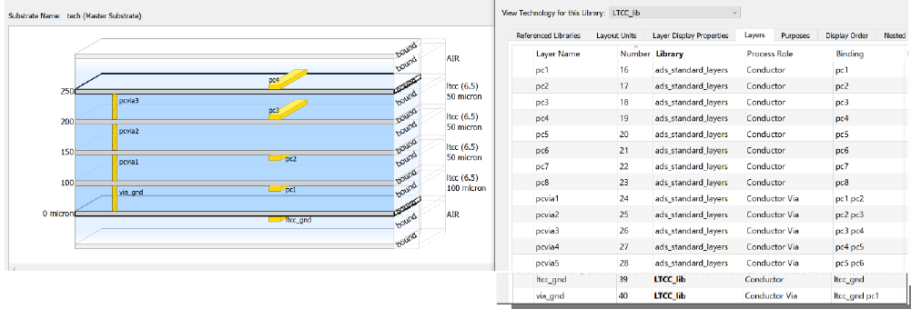

Close all windows.

## You have successfully completed Lab 3A - Module 1.
