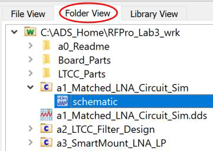
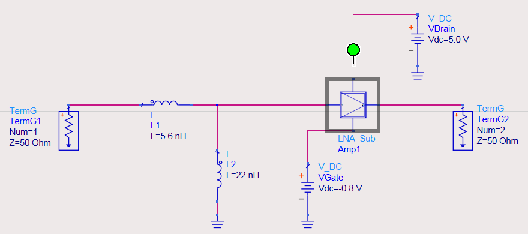
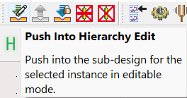
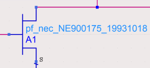
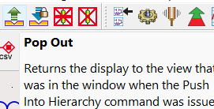
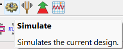
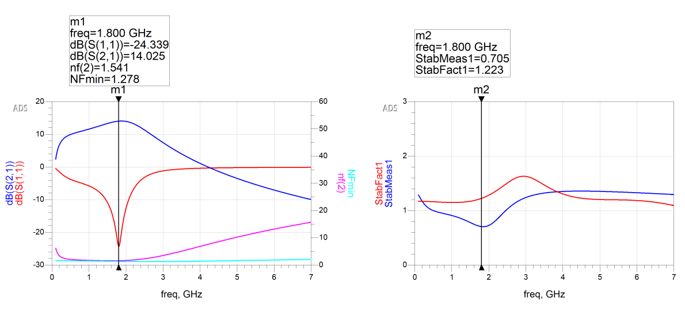

# Lab 3A - Module 2: Circuit simulation of the matched LNA

**Learning Objectives:** In this module, you will complete the following tasks:

- Matched LNA Design
- Simulate the design
- Inspect the data display results

By now you should have a good idea about the different technologies used by the libraries and we can start with the design steps.

## Task 1: Matched LNA Design

Change to **Folder View**, open the schematic of the cell **`a1_Matched_LNA_Circuit_Sim`**.

   

   

> **Note:** Notice the two inductors used as matching network.

### LNA_Sub design

1. Push into the **LNA_Sub** design.

   

You see that a NEC GaAS-MESFET model has been used for the LNA

   

   

### Pop out

Pop out of the LNA_Sub design.

   

## Task 2: Simulate the design

Click the gear icon

   

## Task 3: Inspect the data display results

   

> **Note:** As you can see the LNA has been matched for an operation at 1.8 GHz having a gain of about 14 dB and a Noise Figure of about 1.5 dB.

> **Note:** In addition, the StabMeas (positive) and StabFact ( > 1) prove the sufficient conditions for unconditional stability of the amplifier.

### Close all windows

Close all windows.

## You have successfully completed Lab 3A - Module 2.
