# Lab 3A - Module 3: FEM simulation of the LTCC-filter

**Learning Objectives:** In this module, you will complete the following tasks:

- LTCC filter design
- Generate and update layout
- Add ground layer and confine substrate
- Assign ports to ground layer
- Create RFPro view
- Change component role to layout
- Create ports
- Frequency plans setup
- FEM Simulator
- Run the analysis
- Inspect the Insertion loss

## Task 1: LTCC filter design

Open the schematic view of the cell **`a2_LTCC_Filter_Design`**.

   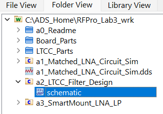

   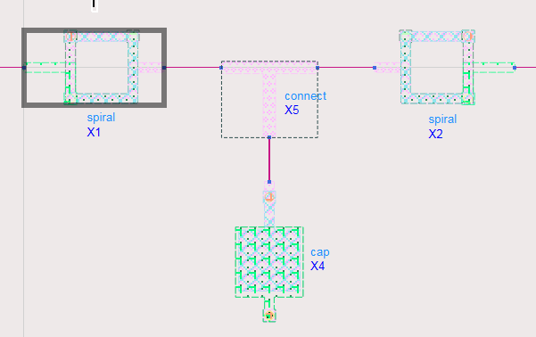

1. Push into the symbols of the **spiral**, **connect** and **cap** 

Quickly check the layout representations, from which the LTCC filter has been made of. Use the hot key “3” to get a 3D View.

   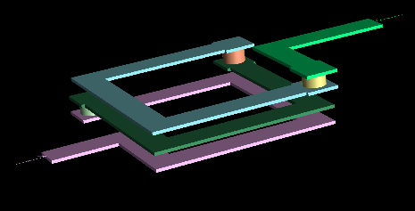

   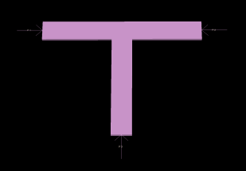

   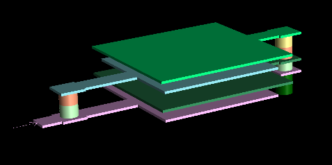

This modular approach allows the designer to optimize each component for a specific inductance/capacitance and combine them as needed.

Close the layouts.

## Task 2: Generate and update layout

1. Back in the **`a2_LTCC_Filter_Design`** schematic

1. Use the command **Layout > Generate/Update Layout** to Sync the entire design.

   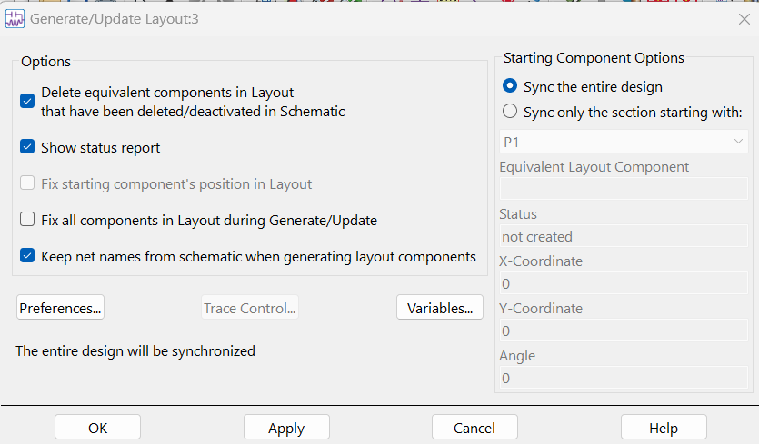

### Check the connections

Use the 3D View (3) to check the proper connections of all parts.

   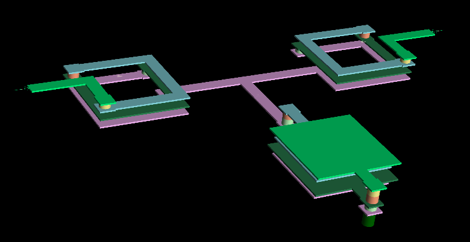

Press “2” to come back in the 2D View.

   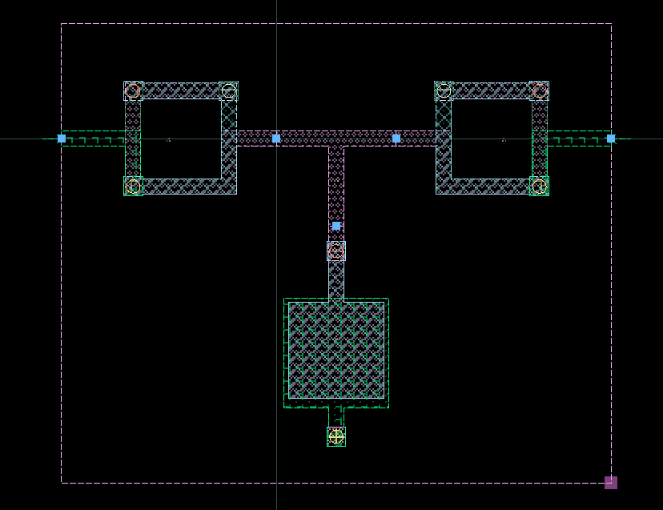

## Task 3: Add ground layer and confine substrate

1. Select **`ltcc_gnd`** as insert layer.

1. Click Insert Rectangle icon

1. Click **Insert > Coordinate Entry.** Enter the following coordinates:

   - **Lower left**: (X: -1125, Y: -1800), **Apply.**

   - **Upper right**: (X: 1750, Y: 600), **OK.**

   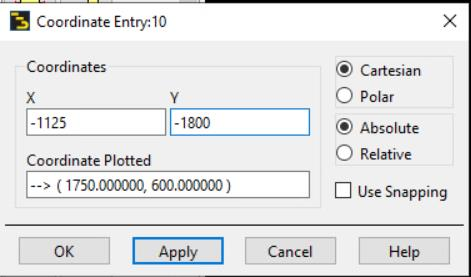

   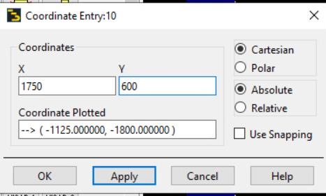

   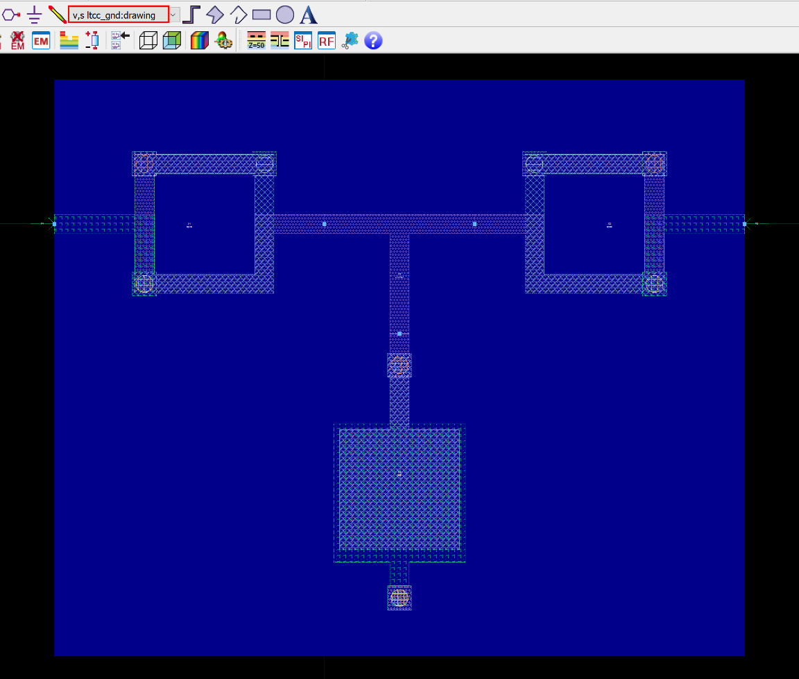

1. Select the **`bound` (not bond!)** as insert layer

1. Draw a rectangle directly over the ground layer.

1. Use the 3D-View (3) to check the proper drawing and return with “2”.

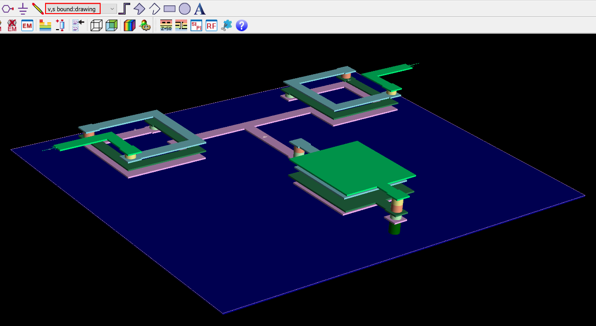

### Set Origin

To simplify the positioning of the LTCC-filter on the board later on, we will set the origin to the lower left corner of the ground plane by the command **Edit > Modify > Set Origin**.

   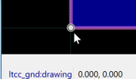

## Task 4: Assign ports to ground layer

   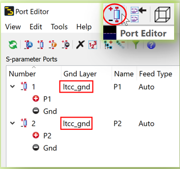

1. Open the Port Editor (Port Editor icon or **EM > Port Editor**)

1. Assign **`ltcc_gnd`** as Gnd Layer for both ports.

1. **Save** your layout.

## Task 5: Create RFPro view

   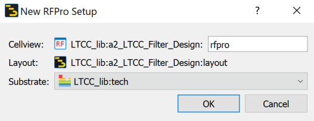

1. Use **Tools > RFPro > New**.

1. Click OK

## Task 6: Change component role to layout

1. In the **Project** panel, under the **Components** branch, select **cap** and **connect**

1. Right-click and **Change Component Role > To Layout.**

   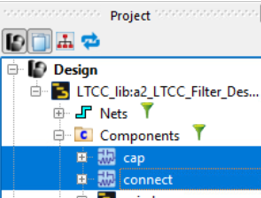

   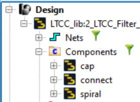

## Task 7: Create ports

Next, select **both Pins** and right click to **Create Ports** for **Full EM Analysis**

   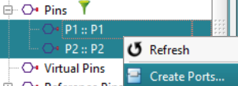

   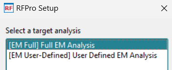

### Setup a full EM analysis

   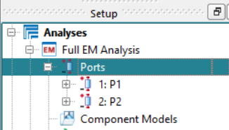

   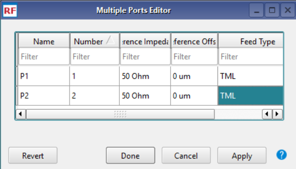

1. Right-click on the **Ports** branch and select **All Properties** to open the Ports Editor.

1. Change the **Feed Type** for both ports to **TML**.

1. Click **Done**.

## Task 8: Frequency plans setup

1. Double-click on **Options**

   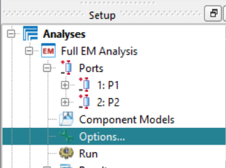

1. Add the **Frequency Plans** as shown here.

   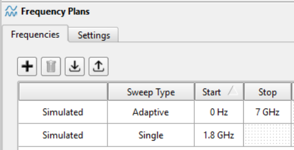

## Task 9: FEM Simulator

   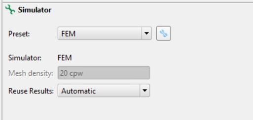

1. Make sure that the **FEM** simulator has been selected, leave all default settings

1. Click **Done**.

## Task 10: Run the analysis

**Run** the analysis.

   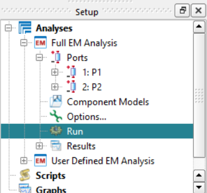

In about 40 seconds the simulation should be finished.

&lt;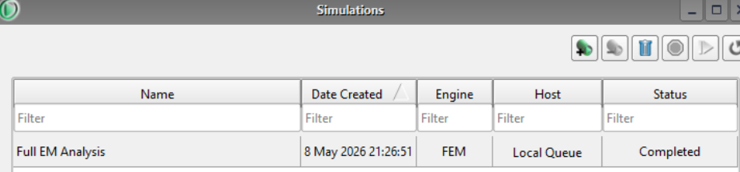

## Task 11: Inspect the Insertion loss

1. In the Results branch, double-click **S-Parameters**.

   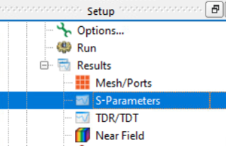

### Inspect the Insertion loss at 1.8 GHz

1. Select S21 and S11 in the **Matrix Selector** panel

1. Use the **Crosshairs Tool** to inspect the insertion loss at 1.8 GHz.

The purpose of this low-pass filter is also to reduce the harmonics of the LNA.

   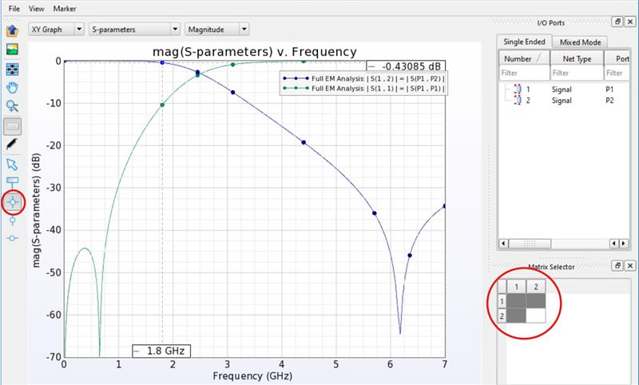

### Save and close

**Save** your work and close RFPro and all open windows.

## You have successfully completed Lab 3A - Module 3.
