# Lab 3A - Module 4: Creating the smart mount design

**Learning Objectives:** In this module, you will complete the following tasks:

- Overview
- Multi-technology setup
- Define Smart Mount Technology options
- Open layout
- Mount LTCC-filter on PCB
- Create a schematic view (1)
- Add bond wires
- Assign ports to ground layer

## Task 1: Overview

So far, we have simulated the LNA and the LTCC-Filter individually and have a good idea about the initial performance. In the next steps we are going to mount both parts on a printed circuit board (PCB) und run a combined EM-simulation.

We have to define the Smart Mount Technology options in the LTCC-Library first before we can mount the LTCC-filter on the PCB.

## Task 2: Multi-technology setup

1. In the ADS Main window, click **Options > Technology >** **Multi-Technology**.

   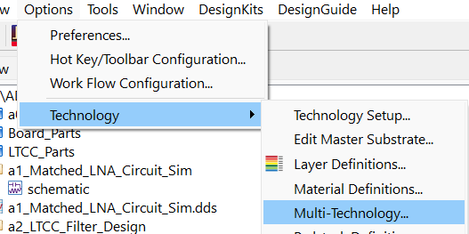

## Task 3: Define Smart Mount Technology options

   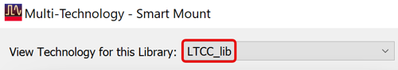

   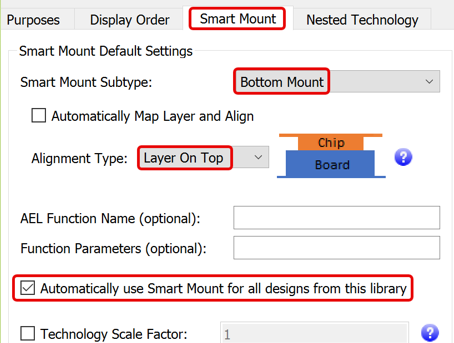

1. Select **LTCC_lib**.

1. Set **Smart Mount Subtype** = **Bottom Mount**

1. **Uncheck** Automatically Map Layer and Align

1. Set **Alignment Type** = **Layer On Top**

1. Click **OK**

These settings apply to any layout located in the library. However, you can override it in any layout view individually ( *File > Customize Pcell* ).

## Task 4: Open layout

Open the prepared layout view in the cell **`a3_SmartMount_LNA_LP`**.

   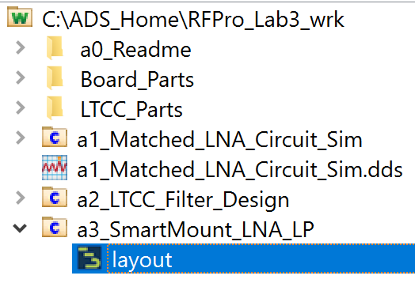

If you get a message dialog about nesting, click OK.

### a3_SmartMount_LNA_LP

This layout contains already the LNA and the lumped components for matching. The only missing part is the LTCC-filter.

   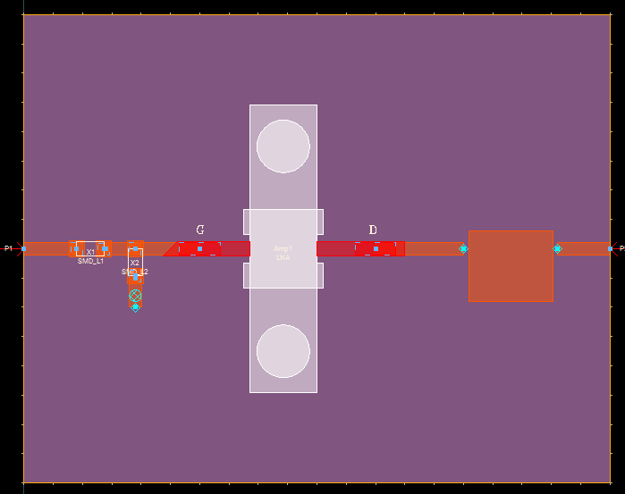

## Task 5: Mount LTCC-filter on PCB

1. Drag & drop the layout **`a2_LTCC_Filter_Design`** onto the mounting plate.

   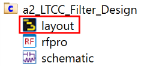

   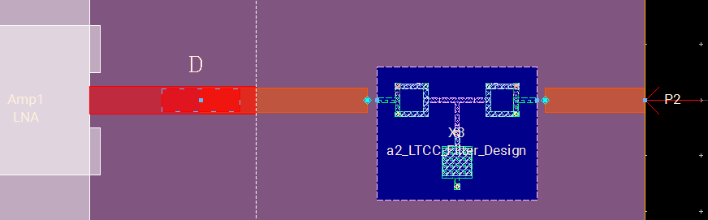

To connect the traces (cond) with the mounted LTCC-Filter (pc4) we need to add bond wires on both sides.

## Task 6: Create a schematic view (1)

In layout view **`a3_SmartMount_LNA_LP`**, use **Window > Schematic**

   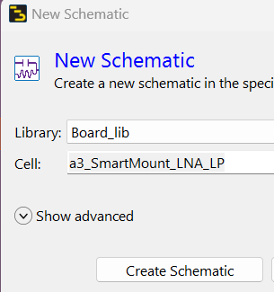

### Create a schematic view (2)

| 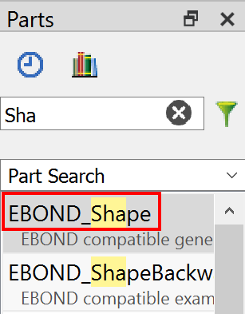 | 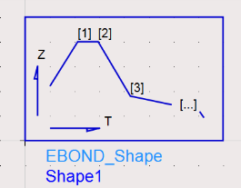 |
|---|---|

1. In the Parts search field, type “**Sha**”

1. Click **EBOND_Shape** to insert one instance.

1. Double-click the symbol.

### Create a schematic view (3)

   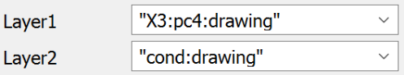

1. Set **Layer1** = **`"X3:pc4:drawing"`**

> **Important:** Edit manually the L1 parameter. Note this layer is not part of the pull-down menu. Change X3 to the instance name of your LTCC filter if different.

1. Set **Layer2** = **"cond:drawing"** (Select from the drop-down list)

1. Click **OK**

1. **Save** the schematic

## Task 7: Add bond wires

Return to the layout view.

1. Click **Insert > Bondwire**

1. Click **Insert > Coordinate entry.**

1. Define the **left wire** to go from **(15.3, 0)** to **(14.7, 0)**, from top to down.

   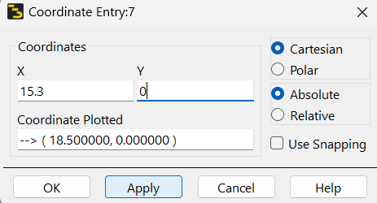

   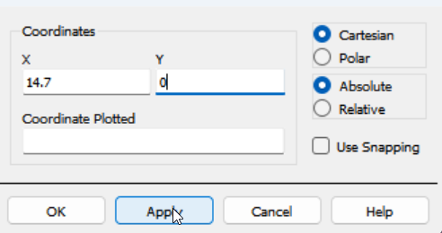

1. For the **right wire** go from **(17.9, 0)** to **(18.5, 0)**

   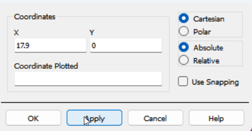

   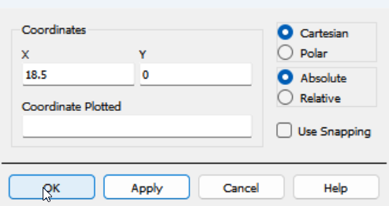

### It should look like this

   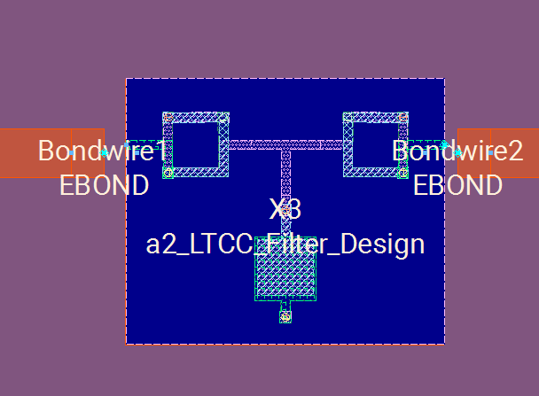

1. Click **Cancel** on EBOND component window

1. **Save** your layout

### Check the connections

1. To check the proper connection, click “3” for the 3D View

Note: You can turn off temporarily the **silk_screen*** layers.

   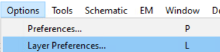

   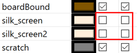

   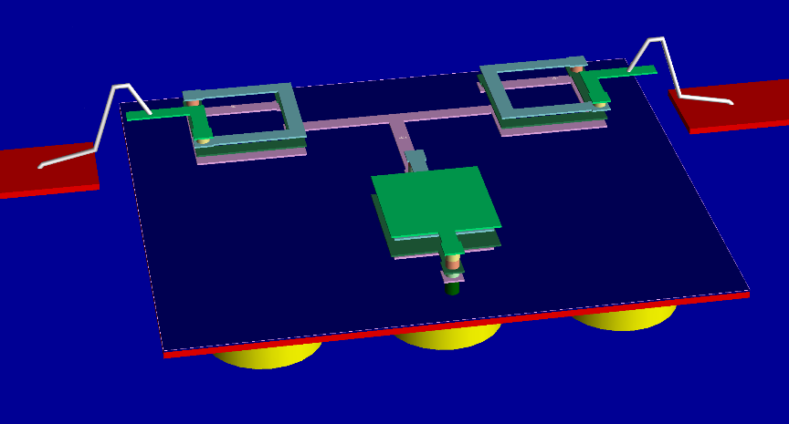

Press “2” to return.

## Task 8: Assign ports to ground layer

   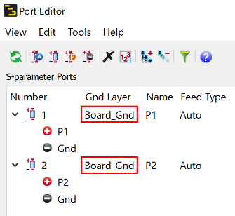

1. Open the Port Editor. 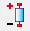

1. Verify that the **`Board_Gnd`**has been assigned to be the Gnd Layer for the board.

1. **Close** the Port Editor

1. **Save** your layout.

## You have successfully completed Lab 3A - Module 4.
