# Lab 3A - Module 5: Setup of a full EM analysis in RFPro

**Learning Objectives:** In this module, you will complete the following tasks:

- Create RFPro view
- Change Component Role
- Setup a full EM analysis
- Simulation setup
- Run the analysis
- Generate test bench
- S-Parameters and Options setup
- Run the simulation
- Examine and compare result

## Task 1: Create RFPro view

Use **RF** icon or **Tools > RFPro > New**.

   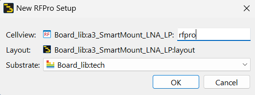

## Task 2: Change Component Role

   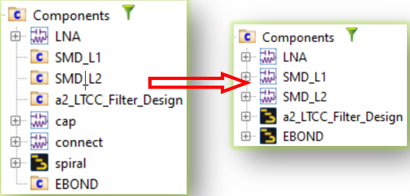

1. In **Project** panel, select two **SMD parts**, right-click and **Change Component Role > To Circuit**

1. Select **a2_LTCC_Filter_Design** and **EBOND**, right-click and **Change Component Role > To Layout**

## Task 3: Setup a full EM analysis

   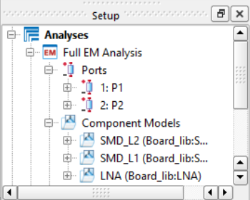

1. Drag & drop **both Pins** into the **Ports** branch of the Setup Panel.

1. Drag & drop the **3 Components** with Circuit Role into the **Components Model** branch in the **Setup** panel.

   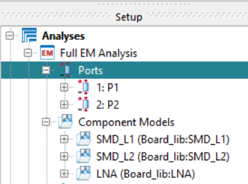

   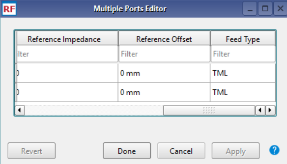

1. Right-click on the **Ports** branch and select **All Properties** to open the Ports Editor.

1. Change the **Feed Type** for both ports to **TML**.

1. Click **Done**

## Task 4: Simulation setup

1. Double click **Options**

   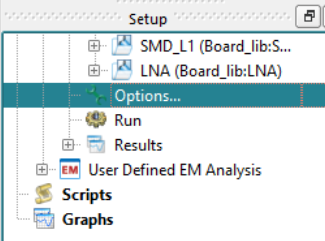

### Add the Frequency Plans

1. Add the **Frequency Plans** as shown here.

   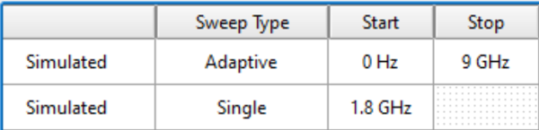

Note that the simulation goes up to **9 GHz** to cover also the 5th harmonic of the fundamental frequency at **1.8 GHz** and provide so accurate data up to the highest harmonic for a Harmonic Balances simulation, which we run later on.

### FEM simulator

   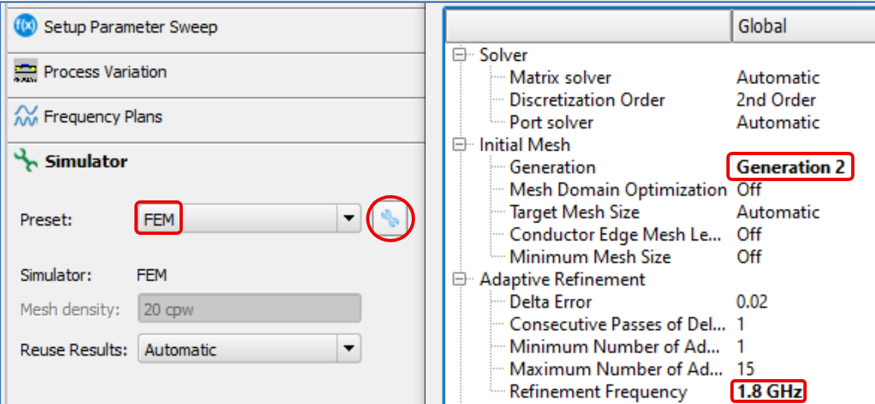

1. Make sure that the **FEM**-Simulator has been selected.

1. Pick under the **Advanced Simulation Setup** the **Generation 2** meshing algorithm

1. Define a **Refinement Frequency** at **1.8 GHz**

1. Click **Done** twice

## Task 5: Run the analysis

1. Click the **gear** icon.

   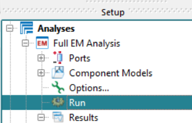

In about 1 minute the simulation should be finished.

   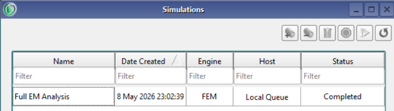

## Task 6: Generate test bench

Under **Results -** **Generate Test Bench…**.

   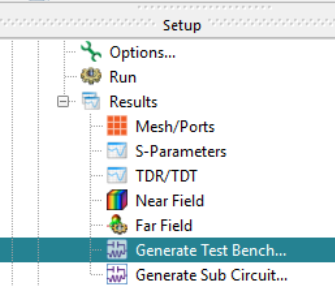

## Task 7: S-Parameters and Options setup

**Remove** the existing controller (**S-Parameter** and **Display Template**)

   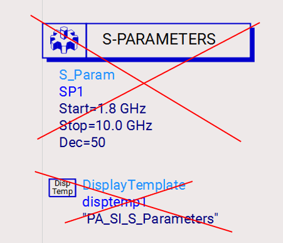

Copy from **`a1_Matched_LNA_Circuit_Sim`** schematic the **S-Parameter controller** and the **Options** into your new test bench.

   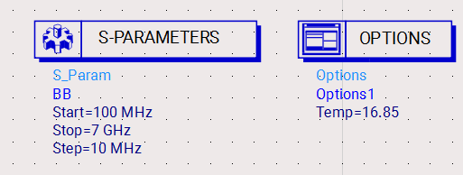

## Task 8: Run the simulation

   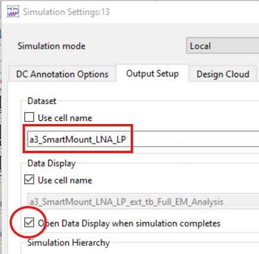

1. Go to the menu **Simulate > Simulation Settings…**

1. Set **Dataset** name = **`a3_SmartMount_LNA_LP`**

1. Check the box for opening the Data Display automatically.

1. **Apply** and **Simulate** the test bench

## Task 9: Examine and compare result

1. Add a rectangular plot displaying **dB(S(1,1))** and **dB(S(2,1))**

1. Add for comparison the results dB(S(1,1)) and dB(S(2,1)) from initial **`a1_Matched_LNA_Circuit_Sim`** simulation.

1. Place a Line Marker  at the new matched frequency at 1.48 GHz.

   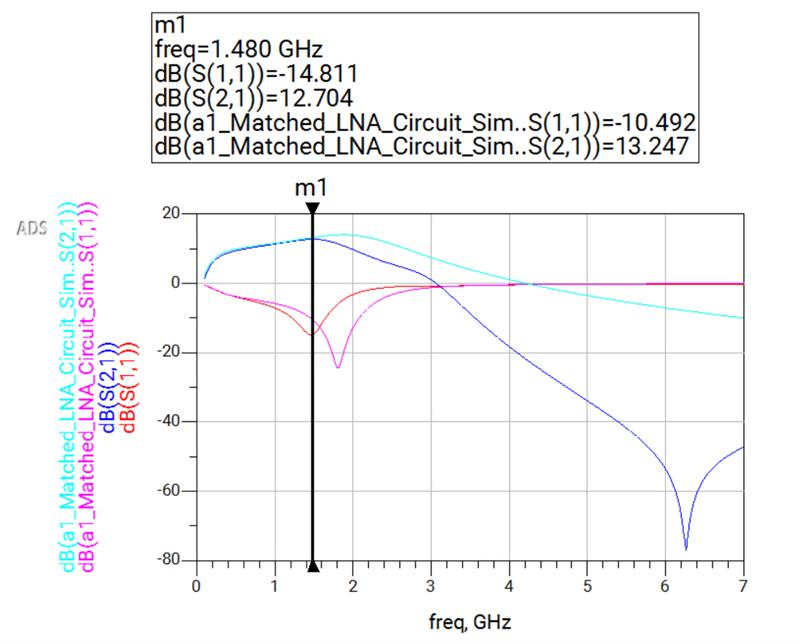

> **Note:** We can observe that the board layout effects cause a **18% shift** to lower frequencies for the matched amplifier.

> **Note:** In addition. the Low-Pass Filter increases the attenuation in the stop band significantly.

### Save and close data display

Save and close the data display

## You have successfully completed Lab 3A.
