# Lab 3B - Module 1: User-defined EM analysis using spiral inductor

**Learning Objectives:** In this module, you will complete the following tasks:

- Overview
- Open workspace
- Open the rfpro view
- Select components
- Flatten the design
- Change component role to layout
- Select the subcircuit
- Assign output pin to ground layer
- Setup an user defined EM analysis
- Frequency plans
- FEM simulator
- Run the simulation
- S-Parameters results
- Inductance parameter result

## Task 1: Overview

In this part, we will have a closer look to a single **spiral inductor** and a **bondwire** transition, to investigate the overall inductance of these two components.

## Task 2: Open workspace

1. **Open workspace**: C:\ADS_Home\RFPro101\Lab3B\RFPro_Lab3_wrk

**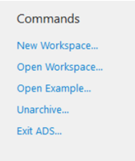**

   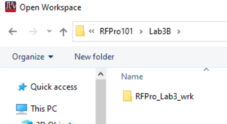

## Task 3: Open the rfpro view

Open the rfpro view **`a3_SmartMount_LNA_LP`**

   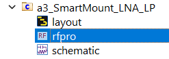

Set the **Visibility** to **Wireframe**.

   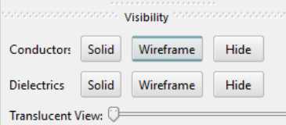

## Task 4: Select components

Select in the Components branch the **2_LTCC_Filter_Design** and **both pins** in the X3 sub-directory (Use Ctrl-key).

   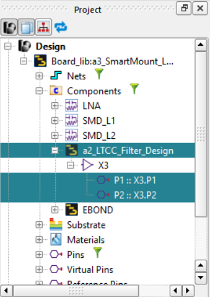

### The entire filter is now highlighted as one part

   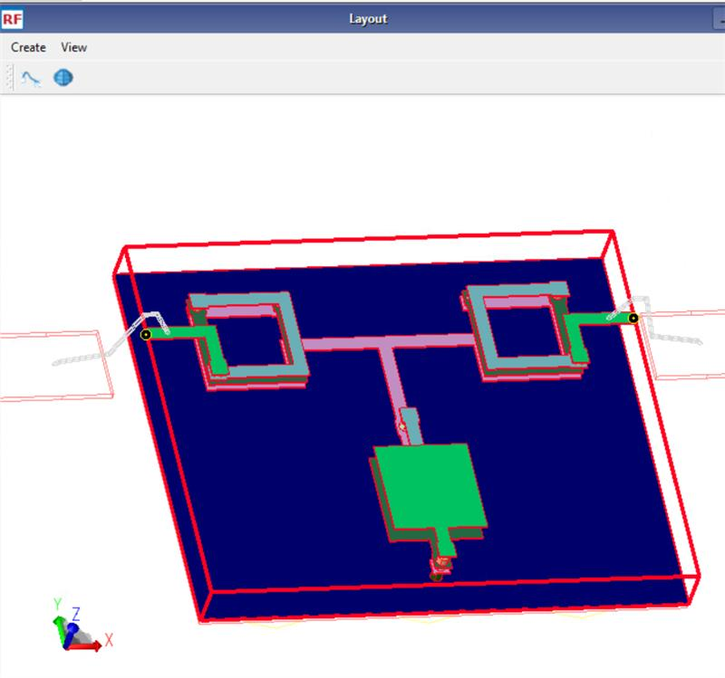

## Task 5: Flatten the design

To get access to a single spiral inductor, we need to **change** the **Component Role** of the **LTCC_Filter** to **SubDesign** to flatten the design.

   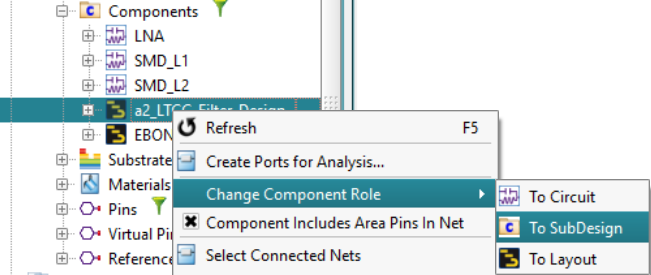

## Task 6: Change component role to layout

| 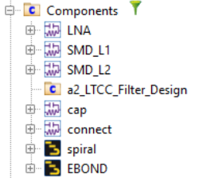 | 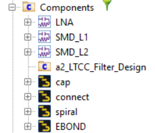 |
|---|---|

1. In the **Project** panel, under the **Components** branch, select **cap** and **connect**

1. Right-click and **Change Component Role > To Layout**

## Task 7: Select the subcircuit

Now we can access the single **spiral X3.X1** with the intended output pin **P1** and the **Bondwire1** with **W1_P2** as intended input pin. Use the Ctrl-key for the selection.

   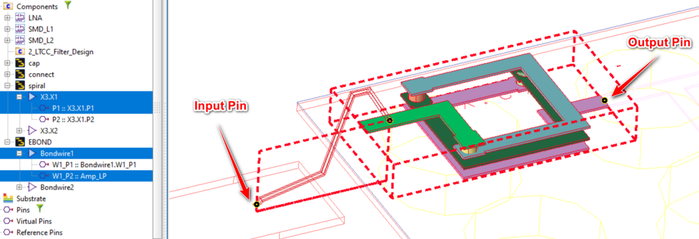

The **input pin** (Bondwire 1) is referenced to the ground layer on **`Board_Gnd`**. However, for the **output pin** (Spiral P1) we want to assign the **`ltcc_gnd`** as ground layer.

## Task 8: Assign output pin to ground layer

   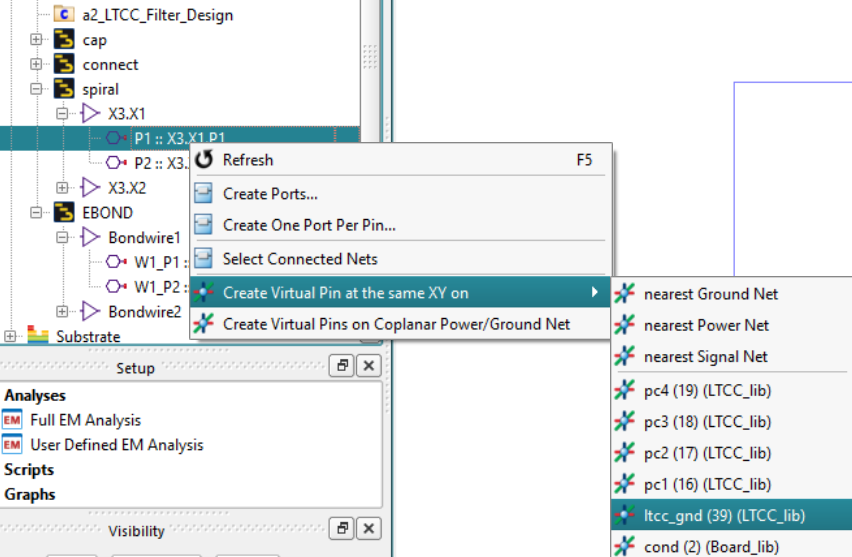

1. Right click **P1** of the spiral X3.X1.

1. Create **Virtual Pin at the same XY** dimension **on `ltcc_gnd`**

### It should look like this

   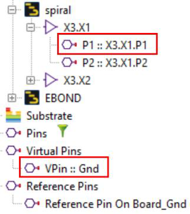

## Task 9: Setup an user defined EM analysis

Now we are ready to prepare the User Defined EM Analysis.

| 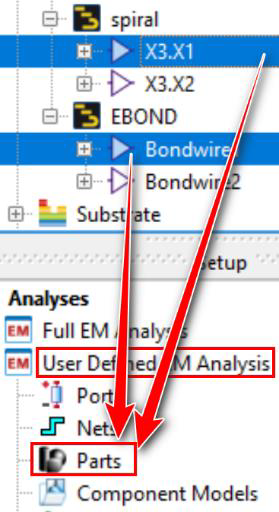 | 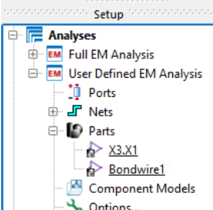 |
|---|---|

1. Drag & drop the **X3.X1** component and the **Bondwire1** into the **Parts**-branch of the **User Defined EM Analysis**.

| 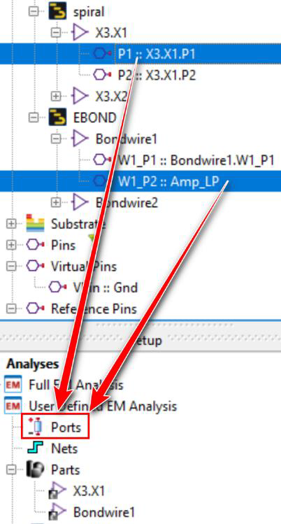 | 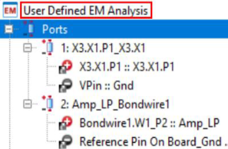 |
|---|---|

1. Drag & drop **P1** and **P2** (Ctrl-key) into the **Ports**-branch.

### Examine ports

Select the **Ports** branch to confirm the correct placement of the **Plus** and **Minus Pins** for the bondwire and the spiral inductor.

   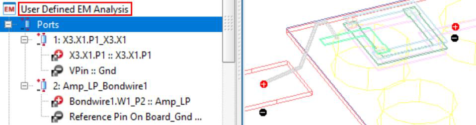

> **Note:** Note also, that the needed nets are copied automatically into the **Nets**-branch.

## Task 10: Frequency plans

1. Double click **Options**

   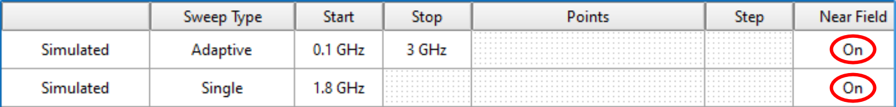

1. Define an **Adaptive** Frequency Plan from **0.1 GHz** to **3 GHz**. Turn on the **Near Field**.

1. Add a **Single** point at **1.8 GHz**. Turn on the **Near Field**.

   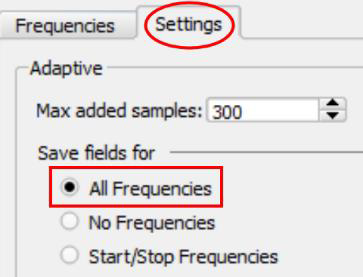

1. Change to the **Settings** tab and **Save fields for “All Frequencies”**.

## Task 11: FEM simulator

   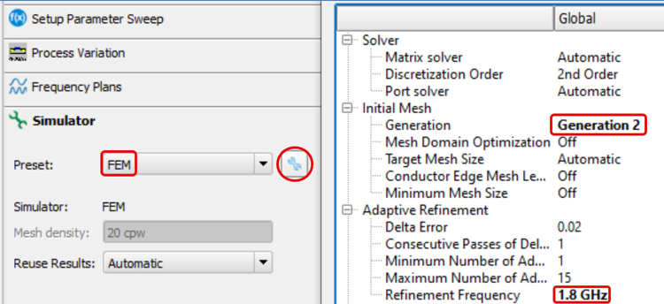

1. Choose the **FEM** simulator.

1. Pick **Generation 2** mesher.

1. Set **Refinement Frequency** at **1.8 GHz**.

1. Click **Done** twice.

## Task 12: Run the simulation

**Run** the Simulation.

   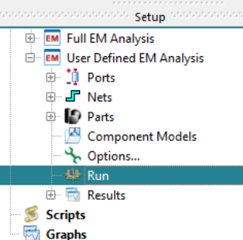

In less than 30 seconds the analysis should be finished.

   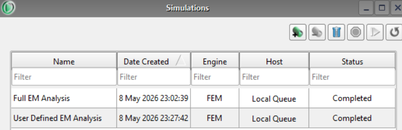

## Task 13: S-Parameters results

1. Double-click on **S-Parameters** in the **Results**-branch

   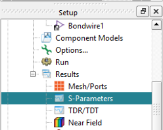

1. Select in the **Matrix Selector** (on the lower right side) **S(1,1)** and **S(2,1)**.

1. Use the **Crosshairs Tool** to get the simulation values at **1.8** **GHz**.

   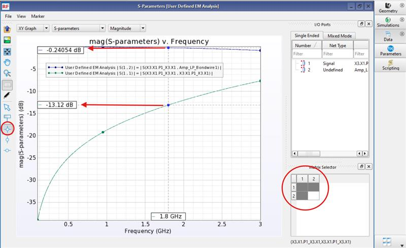

## Task 14: Inductance parameter result

1. Select **Inductance** parameter

1. Check in the **Matrix Selector** **L(2,1)** only, to find a value of **4.26 nH** **@ 1.8 GHz**.

   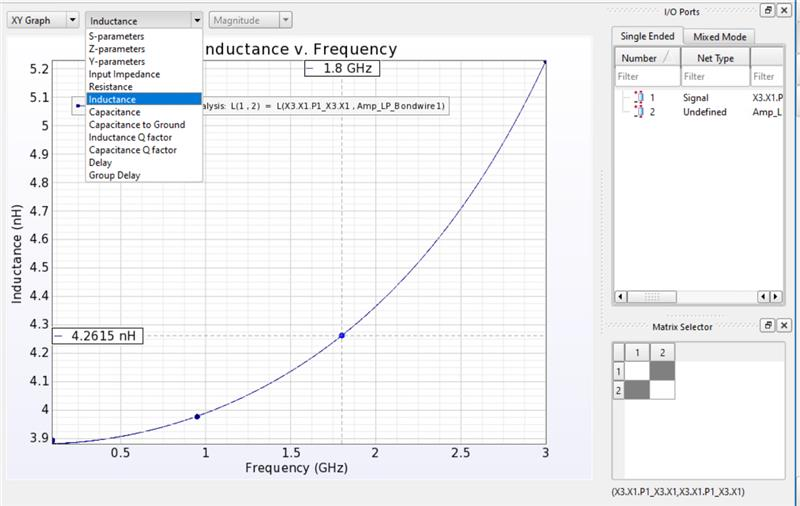

## You have successfully completed Lab 3B - Module 1.
