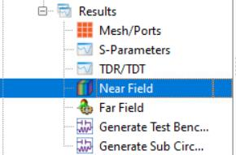
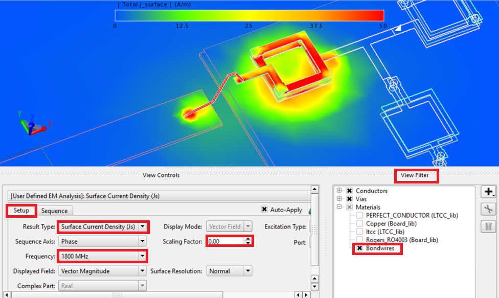
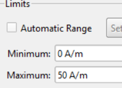
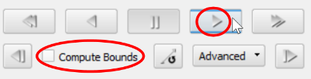
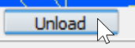

# Lab 3B - Module 2: Viewing current distributions of the bondwire and the spiral inductor

**Learning Objectives:** In this module, you will complete the following tasks:

- Overview
- Select Near Field
- Setting up surface current density animation
- Play the animation
- Stop the animation

## Task 1: Overview

In the next step we’ll investigate the current distribution of both components.

## Task 2: Select Near Field

In the **Results** branch, double-click on the **Near Field**.

   

## Task 3: Setting up surface current density animation

   

1. Set **Result Type** = **Surface Current Density**

1. Set **Frequency** = **1800 MHz**.

1. Set **Scalling Factor** = **0** if you do not want to see the arrows.

1. Check the box for **Bondwires** in the *View Filter* under **Materials**.

1. Right-click on the scale bar and under **Properties**, change the **Limits** from **0 A/m** to **50 A/m** .

   

## Task 4: Play the animation

   

1. Under the **Sequence** tab, make sure the **Compute Bounds** flag is **off**.

1. **Play** the animation.

1. For a faster animation, change the increment to 10 degrees.

## Task 5: Stop the animation

When finished, stop the animation of the spiral and click on the **Unload** button to return to the standard layout view.

   

**Save** your work and close all windows

## You have successfully completed Lab 3B.
