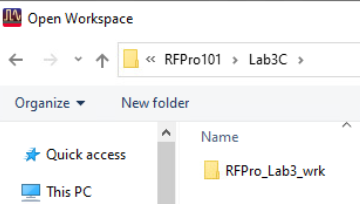
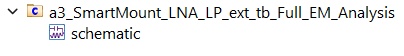
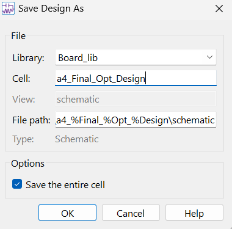
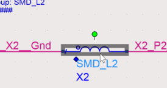
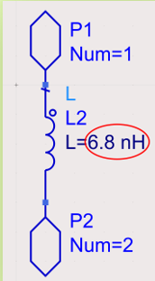
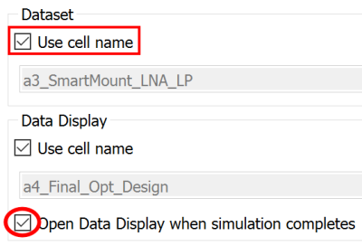
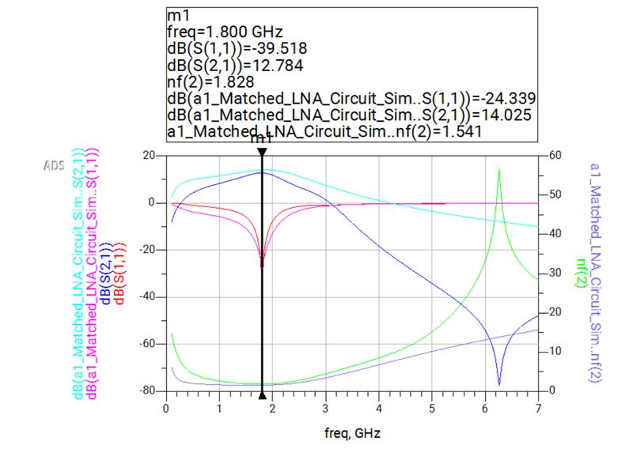

# Lab 3C - Module 1: Optimize the final design

**Learning Objectives:** In this module, you will complete the following tasks:

- Open workspace
- Optimize design
- Run the simulation
- Examine and comparing result

In this exercise, we will optimize the final design and comparing the results to initial design. You will be using the optimized component values to get back the desired amplifier performance and will investigate the nonlinear behavior of our design.

## Task 1: Open workspace

1. **Open workspace**: C:\ADS_Home\RFPro101\Lab3C\RFPro_Lab3_wrk

   

   

## Task 2: Optimize design

**Open** the schematic view of the cell:

   

Use File > Save As… **`a4_Final_Opt_Design`**.

   

Instead of adding the Optimization and Goal controller and running an optimization, we simply **change** the parameter value for the component to the best-found value.

1. Select the **SMD_L2-model** and **Push Into Hierarchy Edit**

   

   

1. Change **L2** from 22 nH to **6.8 nH** (optimized component value).

   

1. Save and Pop Out .

## Task 3: Run the simulation

   

1. Go to **Simulate > Simulation Settings…**

1. Check “**Use cell name**” and "**Open** **Data Display**...."

1. Click Apply and **Simulate**.

## Task 4: Examine and comparing result

1. Add a rectangular plot displaying **dB(S(1,1))** , **dB(S(2,1))** and **nf(2)** (Right Y Axis).

1. Place a Line **Marker** at **1.8 GHz**

1. For comparison add also the initial **`a1_Matched_LNA_Circuit_Sim`**simulation results.

   

> **Note:** We can see that the initial amplifier response has been almost restored but now including the LTCC-Filter and all layout effects.

> **Note:** Also note the steep attenuation in the stop band which is needed for the harmonic suppression.

### Save and close the data display.

**Save** and close the Data Display.

## You have successfully completed Lab 3C - Module 1.
