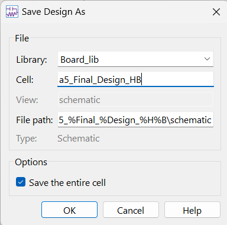
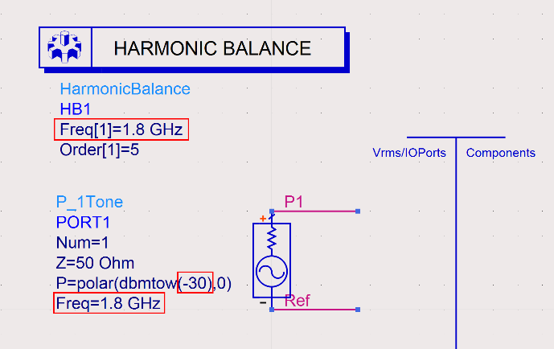
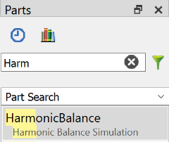
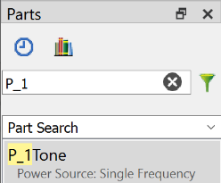
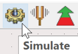
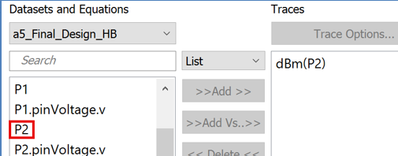
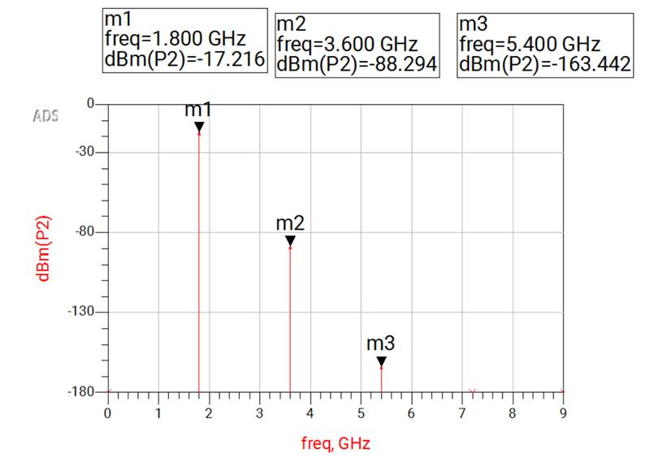

# Lab 3C - Module 2: Nonlinear simulation of the optimized design

**Learning Objectives:** In this module, you will complete the following tasks:

- Non linear simulation setup
- Simulate the design
- Examine result

You will be using the optimized component values to get back the desired amplifier performance and will investigate the nonlinear behavior of our design.

## Task 1: Non linear simulation setup

Back in the schematic **`a4_Final_Opt_Design`** use *File > Save As…* **`a5_Final_Design_HB`**.

   

1. **Delete** the **S-Parameter** controller and the Input Termination **P1**

   

    

1. Pick from the **Parts** window the **Harmonic Balance** controller and the **P_1Tone** source.

1. **Change** the **Freq**-parameters to **1.8 GHz**

1. **Change** the **Power** to **-30 dBm**.

## Task 2: Simulate the design

**Simulate** the design

   

## Task 3: Examine result

1. Create a rectangular plot to display the **Spectrum in dBm** for the amplifier output **(P2)**.

   

1. **Rescale** the **Y-Axis** as shown here

1. Place **Markers**  on the spectral frequencies.

As you can see the 2nd and 3rd harmonics are very well suppressed.

   

## You have successfully completed Lab 3C.
