# Detect, Investigate and Contain a Threat with CrowdStrike Falcon and TENEX.AI

## Scenario

You are a security analyst. Somewhere in your estate is a Windows machine that
is about to do something it should not.

In this lab you will play out a compressed version of a real security incident,
following the loop that every security operations team runs on:

**detect → triage → investigate → contain → remediate → close**

You will confirm your endpoint is being monitored, generate real detections at
three different severities, investigate the most serious one, cut the machine
off the network so an attacker cannot spread any further, prove the isolation
actually worked, and then release the machine and close the case.

---

## Your lab environment

Two virtual machines have been provisioned for you.

| | Analyst VM | Endpoint VM |
|---|---|---|
| **Hostname** | <inject key="AnalystHostname" enableCopy="true"/> | <inject key="EndpointHostname" enableCopy="true"/> |
| **Connect to (RDP)** | <inject key="analystRdpAddress" enableCopy="true"/> | <inject key="endpointRdpAddress" enableCopy="true"/> |
| **Public IP** | <inject key="analystPublicIp" enableCopy="true"/> | <inject key="endpointPublicIp" enableCopy="true"/> |
| **Private IP** | 10.0.1.20 | <inject key="endpointPrivateIp" enableCopy="true"/> |
| **Falcon sensor** | No | Yes |
| **Your role here** | This is your desk | This is the machine under attack |

**Sign in to both VMs with:**

| | |
|---|---|
| Username | <inject key="adminUsername" enableCopy="true"/> |
| Password | <inject key="adminPassword" enableCopy="true"/> |

**Falcon and TENEX details:**

| | |
|---|---|
| Falcon console | <inject key="falconConsoleUrl" enableCopy="true"/> |
| Falcon console username | <inject key="falconLoginEmail" enableCopy="true"/> |
| Falcon console password | <inject key="falconLoginPassword" enableCopy="true"/> |
| API client ID | <inject key="falconClientId" enableCopy="true"/> |
| API client secret | <inject key="falconSecret" enableCopy="true"/> |
| API base URL | <inject key="falconApiBaseUrl" enableCopy="true"/> |

### Why there are two machines

This matters, so it is worth understanding before you start rather than being
surprised in Exercise 5.

Network containment cuts the Endpoint VM off from **everything except the
CrowdStrike cloud**. If you were working on the endpoint when you contained it,
your own session to that machine would drop instantly and you would be locked
out mid-exercise.

So you work from the **Analyst VM** throughout. You will visit the Endpoint VM
exactly once, in Exercise 3, to run some commands. Everything else — the Falcon
console, TENEX, the connectivity tests — happens from the Analyst VM.

This also happens to be how real security teams operate. Nobody investigates a
compromised machine by logging into the compromised machine.

<question source="https://raw.githubusercontent.com/akshatv-spektra/spektra-personal/refs/heads/main/questions/question-01.md" />

---

## Exercise 1: Confirm the endpoint is protected

You cannot respond to an incident on a machine you are not monitoring. Before
anything else, confirm the sensor on your endpoint is installed, online and
reporting to the Falcon cloud.

### Task 1: Sign in to the Falcon console

1. On the **Analyst VM**, double-click the **Falcon Console** shortcut on the
   desktop or open **<inject key="falconConsoleUrl" enableCopy="true"/>** URL on the browser.

   

1. Enter the Falcon console username **<inject key="falconLoginEmail" enableCopy="true"/>** and click **Continue**:

   

1. Enter the password **<inject key="falconLoginPassword" enableCopy="true"/>** and click **Continue**:

   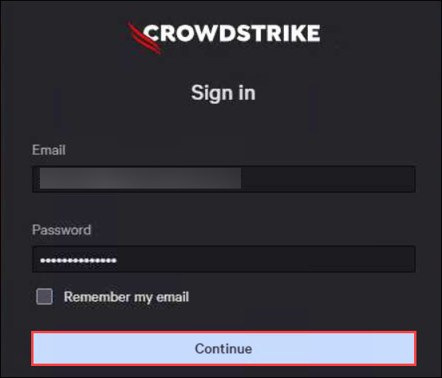

1. The Falcon console opens on the **Main view** dashboard.

   

### Task 2: Find your endpoint

1. In the left navigation menu, click **Host setup and management (1)** and select **Host management (2)**.

   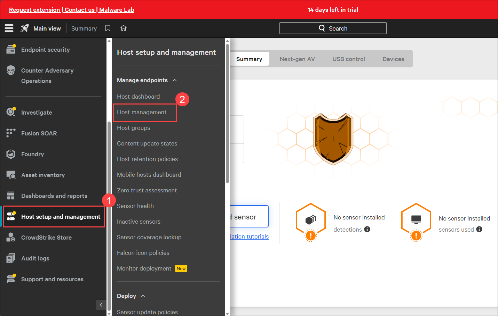

1. The host list opens, showing every machine reporting into this Falcon tenant.

   > This is a shared lab tenant, so you may see hosts belonging to other participants. Always work with your own hostname, which is shown in your lab details panel.

1. You will see the your endpoint.

   

   >**Note:** In the search all fields box above the host list, your can enter your endpoint hostname and press Enter to search your Host: <inject key="EndpointHostname" enableCopy="true"/>

1. Click the hostname to open the host details.

### Task 3: Verify the sensor is healthy

1. In the host details panel, confirm each of the following:

    | Field | What you should see |
    |---|---|
    | **Host ID** | A unique identifier for this sensor install |
    | **Last seen** | Within the last few minutes |
    | **OS version** | Windows Server 2022 |
    | **Sensor version** | A version number, e.g. 8.10.x |

    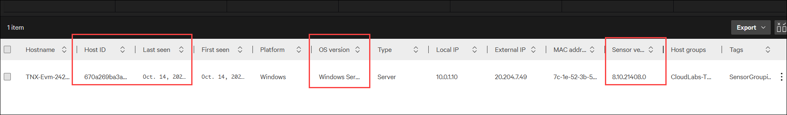

1. Note the **Host ID**. Every machine that installs the sensor generates its
    own, which is how Falcon tells your endpoint apart from everyone else's.

---

## Exercise 2: Connect the TENEX integration

A real security team does not live in one console. Alerts from CrowdStrike flow
into whatever platform the team actually works in. TENEX connects to Falcon
through its REST API — no agent, nothing installed on your machines.

### Task 1: Collect the API credentials

1. From your lab details panel, copy these three values. You will paste each
   one into TENEX in the next task.

   | Value | |
   |---|---|
   | **API client ID** | <inject key="falconClientId" enableCopy="true"/> |
   | **API client secret** | <inject key="falconSecret" enableCopy="true"/> |
   | **API base URL** | <inject key="falconApiBaseUrl" enableCopy="true"/> |

### Task 2: Add the CrowdStrike connection in TENEX

1. On the **Analyst VM**, double-click the **TENEX Platform** desktop shortcut.

   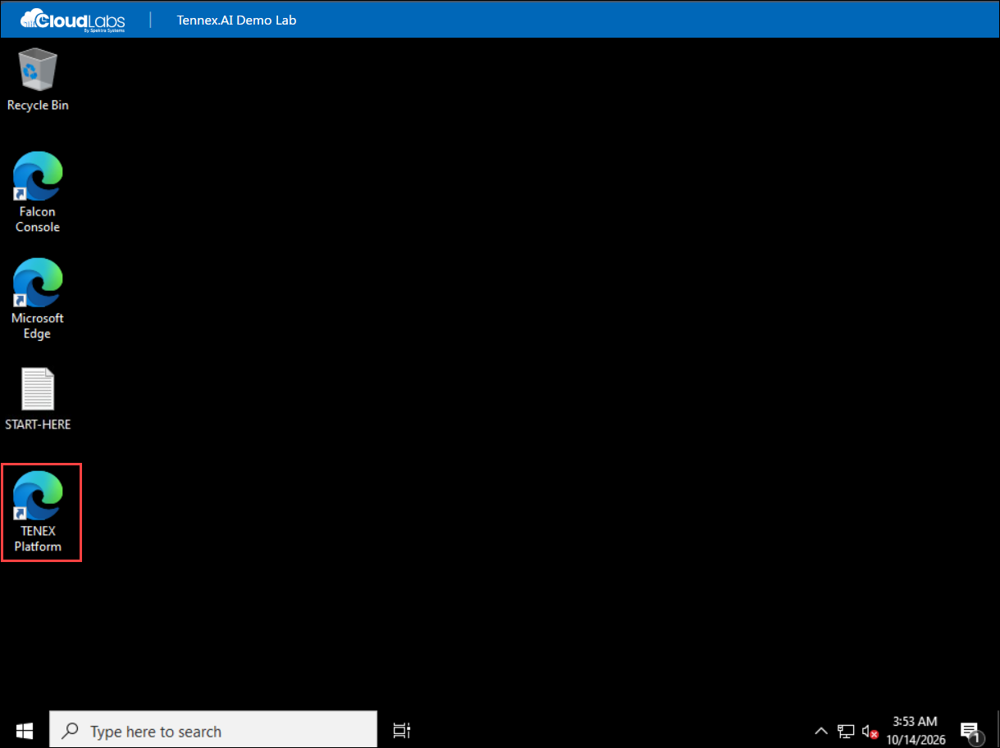

1. Sign in with the TENEX credentials provided to you.

1. Navigate to the integrations area and choose to add a new **CrowdStrike
   Falcon** connection.

1. Paste in the three values from **Task 1** and save the connection.

1. Confirm the connection reports as healthy and that TENEX can see your host,
   <inject key="EndpointHostname" enableCopy="true"/>.

---

## Exercise 3: Generate detections

Now you need something to investigate. CrowdStrike provides built-in test
commands that produce genuine detections at chosen severities, without putting
any real malware on the machine.

**This is the only exercise performed on the Endpoint VM.**

### Task 1: Connect to the Endpoint VM

1. In the CloudLabs toolbar at the top, click the **VM dropdown (1)** and select the Endpoint VM : **<inject key="EndpointHostname" enableCopy="false"/> (2)** to switch to its session.

   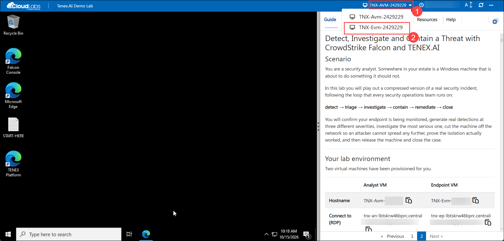

### Task 2: Run the test commands

1. Right-click the **Start (1)** button and select **Windows PowerShell (Admin) (2)**.

   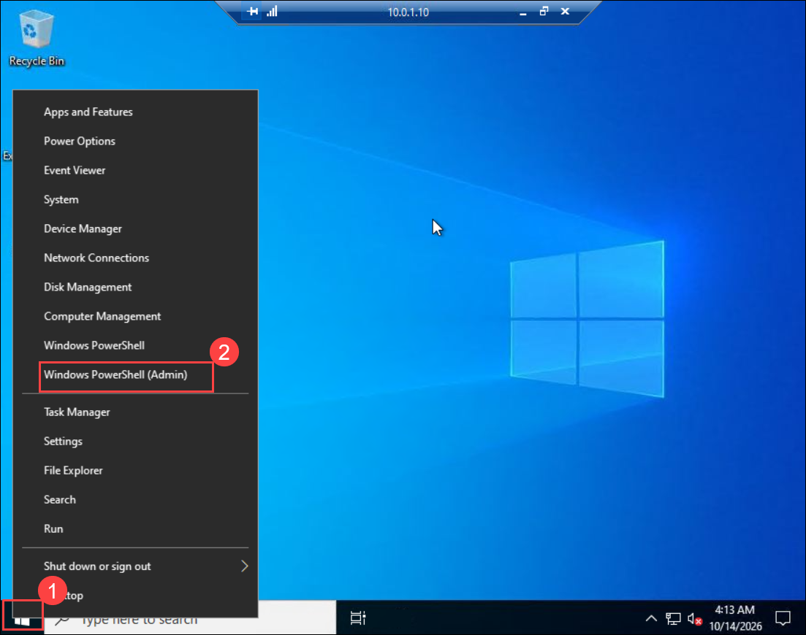

1. If a User Account Control prompt appears, click **Yes**.

1. Type the following command and press **Enter**:

   ```
   crowdstrike_test_critical
   ```

1. You will see this response:

   ```
   'crowdstrike_test_critical' is not recognized as an internal or external
   command, operable program or batch file.
   ```

   **This is expected and is not a failure.** Continue to the next command.

   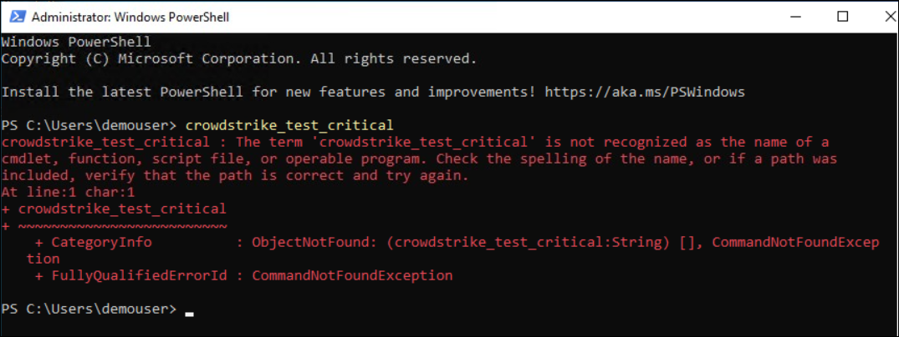

1. Run the second command and press **Enter**:

   ```
   crowdstrike_test_high
   ```

1. Run the third command and press **Enter**:

    ```
    crowdstrike_test_low
    ```

    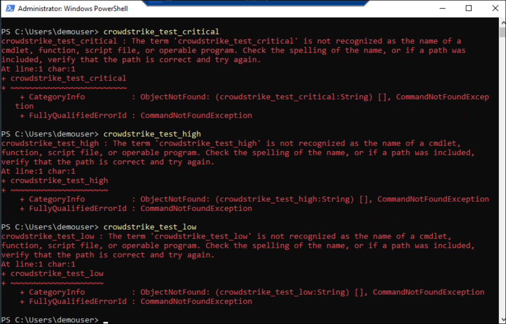

### Task 3: See prevention in action

1. For a visible on-screen reaction, open **PowerShell** and run:

    ```
    svchost.exe -testisatest
    ```

1. This command behaves differently - Falcon actively blocks it, terminates
    the PowerShell process, and displays a notification on screen.

    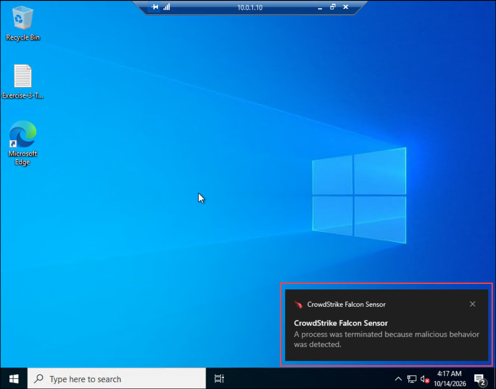

1. Click the **VM dropdown (1**) in the CloudLabs toolbar, then select the Analyst VM **<inject key="AnalystHostname" enableCopy="false"/> (2)** to switch back to the Analyst VM session.

   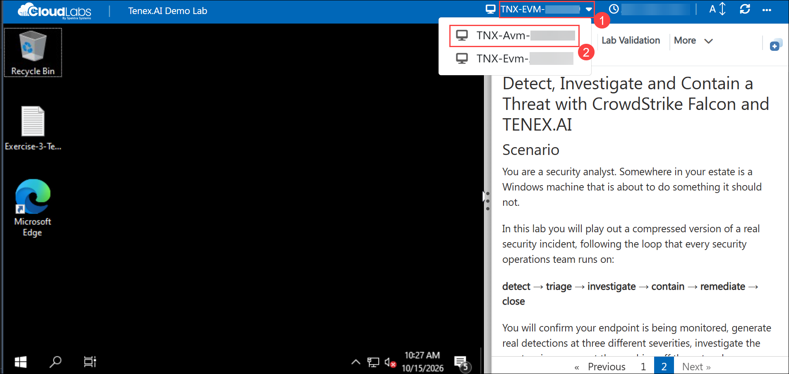

<question source="https://raw.githubusercontent.com/akshatv-spektra/spektra-personal/refs/heads/main/questions/question-02.md" />

<question source="https://raw.githubusercontent.com/akshatv-spektra/spektra-personal/refs/heads/main/questions/question-05.md" />

---

## Exercise 4: Investigate the critical detection

Three alerts have arrived. An analyst's first job is triage: which one matters,
and what actually happened?

### Task 1: Open the detections list

1. On the **Analyst VM**, in the Falcon console, click the **Main menu (1)** icon at the top-left, click **Endpoint security (2)** in the left navigation menu, then under the **Monitor** section of the flyout, click **Endpoint detections (3)**.

   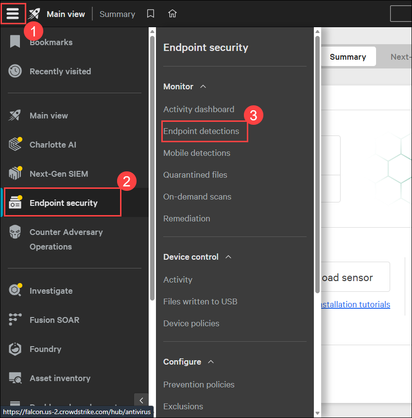

1. The detections list opens.

1. Filter the list to your own machine. In the filter bar, filter by ****<inject key="EndpointHostname" enableCopy="true"/>**** and press enter:

   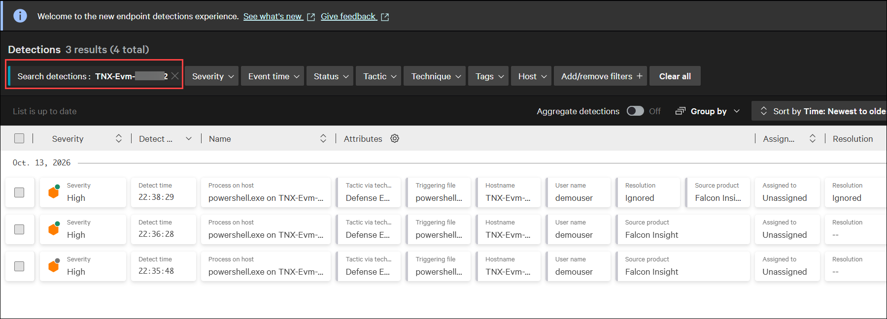

1. Confirm you can see your three detections, with severities **Critical**, **High** and **Low**.

   > If only some have appeared, wait a minute and refresh. Detections take a
   > short time to travel from the sensor to the console.

### Task 2: Open the critical detection

1. Click any detection to open its details.

   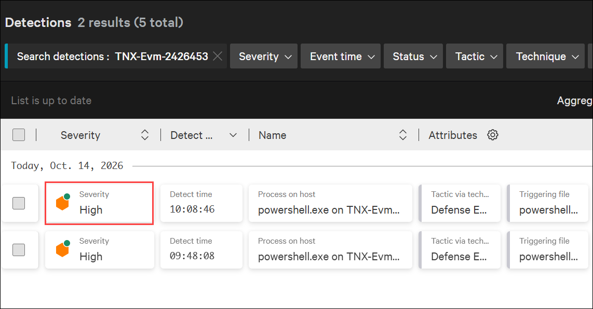

### Task 3: Walk the evidence

1. **Find the process tree.** This is the visual chain showing what launched what. You should be able to read it top to bottom, along these lines:

   ```
   explorer.exe  ->  cmd.exe  ->  crowdstrike_test_critical
   ```

   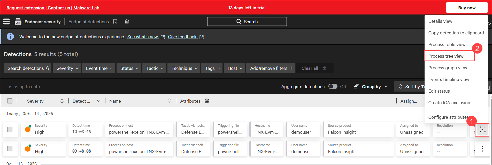

   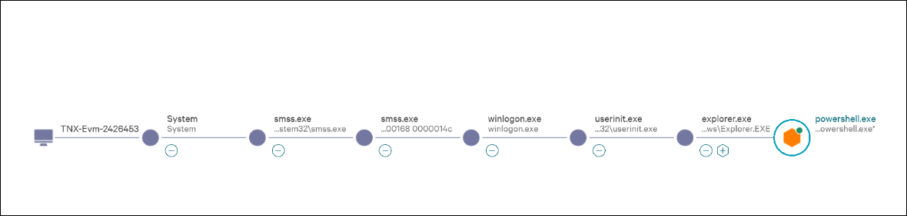

1. **Find the host details.** Confirm the hostname matches your endpoint, and note the user account the process ran under, the OS, and the timestamp.

    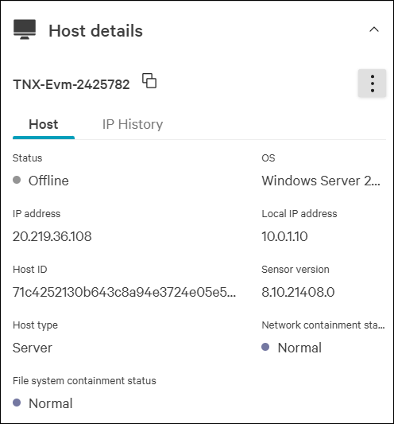

<question source="https://raw.githubusercontent.com/akshatv-spektra/spektra-personal/refs/heads/main/questions/question-04.md" />

## Exercise 5: Respond - contain the host

You have decided the Critical detection is real. The priority now is to stop it
spreading, immediately, without waiting to finish the investigation.

**Network containment** blocks all network traffic to and from the endpoint
**except** traffic to the CrowdStrike cloud. The machine is cut off from file
shares, other machines, the internet and any attacker infrastructure — while
you keep full ability to investigate it and to release it later.

### Task 1: Establish your baseline

Before containing anything, prove the network path works. Without a working
baseline, a failed ping later proves nothing.

1. On the **Analyst VM**, seach for `cmd`**(1)** and press **Enter** to open a **Command Prompt (2)**.

   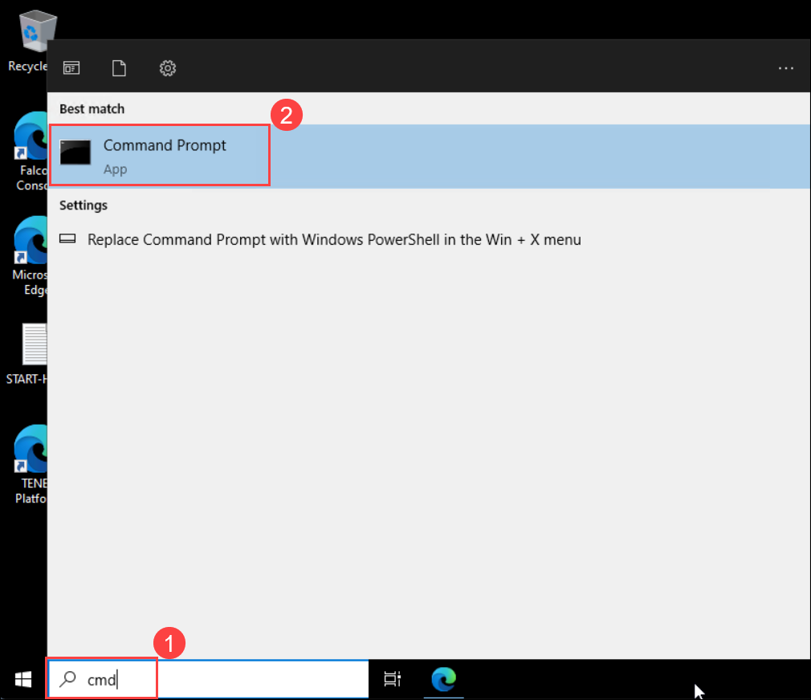

1. Start a continuous ping to the endpoint's private IP, type **ping -t <inject key="endpointPrivateIp" enableCopy="false"/>**.

   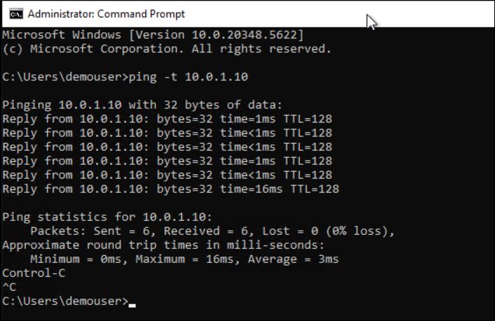

1. Confirm you are getting **Reply from** lines.

1. **Leave this window running and visible.** You are going to watch it change
   in real time.

   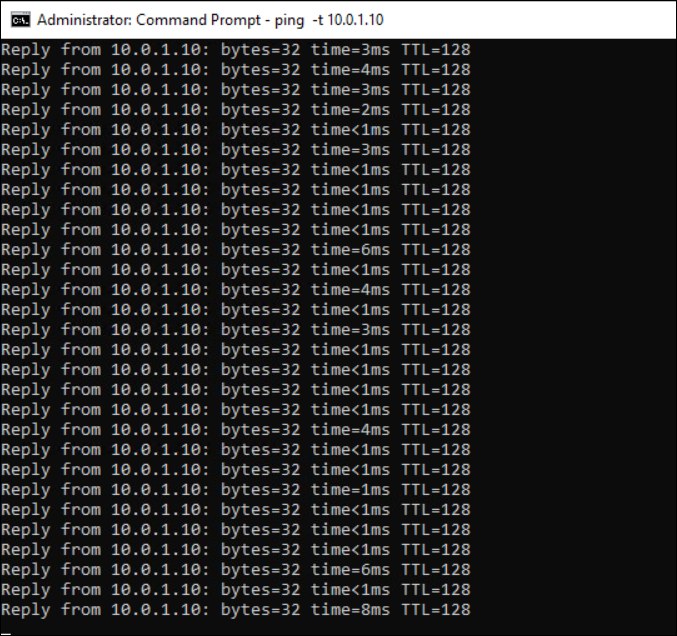

### Task 2: Contain the host

1. In the Falcon console, click **Host setup and management (1)** and select **Host management (2)**.

   

1. Find and select your endpoint: <inject key="EndpointHostname" enableCopy="true"/>

1. Click the **More options (1)** menu next to the selected endpoint host, then select **Network contain host (2)** to contain the endpoint..

   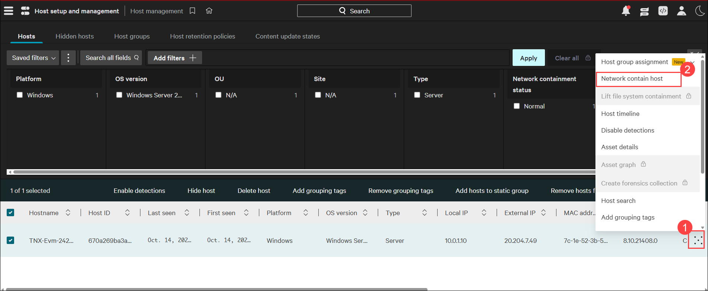

1. A confirmation dialog appears: *"Are you sure want to network contain this
   host?"* It explains that containing this host will only allow communication
   with CrowdStrike and will stop communication with your network and the
   internet.

   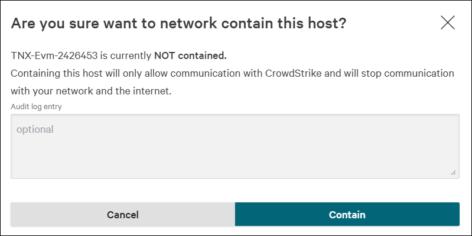

1. Optionally type a note in the **Audit log entry** box, for example
    `Lab exercise - containing after critical detection`.

1. Click **Contain**.

   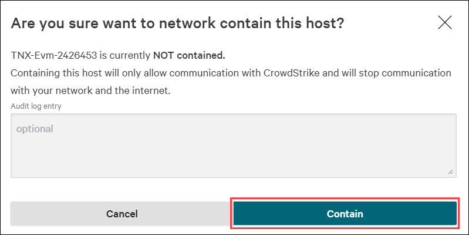

### Task 3: Verify containment took effect

Two independent checks:

1. **Watch your ping window.** Within about a minute, the `Reply from` lines
    change to `Request timed out`.

    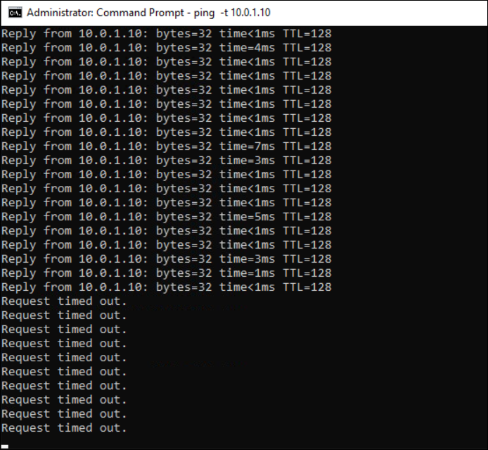

1. **Check the console.** The host status for your endpoint now reads
    **Contained**.

    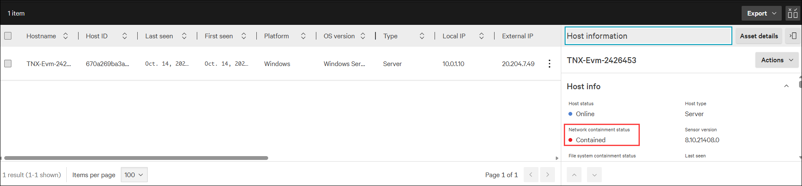

   > If you still had a Remote Desktop session open to the Endpoint VM, it has now dropped. That is containment working as designed, not a lab failure.

> **Congratulations** on completing the task! Now, it's time to validate it. Here are the steps:
> - Hit the Validate button for the corresponding task. If you receive a success message, you can proceed to the next task.
> - If not, carefully read the error message and retry the step, following the instructions in the lab guide.
> - If you need any assistance, please contact us at labs-support@spektrasystems.com. We are available 24/7 to help you out.

<validation step="45cd6313-51c3-4d13-9123-b46c1c0d921f" />

### Task 4: Lift containment

1. In the Falcon console, select your endpoint again.

1. Open the same host actions dropdown and click **Lift network containment**.

    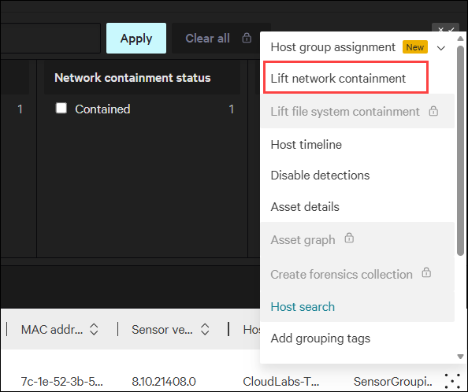

1. Confirm the action.

    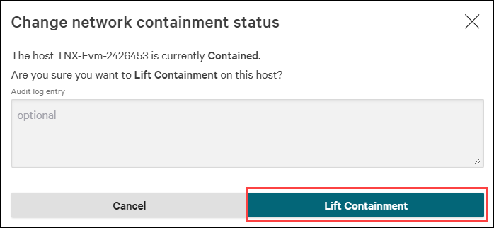

1. Watch the ping window again. Within about a minute, `Reply from` lines
    return.

    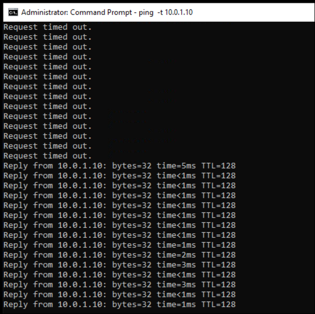

1. Press **Ctrl + C** in the Command Prompt to stop the continuous ping.

<question source="https://raw.githubusercontent.com/akshatv-spektra/spektra-personal/refs/heads/main/questions/question-03.md" />

> **Congratulations** on completing the task! Now, it's time to validate it. Here are the steps:
> - Hit the Validate button for the corresponding task. If you receive a success message, you can proceed to the next task.
> - If not, carefully read the error message and retry the step, following the instructions in the lab guide.
> - If you need any assistance, please contact us at labs-support@spektrasystems.com. We are available 24/7 to help you out.

<validation step="0000ac7f-1e23-484e-accb-0a76c03e8cee" />

---

## Exercise 6: Close the case and reset

An incident is not finished when the threat is stopped. It is finished when the
record is closed and the environment is back to a known state.

### Steps

1. In the Falcon console, go to **Endpoint security → Monitor → Endpoint
   detections**.

1. Filter by **Hostname** using your endpoint: <inject key="EndpointHostname" enableCopy="true"/>

1. Select your detections and click on **Edit Status**.

   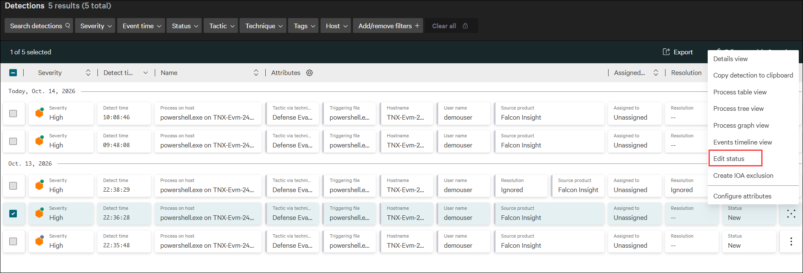

1. Set the status to **Closed** and click on **Update Status**.

   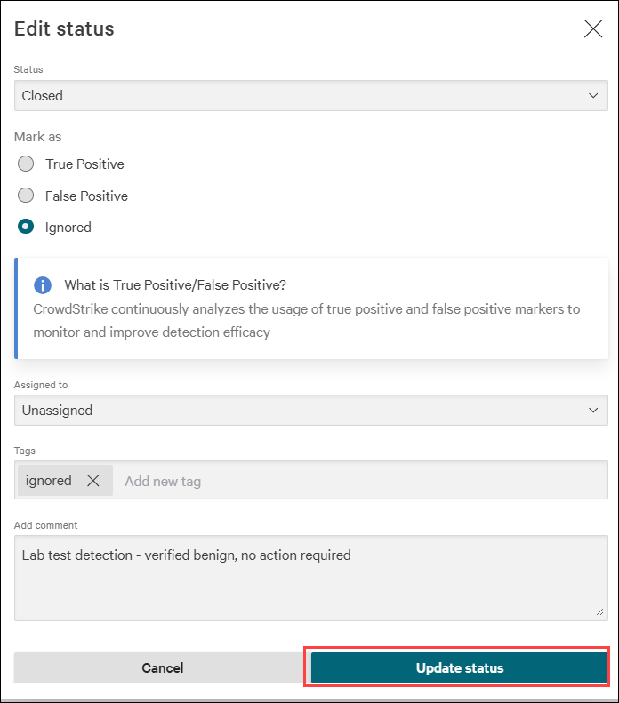

1. Add a brief comment, for example:

   ```
   Lab test detection - verified benign, no action required.
   ```

1. End your lab session.

---

## Troubleshooting

| Symptom | What to check |
|---|---|
| Endpoint not listed in Host management | Wait 2–3 minutes after provisioning and refresh. The sensor registers shortly after first boot. |
| Test commands produce no detections | Confirm you opened Command Prompt **as Administrator**, and that you are on the Endpoint VM, not the Analyst VM. Allow a minute for the detection to reach the console. |
| Many hosts listed, cannot find mine | This is a shared tenant. Filter by your exact hostname from the lab details panel. |
| Ping fails before you contain anything | Confirm you are pinging the **private** IP from the **Analyst VM**, not the public address. |
| Ping still succeeds after containment | Give it up to 60 seconds; the instruction has to reach the sensor. Then confirm the console shows the host as *Contained*. |
| "Network contain host" is not in the menu | Your console account may not hold a role that permits containment. Raise it with your lab instructor. |
| RDP to the endpoint stopped working | Expected if the host is contained. Lift containment and it returns. |
| Falcon console asks for MFA setup | Follow the on-screen prompts using the authenticator app indicated by your instructor. |

---

## What you covered

| Concept | Where you saw it |
|---|---|
| Endpoint telemetry and sensor registration | Exercise 1 |
| API-based security integration | Exercise 2 |
| Detection severity and alert volume | Exercise 3 |
| Process trees and behavioural investigation | Exercise 4 |
| Network containment as a response action | Exercise 5 |
| Case closure and environment hygiene | Exercise 6 |

The loop you just completed — **detect, triage, investigate, contain,
remediate, close** — is the core rhythm of security operations. The hard part
in a real environment is not any single step; it is doing it across thousands
of alerts a day without missing the one that mattered. That is the problem
TENEX.AI is built to solve, and Exercise 3's three severities were your first
look at it.
